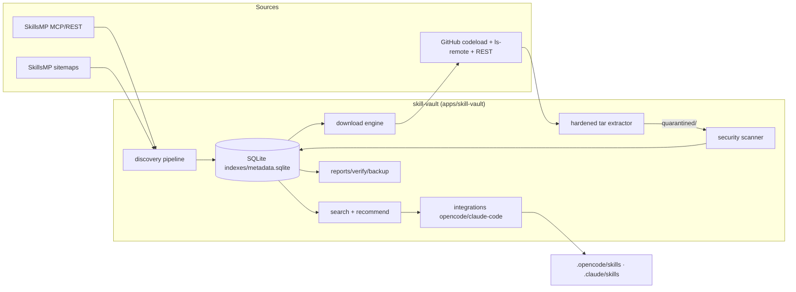

# Skill Vault — Architecture

Date: 2026-10-18 · Status: implemented (v0.1)

A local, persistent **Coding Skill Vault**: discovers coding skills from SkillsMP,
downloads them from their linked GitHub repositories, scans them for malicious or
suspicious content, indexes them in SQLite, and recommends/installs selected skills
for OpenCode and Claude Code — without loading every skill into agent context.

## 1. Placement in this monorepo

| Concern | Decision |
|---|---|
| Code location | `apps/skill-vault` (workspace `@aik/skill-vault`), runnable CLI + importable library |
| Language/runtime | TypeScript ESM on Node ≥ 24.17 (native type stripping — no build step; erasable syntax only) |
| Runtime deps | `better-sqlite3@13.0.3`, `zod@4.6.7` — both already pinned in this monorepo. **No new dependencies.** |
| Vault data root | `%LOCALAPPDATA%\AiKanban\skill-vault` by default (matches the app data-dir convention); override with `--root <dir>` or `SKILL_VAULT_ROOT`. Repo-local roots work but are gitignored — downloaded content never belongs in git. |
| Tests | Vitest, same conventions as `apps/orchestrator` (temp-dir guard; never touch real repos) |

## 2. Verified source interfaces (2026-10-18)

SkillsMP was probed read-only via its own documented, robots-allowed surfaces:

| Interface | Details | Limits (published) |
|---|---|---|
| REST search | `GET /api/v1/skills/search?q=&category=&occupation=&language=&page=&limit=&sortBy=` | Anonymous: **50/day, 10/min**; result window ≤ 1,000 per query; `hasNext` traversal |
| MCP server | `POST https://skillsmp.com/mcp` (Streamable HTTP) — tools: `search_skills`, `get_skill`, `list_categories` | **No daily quota**; 30 tool-calls/60 s, 50 POST/10 s ingress |
| Sitemaps | `sitemap.xml` index → `skills-popular.xml`, `skills-discovered.xml`, `repositories-discovered.xml`, creators hierarchy | robots.txt: public pages allowed, crawl-delay 1 s (`/api/llms.txt` explicitly allowed) |
| Skill metadata | `Skill` = `{id, name, author, description, contentLanguage, githubUrl, skillUrl, stars, updatedAt}` | `get_skill` returns **metadata only, never skill content** |

Consequence: **SkillsMP is a catalog, not a content host.** All skill content comes from
the linked public GitHub repositories via official interfaces:

| GitHub interface | Use | Why |
|---|---|---|
| `git ls-remote <url> refs/heads/*` | Resolve default-branch head **commit SHA** | Smart-HTTP; does **not** consume the 60/hr anonymous REST API quota |
| `https://codeload.github.com/{o}/{r}/tar.gz/refs/heads/{branch}` | Download pinned tarball | Not an API call; no quota |
| `api.github.com/repos/{o}/{r}` (+`/license`) | License + metadata, **opportunistically** | 60/hr anonymous quota; strictly budgeted, cached per repo |

## 3. Components and data flow



Module map (`apps/skill-vault/src/`):

| Module | Responsibility |
|---|---|
| `cli.ts` | Arg parsing (hand-rolled, zero deps), command dispatch, help, exit codes |
| `config.ts` / `paths.ts` | Vault config (JSON, validated with Zod), data-root resolution |
| `db.ts` | SQLite schema, migrations, prepared statements, FTS5 (LIKE fallback) |
| `http.ts` | Polite fetch wrapper: retries, exponential backoff + jitter, `Retry-After`, per-host politeness, byte caps, timeouts, injectable transport |
| `mcp.ts` | Minimal MCP Streamable-HTTP client (initialize → tools/call), SSE or JSON responses |
| `skillsmp.ts` | REST client + category/coding classification + discovery pipeline (checkpointed, incremental) |
| `sitemap.ts` | Streaming sitemap parser (fallback enumeration source) |
| `catalog.ts` | Canonical ids, upsert/dedup, streaming JSONL/CSV export |
| `github.ts` | Repo resolution (ls-remote pinning, budgeted REST), tarball fetch, license detection |
| `tar.ts` | Pure-JS hardened tar.gz extractor (no execution; path/symlink/limits validation) |
| `download.ts` | Bounded-concurrency engine, checkpoints, resume, dry-run, disk guard, dedup by content hash |
| `scanner.ts` | Static security rules → findings → state transitions + audit trail |
| `search.ts` | FTS/ranking, filters, `explain` |
| `repo-inspect.ts` | Detect languages/frameworks/manifests/agent files of a target repo |
| `recommend.ts` | Codebase-aware minimal skill set + explanations + overlap detection |
| `integrations.ts` | Detect agents, validate SKILL.md per-agent, conflict-safe install, manifest, uninstall |
| `apply.ts` | Task-aware application plan (never executes skill commands) |
| `report.ts` / `verify.ts` / `backup.ts` | Reports, integrity re-verification, backup/restore |
| `log.ts` | Redacting JSONL logger (secrets never logged) |

## 4. Vault data layout

```text
<root>/
├── README.md
├── config/vault.config.json
├── catalog/skills.jsonl          # streaming mirror of discovered catalog
├── catalog/sources.json          # configured sources + verified limits
├── catalog/sync-state.json       # checkpoints, MCP session, REST budget
├── skills/
│   ├── quarantined/              # default home after download; scanned-clean stays here until approved
│   ├── approved/                 # only after explicit human approval
│   └── rejected/
│       └── <owner>/<repo>/<skill-path-slug>/
│           ├── SKILL.md …        # original content, immutable
│           └── provenance.json   # source URLs, commit, license, hashes, scan status
├── indexes/metadata.sqlite       # metadata only, never skill bodies
├── reports/*.json
├── logs/*.jsonl                  # redacted
└── backups/
```

Original skill content is immutable; integrations copy (never link over) originals and
add a `skill-vault.json` marker so uninstall removes only vault-managed files.

## 5. States and trust model

`discovered → downloaded → quarantined → scanned → approved | rejected`, plus
`duplicate` (content-provenance kept), `skipped` (policy), `failed` (recorded error).

- Every download lands in `quarantined/`.
- Scan with **critical** finding ⇒ `rejected` automatically (reversible via audit trail).
- Scan with high/medium findings ⇒ stays `quarantined` for manual review.
- Clean scan ⇒ `scanned` (awaiting explicit approval; searchable, clearly labelled).
- `approved` **only** via explicit `skill-vault approve --skill <id>`.
- A failed/incomplete scan never approves anything.

Full policy: `docs/skill-vault/security.md`.

## 6. Scale behavior

- Catalog discovery pages through the API; rows stream into SQLite + append-only JSONL.
- Search runs in SQL (FTS5 + indexes); nothing large is held in memory.
- Downloads run in bounded batches with per-file/per-archive caps, persisted checkpoints
  every batch, and resumable jobs keyed by canonical skill id + content hash.

## 7. Implementation task list (traces to modules above)

1. Workspace scaffold, config/paths/logger, SQLite schema — `package.json`, `config.ts`, `paths.ts`, `db.ts`
2. HTTP layer (retries/backoff/rate caps) + MCP client — `http.ts`, `mcp.ts`
3. SkillsMP discovery (categories → search → upsert/dedup → JSONL/CSV) — `skillsmp.ts`, `catalog.ts`
4. Hardened tar extractor + GitHub resolution/pinning — `tar.ts`, `github.ts`
5. Download engine (concurrency, checkpoints, resume, dry-run, disk guard, dedup) — `download.ts`
6. Security scanner + quarantine/approval audit trail — `scanner.ts`
7. Search/ranking + repo inspection + recommendations — `search.ts`, `repo-inspect.ts`, `recommend.ts`
8. OpenCode/Claude Code integrations (detect, validate, install, uninstall, status) — `integrations.ts`
9. Reports, verify, backup/restore, apply-plan — `report.ts`, `verify.ts`, `backup.ts`, `apply.ts`
10. CLI surface + tests + docs + live verification run
