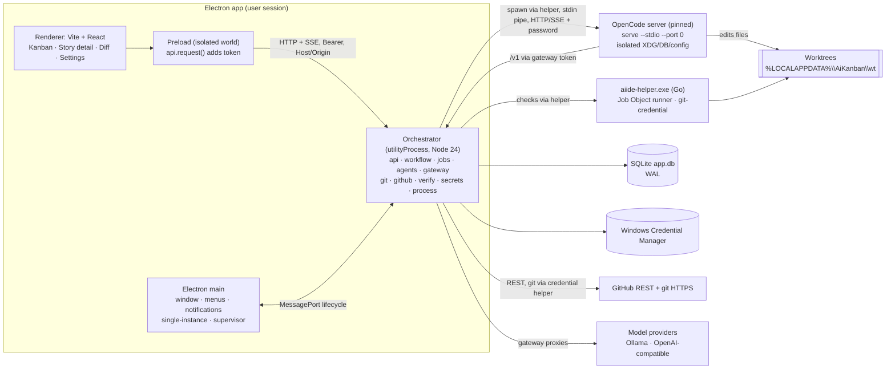
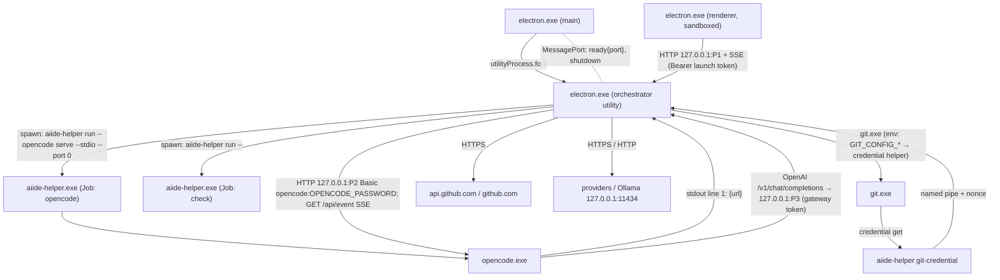
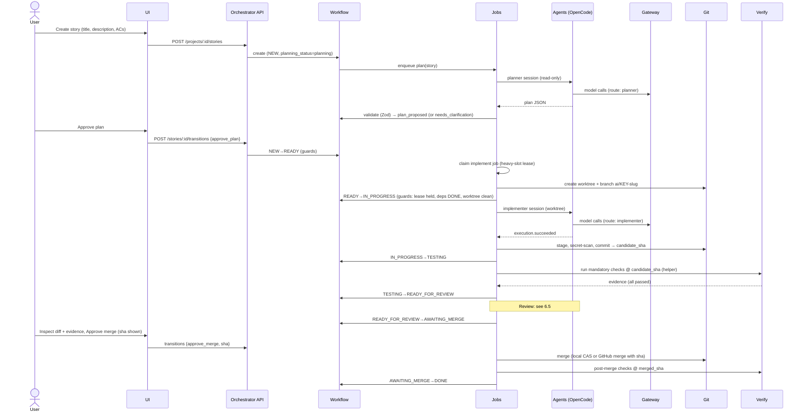
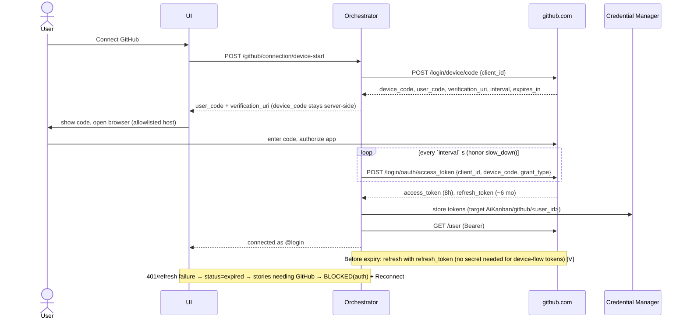
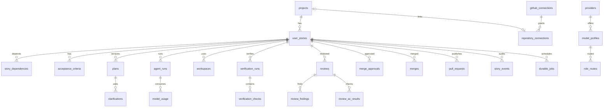
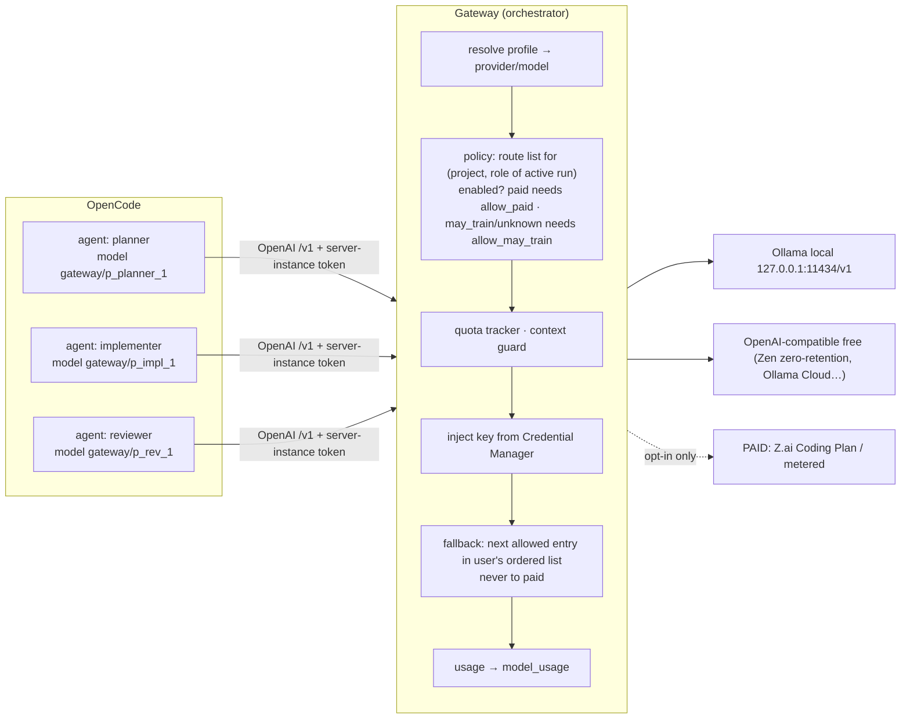
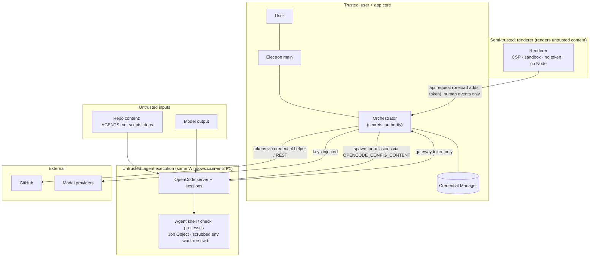
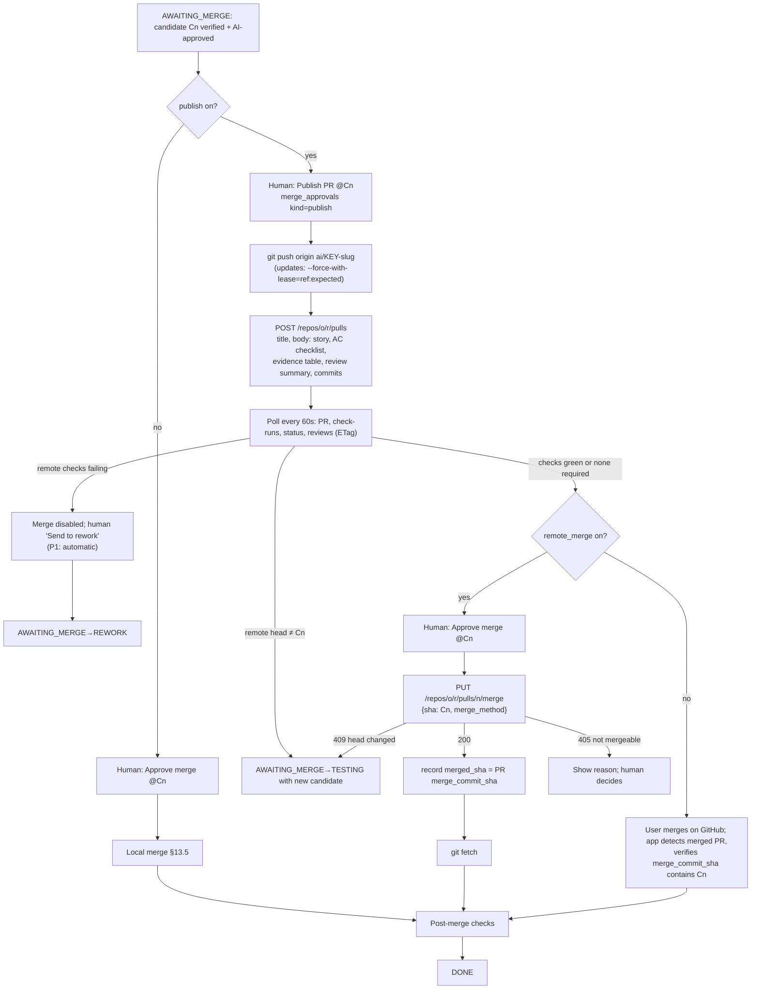
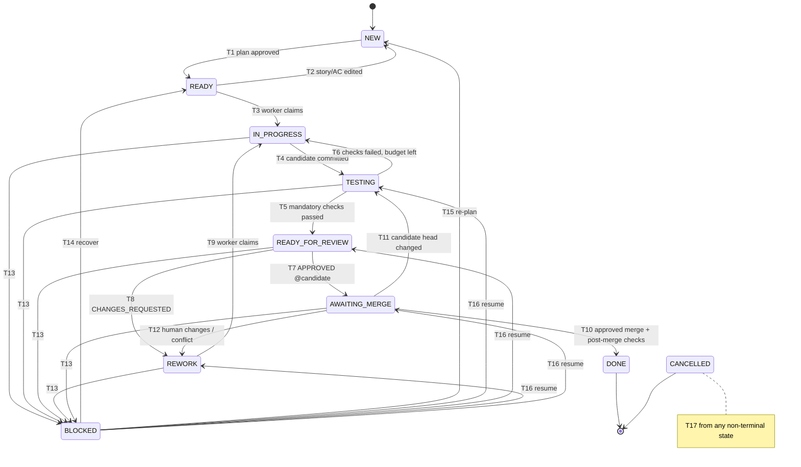
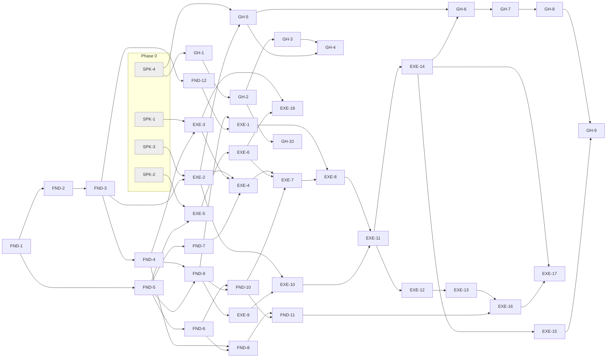

# Autonomous AI IDE (Kanban × OpenCode × GitHub): Design Specification

| | |
|---|---|
| **Date** | 2026-10-18 |
| **Status** | Draft for review. Sections 1–8 of the design were approved in conversation on 2026-10-18; this document consolidates them. |
| **Working name** | "AI Kanban". This is a placeholder: the app ID is `AiKanban` and the data dir is `%LOCALAPPDATA%\AiKanban\` (see Q-7). |
| **Scope** | The architecture and plan for the whole product. Each implementation phase gets its own implementation plan in `docs/superpowers/plans/`. |
| **Next step** | You review this spec, then an implementation plan is written for Phase 0 (spikes) and Phase 1 (walking skeleton). |

## Evidence legend

Statements carry these markers when the distinction matters:

- **[V] Verified.** Checked this session against an official doc, the npm/crates registry, source code at a pinned tag, or a read-only local command. Sources are in Appendix A.
- **[I] Inferred.** Reasoned from verified facts or from secondary sources.
- **[U] Unknown.** Not verifiable yet. It is assigned to a spike or listed as an open question.
- **[A] Assumption.** A working assumption we've made deliberately.
- **[R] Recommendation.** A design decision proposed by this spec.

Prices, quotas and provider terms change often. Every figure here is **as of 2026-10-18**.

## Decision log (user decisions, 2026-10-18)

| # | Decision | Choice |
|---|---|---|
| D-1 | Audience | **Personal tool first, kept ready to distribute later.** That means a publishable GitHub App, repeatable packaging, optional signing at first, and a model layer that doesn't assume one machine's hardware. |
| D-2 | Default AI execution | **Free hosted providers you explicitly enable** are the default on this laptop. Ollama is fully supported. The paid Z.ai Coding Plan is allowed only as a clearly labelled opt-in and is **never a default or fallback**. |
| D-3 | Target stacks for auto-detection | **Python and JS/TypeScript.** Other stacks use per-project manual check commands. |
| D-4 | Plan gate | **The human approves the plan by default** (NEW → READY). Each project can switch on auto-accept. |
| D-5 | Provider data policy | **Defaults include only providers whose terms say no training.** Providers that may train are hidden unless enabled per project, with a warning. Every provider shows a data-use label. Providers whose data use is *unknown* are treated as *may train*. |
| D-6 | Architecture | **Approach A:** Electron shell, Vite + React UI, a Node 24 orchestrator in `utilityProcess`, and one private, pinned OpenCode server. |
| D-7 | State machine deviations | Planning is a sub-status of NEW. Three transitions are added: READY→NEW, AWAITING_MERGE→TESTING and AWAITING_MERGE→REWORK. BLOCKED can resume the step it blocked from. Pause is a hold flag. Interrupted runs go to BLOCKED(`interrupted`) and are never re-run automatically. |
| D-8 | Implementer shell | **Allowlist only**, editable per project. The orchestrator makes all commits. Verification reuses the worktree's installed dependencies; clean-room re-verification comes in P1. |
| D-9 | GitHub | You register your own GitHub App, using **device flow**. The branch must be up to date with its base before merging. In the MVP, a remote CI failure is handled with a manual "Send to rework" button. |
| D-10 | Security stance | The MVP says plainly that **agents run as your Windows user**. A small Go helper provides containment. MXC isolation comes in P1. |
| D-11 | Roadmap | **Phase 0 spikes gate the build.** GitHub (still P0) comes after the local autonomous loop. |

---

## 1. Executive summary

**What we're building:** a Windows desktop app in which a human writes user stories on a Kanban board and approves the important steps. AI agents plan, implement, test, review and rework each story in isolated git worktrees. OpenCode is the coding engine. A story reaches **DONE only with evidence:**
- checks that the orchestrator actually ran;
- a review bound to the exact commit SHA;
- a human merge approval for that SHA;
- a verified merge;
- post-merge checks that passed.

**Key architecture choices, and why they differ from the original proposal:**

1. **Electron instead of Tauri 2** [R].
   - The orchestrator is Node anyway. Electron 44 ships Node 24.22 and supervises it as a separate `utilityProcess` [V].
   - Tauri would need Rust plus roughly 7–9 GB of MSVC Build Tools, and the Build Tools license needs a Visual Studio license [V]. It would also mean two runtimes, a sidecar that only gets its direct process killed [V], and a secret store (Stronghold) that was deprecated in July 2026 [V].
   - The UI talks to the orchestrator only through a loopback API, so switching back to Tauri later means swapping the shell, not rewriting the app.
2. **Vite + React instead of Next.js** [R]. Under the static export a desktop shell requires, Next.js loses API routes, server actions, middleware, ISR and its image optimizer [V]. Tauri's own docs recommend Vite for single-page apps [V].
3. **A private, pinned OpenCode v2 server** (`opencode serve --stdio --port 0`) [V].
   - It runs in an isolated environment, so it never touches the user's personal OpenCode data or paid credentials.
   - Repository-supplied OpenCode configuration is disabled.
   - OpenCode v2 is five weeks old and releases about daily [V], so the version is pinned and every upgrade must pass a contract-test suite.
4. **A model gateway** [R]: a loopback proxy compatible with the OpenAI API, sitting between OpenCode and every model provider. It:
   - adds real API keys taken from Windows Credential Manager;
   - enforces the per-project, per-role allowlist and the data-use policy;
   - **never falls back to a paid provider**;
   - turns quota errors into BLOCKED(`quota`).
5. **SQLite + Drizzle + better-sqlite3, and a hand-written durable job queue** with leases and idempotency keys [R]. Redis/BullMQ is excluded: Redis has no native Windows build, its licence has changed twice, and a single-user queue doesn't need it [V].
6. **A GitHub App with device flow** [R]. No client secret is shipped. Tokens expire after 8 h and come with 6-month refresh tokens [V]. Merges are SHA-pinned (`PUT …/merge` with `sha`, which returns 409 if the head moved) [V].
7. **Honest security.** Until P1 isolation (Microsoft MXC) lands, agents run as the user. The MVP relies on containment (Windows Job Objects through a small Go helper, a scrubbed environment, permission rules) plus gates: SHA-bound review, SHA-bound human approval, and secret scanning.

**Hardware reality** [V/I]: the target laptop has an i5-10310U, 16 GB RAM and only an integrated GPU.
- It can't run local agentic coding at a useful speed: an estimated 5–8 min per agent turn when the prompt cache is warm, 30–50 min when it's cold.
- Free hosted providers are therefore the default (D-2). With the no-training policy (D-5), that realistically means **about 1–3 stories per day at $0**, and the set of providers changes often.

**Roadmap:**
- **Phase 0:** spikes that check the riskiest assumptions.
- **Phase 1:** a walking skeleton.
- **Phase 2:** the local autonomous loop (Milestone A).
- **Phase 3:** GitHub (Milestone B = MVP).
- **Phases 4–6:** reliability and isolation, the full IDE, and advanced features.

---

## 2. Repository discovery findings

Discovery ran read-only on 2026-10-18.

| Area | Finding | Evidence |
|---|---|---|
| Project directory | `C:\Users\USER\Documents\data\ai-kanban-automation` was **empty** and **not a git repository**. There was no README, CLAUDE.md, AGENTS.md, Graphify or OpenSpec configuration. **This is a greenfield project.** The repo was initialized on 2026-10-18 for this spec. | [V] recursive directory listing |
| OS | Windows 11 Pro 10.0.26200 (25H2, build 26200.9711). WSL 2.7.10 is present. The `wsb` (Windows Sandbox) CLI isn't on PATH. | [V] |
| CPU / RAM / GPU | Intel i5-10310U (4 cores / 8 threads, AVX2), 15.7 GB RAM, Intel UHD Graphics only. `nvidia-smi` is absent. | [V] WMI |
| Disk | C: has 112 GB free of 237 GB. | [V] |
| Toolchain present | Git 2.54.0.windows.1 (with Git Credential Manager 2.7.3; `credential.helper=manager`), Node 24.17.0, npm 12.0.1, Python 3.14.7, Docker 29.6.2 (Docker Desktop), **OpenCode 2.0.29** (npm `@opencode/cli`). | [V] |
| Toolchain absent | Ollama, Rust/cargo, GitHub CLI (`gh`), pnpm, bun, Go. | [V] |
| OpenCode global config | `~/.config/opencode/opencode.jsonc` adds a skills path. Plugin `@opencode-ai/plugin` 1.18.4 and the `superpowers` skills are installed. `cli.json` holds UI preferences. | [V] |
| OpenCode credentials | `auth.json` holds **one provider credential: `zai-coding-plan`**, a **paid** Z.ai subscription priced from $18/month [V]. Its value was not read. | [V] |
| OpenCode service | `~/.config/opencode/service.json` holds the background-service password **in plaintext**. The value was not reproduced here. | [V] |
| OpenCode data | The personal database `~/.local/share/opencode/opencode.db` is about **5.8 GB**. A stale v1 directory `node_modules\.opencode-ai-R2I2dEyV` remains. | [V] |

**What this means for the design:**
- **(a)** The orchestrator **must not** use the user's shared OpenCode service or database. Plain `opencode run` attaches to both [V].
- **(b)** The paid Z.ai credential must never be reachable by orchestrator agents unless the user opts in. The isolated `XDG_*` directories (§18.3) and the gateway (§18.7) make sure of this.
- **(c)** Rust isn't installed, which counts against Tauri.
- **(d)** The hardware makes local inference unsuitable as a default.

These are optional suggestions for the user and outside this product's scope: clean up the stale v1 OpenCode directory, and keep in mind that `service.json` stores its password in plaintext.

---

## 3. Current architecture assessment

The project is greenfield, so "Current" means what exists on the machine, not in the repo.

| Component | Current implementation | Evidence | Missing | Risks | Recommended change | Priority |
|---|---|---|---|---|---|---|
| Directory structure | None | Empty directory [V] | Everything | — | npm-workspaces monorepo (§24) | P0 |
| Manifests and lockfiles | None | [V] | `package.json`, lockfile, Go module | Unpinned dependencies | Exact pins plus a lockfile, installed with `npm ci` | P0 |
| Runtime versions | Node 24.17 system-wide; Electron 44 would bring Node 24.22 | [V] | Version policy | Node 24 enters maintenance on 2026-10-20 [V] | Run the orchestrator on Electron's Node and track Electron's majors | P0 |
| Desktop shell | None | [V] | Shell | — | Hardened Electron (§5, §21) | P0 |
| Next.js config | None | [V] | — | Server features don't work in a desktop shell | Use Vite + React instead (§5) | P0 |
| Backend / API | None | [V] | Orchestrator | — | Fastify + Zod on loopback (§17) | P0 |
| Database and migrations | None | [V] | Schema, migrations | — | Drizzle + better-sqlite3, migrations at startup after a backup (§15) | P0 |
| Git integration | Git 2.54 + GCM installed | [V] | Worktree manager, merge logic | Touching the user's checkout | Worktrees outside the repo; CAS ref updates (§13) | P0 |
| GitHub auth | GCM holds credentials for the user's own git usage | [V] | App-level auth | Borrowing GCM's broad credential | Our own GitHub App with device flow (§11) | P0 |
| OpenCode installation | 2.0.29 global, personal config and data | [V] | Managed, pinned, isolated instance | Version churn; data and credential leakage | Managed install plus isolated environment (§18) | P0 |
| Model providers | Paid Z.ai credential in personal OpenCode | [V] | Registry, gateway, policy | Silent paid usage | Gateway with policy; paid only as opt-in (§10, §9) | P0 |
| Agent definitions | None for this product | `debug agents` returned `[]` [V] | Planner, implementer, reviewer | Over-permissive defaults | Start every role at `*:deny` (§19) | P0 |
| Security boundaries | None | — | All | Same-user execution | Containment now, MXC in P1 (§21) | P0/P1 |
| Logging / process management | None | — | Supervisor, Job Objects, redaction | Orphaned process trees [V] | Go helper plus a redactor (§21) | P0 |
| Testing / CI | None | — | All | — | Vitest, Playwright for Electron, mock LLM; CI on GitHub Actions `windows-latest` | P0 |
| Environment variables | None for this project | — | Config policy | Secrets in env | No secrets in env vars; keys go in Credential Manager | P0 |
| Documentation / instructions | None | [V] | README, AGENTS.md for this repo | — | Add in FND-1 | P0 |
| Uncommitted changes | None (empty) | [V] | — | — | — | — |

---

## 4. Feature inventory and gap analysis

Every feature is missing, since the project is greenfield. Priorities follow §26: P0 = MVP; P1 = a reliable autonomous workflow; P2 = the complete IDE; P3 = advanced.

| Area | Feature | Priority | Notes |
|---|---|---|---|
| Shell | Native Windows window, single instance, graceful shutdown, crash restart | P0 | |
| Shell | Installer (unsigned NSIS) | P1 | For personal use, running from source is enough until P1 |
| Shell | Code signing, auto-update | P3 | Needed only for distribution |
| Projects | Project dashboard, local repo picker, persistent settings | P0 | |
| Projects | GitHub repo browser, clone, link an existing clone | P0 | Required, not optional |
| Kanban | Board with all 10 states; drag = transition request; filtering, search, sorting | P0 | |
| Stories | CRUD, acceptance criteria, labels, priority, complexity, dependencies, history | P0 | |
| Stories | Hold/unhold, stop, retry, cancel, recovery actions, failure details | P0 | |
| AI | Planner with clarifications and plan approval | P0 | D-4 |
| AI | Implementer, verification, reviewer, rework loop, budgets | P0 | |
| AI | Model registry, gateway, Ollama, OpenAI-compatible providers, routing per role | P0 | |
| AI | Usage and quota dashboard | P1 | Usage is *recorded* from P0 |
| Git | Worktrees, branches, status, diff viewer, local merge, post-merge checks | P0 | |
| Git | Branch and commit history view | P2 | |
| GitHub | Device-flow connect, PR publishing, PR and check polling, SHA-bound merge | P0 | |
| GitHub | Automatic rework when remote CI fails | P1 | MVP has a manual button (D-9) |
| IDE | Monaco editor, file explorer, search across files | P2 | Monaco *diff* is P0 |
| IDE | Integrated terminal | P2 | Only the user can open it; agents can't reach it |
| IDE | Themes, keyboard shortcuts | P2 | Basic dark/light theme in P0 |
| Ops | Diagnostics and logs: basic in P0, advanced in P2 | P0/P2 | |
| Security | Containment, redaction, secret scanning | P0 | |
| Security | MXC isolation, osv-scanner, clean-room verification | P1 | |
| Security | Separate Windows-user sandbox, Docker runner | P3 | |
| Scale | Parallel stories with conflict detection | P3 | MVP runs one heavy job at a time |


---

## 5. Recommended architecture

### 5.1 Changes from the original proposal

| Proposed | Decided | Reason |
|---|---|---|
| Tauri 2 | **Electron 44** [R] | One Node runtime and no Rust/MSVC toolchain. N-API addons such as better-sqlite3 and `@napi-rs/keyring` load as they are. `utilityProcess` handles the backend lifecycle. VS Code runs the same Monaco/xterm/node-pty stack. Trade-off: an installer of about 100–150 MB and more RAM [I]. |
| Next.js | **Vite 8 + React + TanStack Router** [R] | Under static export, Next.js server features don't work [V]. Tauri itself recommends Vite for single-page apps [V]. |
| Prisma or Drizzle | **Drizzle 0.45 + better-sqlite3 13** [R] | Prisma 7 migrations still need a downloaded native schema-engine binary, and Prisma 8 marks SQLite as experimental [V/I]. Drizzle can run migrations from code at startup [V]. |
| SQLite queue vs Redis/BullMQ | **A hand-written SQLite jobs table** [R] | No mature SQLite queue library exists [V]. Redis has no native Windows build and has had licence churn [V]. |
| SSE vs WebSocket | **SSE** for the activity stream; WebSocket only for the P2 terminal [R] | The stream is one-directional, and SSE gives automatic reconnect plus `Last-Event-ID` replay [I]. |
| OpenCode CLI or SDK | **A private `serve --stdio` server driven through its HTTP API with `@opencode/client`** [R] | It offers clean interrupts, permission replies, parallel sessions, and messages that can be re-read to reconcile state [V]. See §6.13 for alternatives. |
| (not in proposal) | **Model gateway** [R] | It is the only enforcement point that guarantees "never silently pay" and "keys never reach agents". |
| (not in proposal) | **`aiide-helper.exe` (Go)** [R] | Starts processes inside a Job Object without a race, kills whole process trees, and acts as the git credential helper. Go needs no MSVC. |

### 5.2 Layering principles

1. **The renderer is untrusted UI.** It never authorizes anything. It holds no token, because the preload adds it. It can only *request* human events.
2. **The orchestrator is the only authority.** It alone writes story state, commits, pushes, merges, and holds secrets.
3. **OpenCode only edits files in a worktree.** It is never the system of record and never decides whether a story is complete.
4. **Every gate rests on evidence** stored in SQLite and bound to commit SHAs, never on an agent's own claims.
5. **Each piece is a small unit behind an interface** (`AgentRuntime`, `ProviderAdapter`, `GitService`, `GitHubClient`, `CheckRunner`), so it can be tested with fakes and replaced.

---

## 6. Architecture diagrams and strategies

### 6.1 Architecture diagram



### 6.2 Component responsibility matrix

| Component | Responsibilities | Owns | Must never |
|---|---|---|---|
| Electron main | Window lifecycle, menus, notifications, single-instance lock, deep-link registration (P3), starting the orchestrator with backoff, handing the API port and token to the preload | Launch token (in memory) | Run business logic or touch the DB |
| Preload | Exposes `api.request(method, path, body)` and `events.subscribe()` through `contextBridge`, adding the token | — | Expose Node or `ipcRenderer` to the renderer |
| Renderer | All UI; requests human events; renders evidence | UI state only | Authorize anything or hold secrets |
| Orchestrator `api` | HTTP routes, Zod validation, Host/Origin/token checks, idempotency, SSE | `api_idempotency` | Run arbitrary commands |
| `workflow` | Pure state machine, guards, transactional transitions, audit and outbox | `user_stories.status*`, `story_events`, `outbox_events` | Be bypassed: this is the only code path that changes status |
| `jobs` | Durable queue, leases, heartbeats, slots, recovery sweep | `durable_jobs` | Run a side-effecting job twice |
| `agents` | `AgentRuntime` and the OpenCode adapter; supervises the OpenCode server; sessions, prompts, event reconciliation, timeouts | `agent_runs` | Trust an agent's completion claim |
| `gateway` | OpenAI-compatible proxy, key injection, route and policy enforcement, quota tracking, usage | `model_usage`, quota state | Log keys or fall back to a paid provider |
| `providers` | Catalog, discovery, provider tests, routes | `providers`, `model_profiles`, `role_routes` | Enable a provider without the user |
| `git` | Worktrees, commits, diff, merge-tree, CAS ref updates, cleanup with path validation | `workspaces`, `merges` | Touch the user's checkout without the cases in §13 |
| `github` | Device flow, tokens, REST client, rate limits, PR flow | `github_connections`, `repository_connections`, `pull_requests`, `remote_sync_runs` | Push or merge without a recorded human approval for that SHA |
| `verify` | Check detection and execution, evidence | `verification_runs`, `verification_checks` | Mark a skipped or unsupported check as passed |
| `review` | Reviewer runs, normalization, finding lifecycle | `reviews`, `review_findings`, `review_ac_results` | Approve with blocking findings |
| `secrets` | Credential Manager access, redaction | — | Write secrets to DB, logs or env |
| `process` | Talks to `aiide-helper`; resource limits; tree kill | — | Spawn processes outside containment (apart from the helper itself) |
| OpenCode server | LLM tool loop inside one worktree per session | Its own isolated DB | Commit, push, or read outside its worktree (by permissions) |
| `aiide-helper` | `run` (Job Object), `git-credential` (named pipe) | — | Hold tokens beyond a single request |

### 6.3 Process and communication diagram



How processes are kept from outliving the app:
- OpenCode exits when its stdin closes [V].
- Each helper's Job Object has kill-on-close, so killing the helper kills the whole tree [V].
- If the orchestrator dies, its pipes close and the helpers exit, which kills their trees [I; tested in SPK-3].

### 6.4 Story execution sequence



### 6.5 Review and rework sequence

```mermaid
sequenceDiagram
  participant J as Jobs
  participant GIT as Git
  participant AG as Reviewer (OpenCode)
  participant WF as Workflow
  participant IM as Implementer (OpenCode)
  participant V as Verify
  J->>GIT: detached read-only worktree @ candidate_sha (Cn)
  J->>AG: reviewer session (deny-all + read/glob/grep), prompt: story, ACs, plan, diff base..Cn, evidence, prior findings
  AG-->>J: review JSON
  J->>J: Zod validate + normalize (blocking finding ⇒ CHANGES_REQUESTED)
  J->>GIT: assert review worktree clean and HEAD==Cn (else discard review)
  alt APPROVED and all ACs met and sha==candidate_sha
    J->>WF: READY_FOR_REVIEW→AWAITING_MERGE
  else CHANGES_REQUESTED, attempts remain
    J->>WF: READY_FOR_REVIEW→REWORK (findings persisted, bound to Cn)
    J->>WF: REWORK→IN_PROGRESS (attempt n+1)
    J->>IM: fresh session in story worktree @ Cn, repair prompt
    IM-->>J: done
    J->>GIT: commit C(n+1); tree(C(n+1)) ∈ rejected trees? → BLOCKED(no_progress)
    J->>WF: IN_PROGRESS→TESTING
    J->>V: checks @ C(n+1)
    J->>WF: TESTING→READY_FOR_REVIEW (fresh reviewer, sees delta Cn..C(n+1) + prior findings)
  else attempts exhausted
    J->>WF: →BLOCKED(retry_limit)
  else verdict BLOCKED
    J->>WF: →BLOCKED(reviewer_blocked)
  end
```

### 6.6 GitHub authentication flow (device flow, GitHub App)



### 6.7 Database architecture

There is one SQLite file, `%LOCALAPPDATA%\AiKanban\app.db`.
- Settings: WAL mode, `foreign_keys=ON`, `busy_timeout=5000`.
- The orchestrator is the only writer and uses synchronous `BEGIN IMMEDIATE` transactions.
- Before migrating, it backs up the database with `VACUUM INTO backups\app-<ts>.db` and keeps the last 5 backups.

The full schema is in §15; the overview below shows only the relationships.



### 6.8 Model-provider architecture



### 6.9 Desktop packaging strategy

- **Packaging tool:** electron-builder with a per-user NSIS installer (no admin needed). Which tool to use is confirmed in Phase 4 (Q-8) [U].
- **Run from source** (`npm run dev`, or a packaged build that isn't installed) is enough for personal use until P1.
- **What the installer bundles:**
  - Electron runtime.
  - `app.asar` containing main, preload, renderer, and an esbuild bundle of the orchestrator.
  - Native addons unpacked: better-sqlite3, `@napi-rs/keyring`.
  - `aiide-helper.exe` and the provider `catalog/`.
- **Not bundled; installed or detected at setup:**
  - **OpenCode**: a managed install of the pinned `@opencode/cli` into `%LOCALAPPDATA%\AiKanban\runtime\opencode` from a lockfile shipped with the app (`npm ci`, integrity-checked).
  - **Git for Windows**: a prerequisite that is detected.
  - **Ollama**: optional, detected.
  - **Target-repo toolchains** (Node/npm, Python/uv): the user's own installs, detected for each project.
- **Data directories** under `%LOCALAPPDATA%\AiKanban\`: `app.db`, `backups\`, `logs\`, `wt\`, `opencode\{data,config,state,cache,db}`, `runtime\`.
- **Electron fuses:** `RunAsNode` off, `EnableNodeOptionsEnvironmentVariable` off, `EnableNodeCliInspectArguments` off, `OnlyLoadAppFromAsar` on, embedded ASAR integrity validation on [V for fuse names via Electron docs; support for these on Windows is to be verified in Phase 4].
- **Signing (P3):** SmartScreen shows "Run anyway" for unsigned builds [V]. Options are compared in §8.
- **Auto-update:** P3, and requires signing.

### 6.10 Error recovery strategy

| Failure | Detection | Automatic response | Story effect | Human recovery |
|---|---|---|---|---|
| Orchestrator crash | `utilityProcess` exit event | Restart with backoff 1/2/4/8/16 s. More than 5 crashes in 5 min shows an error screen with a log link | Recovery sweep on start | Restart app; diagnostics export |
| Electron main crash | — | Everything exits: OpenCode on stdin EOF, check trees via Job kill-on-close | Recovery sweep next launch | Relaunch |
| Recovery sweep (startup) | Expired leases | Idempotent jobs (verify, poll, fetch, cleanup) re-queue. Side-effecting jobs (plan, implement, review, publish, merge) fail with reason `interrupted` | Side-effecting: BLOCKED(`interrupted`) | One-click Resume |
| OpenCode server exit or health failure | Process exit, `/health` probe | Restart the server; the in-flight session is abandoned | BLOCKED(`interrupted`) | Resume |
| Run exceeds its wall-clock or inactivity limit | Timer | `interrupt`, then restart the server after 30 s | Counts as a failed attempt (agent-caused) | — |
| Provider 5xx or timeout | Gateway | Retry twice with backoff, then the next allowed route | No route left: BLOCKED(`provider_down`) | Retry when the provider is up |
| Provider 429, short `retry-after` (≤60 s) | Gateway | Wait and retry | — | — |
| Provider quota exhausted | Gateway (429, headers, counters) | Mark the provider exhausted until reset; next allowed route | None left: BLOCKED(`quota`) with reset ETA | Resume after reset, or enable another provider |
| Prompt exceeds the model's context | Gateway estimate or provider error | — | BLOCKED(`model_limit`) | Pick a model with a larger context |
| GitHub 401 or refresh failure | Client | One refresh attempt | BLOCKED(`auth`) for stories that need GitHub | Reconnect |
| GitHub 5xx or rate limit | Client | Honor `retry-after` / `x-ratelimit-reset`; polls back off | — | — |
| Merge conflict on base sync | `merge-tree` | Attempts remain → AWAITING_MERGE→REWORK (the agent resolves it) | No attempts left: BLOCKED(`conflict`) | Resolve manually, then Resume |
| Base branch checked out with uncommitted changes | `git status` in the user's worktree | Refuse | Stays AWAITING_MERGE with a notice | Commit or stash, then retry merge |
| Missing toolchain, disk full, repo moved | Preflight checks, spawn errors | — | BLOCKED(`environment`) | Fix, then Resume |
| DB corruption or failed migration | Integrity check, migration error | Refuse to start | — | Restore a backup from the diagnostics screen |
| Post-merge checks fail | Verify | — | BLOCKED(`post_merge_failed`) | Offered revert commit, started by the human |

### 6.11 Security boundary diagram



### 6.12 Dependency and license inventory

See §7 (tool inventory) and §8 (licence and pricing verification).

### 6.13 Alternative architectures and trade-offs

| Alternative | Pros | Cons | Verdict |
|---|---|---|---|
| Tauri 2 + Node sidecar (`node.exe` bundled) | Smaller shell, lower RAM, Rust safety | Rust + 7–9 GB of MSVC Build Tools (licence check) [V]; two runtimes; sidecar kill only reaches the direct process [V]; Stronghold deprecated [V]; the 94 MB `node.exe` cancels most of the size win [V] | Rejected for now. The loopback API keeps it possible later |
| Browser-first (no shell) | Fastest MVP | No installer or native notifications; any browser tab can reach the local server | Rejected (user chose A) |
| Next.js static export | Familiar | No server features in a desktop shell [V] | Rejected |
| Orchestrator inside Electron main | One fewer process | A crash takes down the UI; blocking work freezes the window | Rejected; `utilityProcess` isolates it |
| OpenCode `run --format json` per run | Each run gets its own process for crash isolation; stdout NDJSON isn't volatile; exit codes [V] | Each run starts its own server; cancelling with SIGINT on Windows is crude; sharing one DB across processes is [U]; no permission-reply channel | Kept as a **fallback adapter** if server mode proves unstable in SPK-1 |
| OpenCode in-process SDK (`@opencode/sdk`) | No port | Bun-oriented; Node support is [U]; no crash isolation | Rejected |
| OpenCode via ACP | Standard protocol | Always starts its own private server; less control over permissions [V] | Rejected |
| Redis + BullMQ | Mature queue | No native Windows Redis; licence churn; an extra service [V] | Rejected |
| Prisma 7 | Popular | Native schema engine needed for migrations [I]; v8 still in RC [V] | Rejected |
| Containers (Docker) for all execution | Strong filesystem and network isolation | Docker Desktop licence limits [V]; heavy on a 16 GB laptop; Windows toolchains in Linux containers | Optional runner for checks (P3); MXC preferred (P1) |
| OAuth App instead of GitHub App | Simpler model | Coarse `repo` scope; GitHub prefers GitHub Apps [V] | Rejected |
| Webhooks instead of polling | Instant updates | Need a public endpoint | Rejected; poll with ETags |


---

## 7. Free and open-source tools inventory

Versions and licences were checked against registries on 2026-10-18 [V] unless marked otherwise. Exact versions are pinned when Phase 1 is implemented. Column key:
- **Acct/Pay:** whether an account, API key or payment is needed.
- **Win:** works locally on Windows.
- **Offline:** works without a network connection.

| Tool (purpose) | Website · Source | License | FOSS? | Acct/Pay | Win | Offline | Resources | Maintenance notes | Alternatives |
|---|---|---|---|---|---|---|---|---|---|
| **Electron 44** (desktop shell) | electronjs.org · github.com/electron/electron | MIT [V] | Yes | No | Yes | Yes | ~159 MB runtime zip [V]; ~150–300 MB RAM [I] | Major release every ~8 weeks; bundles Node 24.22 [V] | Tauri 2, Electrobun |
| **Node.js 24** (target-repo toolchain; dev) | nodejs.org · github.com/nodejs/node | MIT [I] | Yes | No | Yes | Yes | — | Maintenance LTS from 2026-10-20; Node 26 LTS on 2026-10-28 [V] | — |
| **TypeScript 6.0.x** | typescriptlang.org · github.com/microsoft/TypeScript | Apache-2.0 [V] | Yes | No | Yes | Yes | — | Pinned below 7 because typescript-eslint requires `<6.1` [V] | TS 7 (native) later |
| **Vite 8** (bundler/dev server) | vite.dev · github.com/vitejs/vite | MIT [V] | Yes | No | Yes | Yes | — | Active | Rsbuild |
| **React** (UI) | react.dev · github.com/facebook/react | MIT [I] | Yes | No | Yes | Yes | — | Active | Solid, Svelte |
| **TanStack Router** | tanstack.com/router · github.com/TanStack/router | MIT [V] | Yes | No | Yes | Yes | — | Active (1.170.x) [V] | React Router 8 (MIT) [V] |
| **Tailwind CSS 4** | tailwindcss.com · github.com/tailwindlabs/tailwindcss | MIT [V] | Yes | No | Yes | Yes | — | Active | CSS modules |
| **shadcn/ui** (copy-in components) | ui.shadcn.com · github.com/shadcn-ui/ui | MIT [V] | Yes | No | Yes | Yes | — | Base UI is the default primitive since Jul 2026; Radix still supported [V] | Mantine |
| **Base UI / Radix UI** (primitives) | base-ui.com · radix-ui.com | MIT [I]/[V] | Yes | No | Yes | Yes | — | Radix development reportedly slower [I] | — |
| **Monaco Editor** (diff now; editor in P2) | microsoft.github.io/monaco-editor · github.com/microsoft/monaco-editor | MIT [V] | Yes | No | Yes | Yes, bundled locally (not from a CDN) | A few MB of JS | `@monaco-editor/react` 4.7 loads from jsDelivr by default, so it must be configured with `loader.config({monaco})` [V] | CodeMirror 6 |
| **@git-diff-view/react** (optional diff UI) | npm `@git-diff-view/react` (repo URL [I]: github.com/MrWangJustToDo/git-diff-view) | MIT [V] | Yes | No | Yes | Yes | — | Pre-1.0 [V] | Monaco DiffEditor (default) |
| **xterm.js 6** (terminal, P2) | xtermjs.org · github.com/xtermjs/xterm.js | MIT [V] | Yes | No | Yes | Yes | — | Use `windowsPty:{backend:'conpty'}` [V] | — |
| **node-pty 1.1** (PTY, P2) | github.com/microsoft/node-pty | MIT [V] | Yes | No | Yes (ConPTY, Win10 1809+) | Yes | ~31 MB prebuilds [V] | Building from source needs Visual Studio [V]; prebuilds avoid this | — |
| **pragmatic-drag-and-drop** (Kanban) | atlassian.design · github.com/atlassian/pragmatic-drag-and-drop | Apache-2.0 [V] | Yes | No | Yes | Yes | Small | One-way mirror of Atlassian's internal repo; no external PRs [V] | @dnd-kit (MIT; core last released Dec 2024) [V] |
| **Fastify 5** (API) | fastify.dev · github.com/fastify/fastify | MIT [V] | Yes | No | Yes | Yes | Small | Active | Hono 4 (MIT) [V] |
| **Zod 4** (validation) | zod.dev · github.com/colinhacks/zod | MIT [V] | Yes | No | Yes | Yes | — | Active (4.6.x) | Valibot |
| **SQLite** (storage engine) | sqlite.org | Public domain [I] | Yes | No | Yes | Yes | Tiny | — | — |
| **better-sqlite3 13** (driver) | github.com/WiseLibs/better-sqlite3 | MIT [V] | Yes | No | Yes (N-API prebuild in the package) [V] | Yes | Small | Active | `node:sqlite` (release candidate) [V] |
| **Drizzle ORM 0.45 / drizzle-kit 0.31** | orm.drizzle.team · github.com/drizzle-team/drizzle-orm | Apache-2.0 / MIT [V] | Yes | No | Yes | Yes | — | 1.0 is in RC [V]; stay on 0.45 | Kysely, raw SQL |
| **Node.js native fetch / ReadableStream** (SSE client) | nodejs.org | Built-in | Yes | No | Yes | Yes | Tiny | Built-in | Main-process EventForwarder consumes GET /events |
| **@napi-rs/keyring 2** (Credential Manager) | github.com/Brooooooklyn/keyring-node | MIT [V] | Yes | No | Yes | Yes | — | Active; keytar is archived [V] | Rust `keyring` crate (via the helper) |
| **pino** (structured logs; Fastify's logger) | getpino.io · github.com/pinojs/pino | MIT [I] | Yes | No | Yes | Yes | Small | Active [I] | Node `console` + custom writer |
| **esbuild** (orchestrator bundle) | esbuild.github.io · github.com/evanw/esbuild | MIT [I] | Yes | No | Yes | Yes | — | Active | Rollup |
| **OpenCode 2.0.x** (coding agent) | opencode.ai · github.com/anomalyco/opencode | MIT [V] | Yes | Not for local models; hosted providers have their own terms | Yes | Yes with Ollama | ~100–500 MB RAM [U] | **About one release a day; v2 is 5 weeks old** [V]. Pin exactly, with contract tests | Aider, Codex CLI (not evaluated) |
| **Ollama** (local inference, optional) | ollama.com · github.com/ollama/ollama | MIT [V] | Yes | No | Yes (per-user install) [V] | Yes | Model size plus KV cache (§10) | v0.40.x [V] | llama.cpp server, LM Studio (closed) |
| **Git for Windows 2.54** (VCS, prerequisite) | gitforwindows.org · github.com/git-for-windows/git | GPL-2.0 [I] | Yes | No | Yes | Yes | — | Run as a separate program, not redistributed | — |
| **Git Credential Manager** (bundled with Git for Windows; *not used* by agents) | github.com/git-ecosystem/git-credential-manager | MIT [I] | Yes | — | Yes | — | — | Disabled for our git calls via `GIT_CONFIG_*` | — |
| **Go toolchain** (builds `aiide-helper`; build time only) | go.dev · github.com/golang/go | BSD-3 [I] | Yes | No | Yes (no MSVC) [I] | Yes | ~250 MB [I] | Stable | C#/.NET AOT (needs an MSVC linker) |
| **betterleaks** (secret scanning) | Reported as gitleaks' successor (Appendix A); canonical repo URL to confirm in Phase 1 [U] | MIT [V] | Yes | No | Yes (Windows zip) [V] | Yes | Small | gitleaks is in maintenance [V] | gitleaks 8.30 (MIT) |
| **osv-scanner 2** (dependency vulnerabilities, P1) | google.github.io/osv-scanner · github.com/google/osv-scanner | Apache-2.0 [V] | Yes | No | Yes (.exe) [V] | Partial (needs the OSV DB; supports offline DBs [I]) | Small | Active | `npm audit` (built in), `pip-audit` (Apache-2.0 [I]) |
| **Vitest 5** | vitest.dev · github.com/vitest-dev/vitest | MIT [V] | Yes | No | Yes | Yes | — | Active | Jest |
| **fast-check** (property tests) | fast-check.dev · github.com/dubzzz/fast-check | MIT [I] | Yes | No | Yes | Yes | — | Active [I] | — |
| **Playwright 1.64** (E2E, including Electron) | playwright.dev · github.com/microsoft/playwright | Apache-2.0 [V] | Yes | No | Yes | Yes | ~Chromium download for web tests | Electron support is "experimental" [I] | WebdriverIO |
| **ESLint 10 + typescript-eslint 8** | eslint.org · typescript-eslint.io | MIT [V] | Yes | No | Yes | Yes | — | Flat config only [V] | Biome |
| **electron-builder** (NSIS packaging, P1) | electron.build · github.com/electron-userland/electron-builder | MIT [I] | Yes | No | Yes | Yes | — | Choice confirmed in Phase 4 (Q-8) [U] | Electron Forge |
| **Microsoft MXC** (isolation, P1 spike) | github.com/microsoft/mxc · npm `@microsoft/mxc-sdk` | MIT [V] | Yes | No | Yes (build ≥26200.9278; this PC qualifies) [V] | Yes | — | **v1.0.1, released 2026-10-17** [V]; immature | Separate Windows user; Docker |
| *Docker Desktop* (optional checks runner, P3) | docker.com | Proprietary; free only for personal use, education, non-commercial OSS, or companies under 250 employees **and** under $10M revenue [V] | **No** | Business tiers are paid | Yes | Yes | Heavy | — | Podman Desktop (Apache-2.0) [V]; Docker Engine in WSL |

**Explicitly excluded:**
- **Redis/BullMQ:** see §5.
- **Prisma:** see §5.
- **Trivy:** its March 2026 supply-chain compromise (CVE-2026-33634) [V]. If ever used, pin it by digest.
- **Semgrep Registry rules:** the Rules License allows internal use only and forbids redistribution or offering them as a service [V]. Use only our own or OSS-licensed rules if Semgrep is ever added.
- **keytar:** archived [V].
- **Tauri Stronghold:** deprecated [V].
- **GitHub Models:** retired 2026-07-30 [V].

---

## 8. License and pricing verification

**Core cost: $0** [V/I]. Every required component is MIT, Apache-2.0, BSD or public domain. Git is GPL-2.0, which is fine because it is run as a separate program and not redistributed. Running the core product needs no account, API key or payment:
- Ollama runs locally.
- GitHub is optional for local-only projects.
- Free hosted providers are optional; their accounts are free but may be required.

**Distribution licence duties (P3).**
- Electron includes Chromium and its third-party notices, which must ship with the app (Electron provides `LICENSES.chromium.html`) [I].
- We don't redistribute OpenCode; it's installed from npm at setup. Its MIT licence would allow redistribution anyway [V].

**Optional costs:**

| Item | Cost (as of 2026-10-18) | Needed? |
|---|---|---|
| Z.ai GLM Coding Plan | From $18/month (Lite/Pro/Max credit tiers) [V] | Optional, opt-in only (D-2) |
| Metered hosted models (e.g. Zen pay-as-you-go GLM 5.3 Flash, $0.15 in / $0.50 out per M tokens) [V] | ≈ $0.05–0.30 per story at about 1M input tokens [I] | Optional |
| GitHub Pro or Team | Paid | Only for branch protection or required checks on **private** repos, or Actions minutes beyond 2,000/month on Free [V]. The app doesn't need either; it enforces its own gates. |
| Code signing | Azure Artifact Signing $9.99/month (Basic; individual developers in US/CA only) [V]; OV certificate ≈ $116–219+/year [I]; SignPath Foundation free for OSI-licensed open source (publisher shown as SignPath Foundation) [V] | Only for distribution (P3) |
| Docker Desktop | Paid for businesses above the threshold [V] | Optional (P3) |
| Electricity | Laptop draws ~15–45 W under load [I]. 8 h/day at 30 W ≈ 7 kWh/month ≈ $1–2/month at $0.15–0.30/kWh [I] | Inherent |
| Network | Model traffic ≈ 1M tokens/story ≈ a few MB of text [I]; Ollama models 3–20 GB each; npm/pip installs per worktree | Inherent |
| Hardware for useful local models | GPU with 16–24 GB VRAM and 32 GB RAM (§10) | Optional |

**Model licences differ from hosting terms.**
- *Open-weight licences* govern use of the model itself. Qwen3.5: Apache-2.0 [V]. Ornith-1.0: MIT [V]. Gemma 4: Apache-2.0 [I]. Nemotron 3.5 Bolt: a custom licence, OpenMDW-1.1 [V].
- *Hosted free tiers* are services with their own terms: quotas, retention, training. The provider catalog (§9) records data use and terms separately from the model licence.
- No free quota is assumed to be permanent. Every catalog entry carries `terms_checked_at`.

---

## 9. Model compatibility assessment

### 9.1 Requirements

**What OpenCode needs:**
- Tool calling (read, edit, shell).
- A context of 32–64k tokens. Ollama's OpenCode page says "64k or higher" [V]. OpenCode itself suggests `num_ctx` of 16–32k if tool calls fail [V].
- Reliable multi-turn agent behaviour.

**What each role needs:**
- **Planner** and **reviewer:** structured JSON output.
- **Implementer:** many turns of tool calls.

### 9.2 Local candidates (must fit in ~8–10 GB with KV cache on this laptop)

All figures are from model cards and Ollama listings as reported in research. Benchmark scores are self-reported by vendors and were measured at long context on GPUs, so **expect worse on CPU at 32–64k**.

| Model | Params | Ollama size | Max ctx | Agentic evidence | Licence | Fit here |
|---|---|---|---|---|---|---|
| Ornith-1.0-9B | 9B dense | 5.6 GB | 256K | SWE-bench Verified 69.4 (self-reported) [V card] | MIT [V] | Best quality that fits; slow |
| Qwen3.5-9B | 9B dense (hybrid attention) | 6.6 GB | 256K | BFCL-V4 66.1, TAU2 79.1 [V] | Apache-2.0 [V] | Small KV cache (~2 GiB at 64k) [V/I] |
| Qwen3.5-4B | 4B | 3.3–4.0 GB | 256K | BFCL-V4 50.3 [V] | Apache-2.0 [V] | Faster; weaker tool calling |
| Gemma 4 12B | ~12B | 7.7–8.0 GB | 256K | SWE-bench V 44.2 [I] | Apache-2.0 [I] | Tight on RAM |
| Granite 4.0 tiny-h | 7B / ~1B active (MoE) | [U] | 128K | No agentic scores | Apache-2.0 [V] | Fast; weak at agentic work |

**Better models that need a GPU or 24–32 GB of RAM:**

| Model | Params (total/active) | Size | SWE-bench Verified | Licence |
|---|---|---|---|---|
| Qwen3.6-27B | 27B dense | 18–19 GB | 77.2 [I] | Apache-2.0 [I] |
| Meta Muse Glimmer | 30B | 18 GB | 76.0 [V] | Apache-2.0 [V] |
| Qwen3.6-35B-A3B | 35B / 3B | 23–24 GB | 73.4 [I] | Apache-2.0 [I] |
| Devstral Small 2 | 24B | ~14 GB | 68.0 [I] | Apache-2.0 [I] |
| gpt-oss-20b | 21B MoE | 14 GB | — | Apache-2.0 [V] |

### 9.3 Free hosted providers (OpenAI-compatible)

The gateway enforces the policy (§18.7). This table is the starting catalog.

| Preset | Cost class | Data use | Default-eligible (D-5)? | Notes |
|---|---|---|---|---|
| Ollama (local) | local | no_training | ✅ | Slow on this laptop |
| Ollama Cloud Free | free_limited | no_training ("never logged or trained on") [V] | ✅ once verified | Starter usage that resets monthly; 1 concurrent request [V]; OpenAI-compatible endpoint [U] (SPK-2) |
| OpenCode Zen zero-retention free models (GLM-5.3-Flash Free, DeepSeek V4.1 Flash Free) | free_limited ("limited time") [V] | no_training per model [V] | ✅ per model, once verified | Whether billing details are needed for free models is [U] (SPK-2). The lineup rotates [V] |
| Cloudflare Workers AI (glm-4.7-flash) | free_limited: 10k neurons/day ≈ 1 story/day [V/I] | unknown | ❌ until verified | 131K context, multi-turn tool calling [V] |
| OpenRouter `:free` | free_limited: 50 req/day (<$10 lifetime credit) [V] | depends on the upstream provider | ❌ opt-in | Only ~2 free variants listed today [V] |
| Google AI Studio free tier | free_limited | **may_train** (human review possible) [V] | ❌ opt-in per project, with a warning | EEA/UK/CH get paid-tier data terms [V] |
| Z.ai Coding Plan | **paid_flat** | per Z.ai terms | ❌ explicit opt-in, labelled PAID | Never a fallback |
| Groq / Cerebras / HF | — | — | Not presets | Groq's 8K tokens/min is too small for 20k-token prompts [V]; Cerebras needs a card [V]; HF gives free accounts no credits [V] |

### 9.4 Initial default routes [A, pending SPK-2]

The reviewer is drawn from a **different model family** than the implementer where possible.

| Role | Ordered route (first allowed entry wins; fallback moves down the list, never to paid) |
|---|---|
| Planner | Zen DeepSeek V4.1 Flash Free → Zen GLM-5.3-Flash Free → Ollama Cloud Free → local Qwen3.5-9B |
| Implementer | Zen GLM-5.3-Flash Free → Ollama Cloud Free → local Ornith-1.0-9B |
| Reviewer | Zen DeepSeek V4.1 Flash Free → Ollama Cloud Free (other family) → local Qwen3.5-9B |

**Caveats:**
- Ornith is post-trained from Qwen3.5/Gemma 4, so for independence purposes it counts as the same family as Qwen3.5.
- **Different models don't guarantee an independent or correct review** [R]. Models share training data, blind spots and failure modes. Independence comes mainly from separate context, read-only permissions, commit binding and human merge review.

### 9.5 Validating a model before use

The "Test provider" action sends four probes through the gateway:
1. **A tool-call round trip:** a canned function definition, checking that the model returns a valid call and accepts the tool result.
2. **A long-context request** at the configured limit.
3. **JSON-schema adherence** using the plan and review schemas.
4. **Measured tokens/s** for prompt processing and generation.

The results are stored on the `model_profiles` row. A profile that fails probe 1 can't be routed to any role.

For Ollama, the app offers to create a derived model `<name>-aiide-<N>k` with `PARAMETER num_ctx N`, because the OpenAI-compatible endpoint can't set the context length [V].

---

## 10. Hardware requirements

### 10.1 Requirement tiers

| Tier | CPU | RAM | GPU | Disk | Notes |
|---|---|---|---|---|---|
| **Minimum (hosted models)** | 4 cores x64 | 16 GB | None | 20 GB free | **This laptop.** One heavy job at a time |
| Recommended (hosted models) | 6–8 cores | 32 GB | None | 50 GB SSD | Room for parallel stories later (P3) |
| Recommended (local models, useful quality) | 8+ cores | 32 GB | 16 GB VRAM for ~14B dense or 24B models at Q4; **24 GB VRAM** for 27–35B models [I] | 100 GB | For example Devstral Small 2 (~14 GB) or Qwen3.6-27B (~19 GB) |

### 10.2 This laptop (i5-10310U, 15.7 GB, UHD iGPU)

**Memory budget during a story** [I]:

| Component | RAM |
|---|---|
| Windows and background | ~4–5 GB |
| Electron UI | ~0.3–0.6 GB |
| Orchestrator | ~0.15 GB |
| OpenCode server | ~0.3–0.5 GB [U] |
| Check runs (tsc, vitest, pytest) | 0.5–2 GB |
| **Headroom left** | **~6 GB** |

A local 9B model at 32k context needs 8–9 GB, so **running local models alongside checks will swap**. That is why there is exactly one heavy slot **per repository**: independent repositories run in parallel, while one repository never runs two heavy jobs at once.

**CPU-only throughput estimates** [I, ±50%]. The anchor measurement is an i7-8550U running llama.cpp on a 7B Q4 model, at 13–16 tokens/s prompt processing and 5.6–6.4 tokens/s generation.

| Model class (Q4) | Prompt t/s | Gen t/s | Cold turn (20k prompt) | Warm turn | 30–60-turn task |
|---|---|---|---|---|---|
| 3–4B | 20–40 | 7–13 | 12–17 min | 2–3 min | 1–3 h warm / 6–17 h cold |
| 7–9B | 7–16 | 3.5–6 | 32–50 min | 5–8 min | 3–8 h warm / 16–50 h cold |
| 14B | 3.5–8 | 2–3.5 | 65–100 min | 10–15 min | 5–15 h warm / 33–100 h cold |

**The integrated GPU doesn't help.**
- The UHD 620 benchmarked *slower* than the CPU [I].
- IPEX-LLM was archived in Jan 2026 [V].
- Ollama's Vulkan backend should be benchmarked once, then left on the CPU default.

If the RAM is single-channel, generation speed roughly halves [U]; check Task Manager → Memory → Slots.

**The limits of small GPUs and CPU-only inference.** "Fits in memory" doesn't mean "works reliably":
- Small models degrade at multi-step tool calling over long contexts.
- Hybrid and reasoning models add thousands of thinking tokens.
- Role switches and context compaction invalidate the prompt cache, so cold turns are routine.

### 10.3 Other dimensions

| Dimension | Expectation | Basis |
|---|---|---|
| Concurrent agents | 1 heavy lane per repository (agent or checks) plus 1 light slot (polls/fetch); at most 3 lanes at a time (`AIK_MAX_CONCURRENT_LANES`) | [R] |
| Test execution | Depends on the repo; Job Object memory cap defaults to 4 GB and 64 processes, adjustable per project | [A] tune in Phase 2 |
| DB growth | ≈0.5 MB per story (events, check tails, reviews, usage) [I]. 1,000 stories ≈ 0.5 GB. Full logs on disk with 30-day retention | [I] |
| Worktree disk | 0.2–1 GB per JS worktree (`node_modules`), 0.1–0.5 GB per Python `.venv`. Warns above 20 GB total | [I] |
| OpenCode DB growth | Sessions are deleted after 30 days through the API (SPK-1 confirms the operation). The user's personal DB reached 5.8 GB with no retention | [V]/[U] |
| Desktop startup | Target < 5 s to an interactive board on this laptop; measured in Phase 1 | [A] target |
| Recovery | Startup sweep is O(active jobs); target < 2 s | [A] target |
| Model loading (local) | 5–30 s per model load from SSD [I]. Roles that share a model avoid reloads | [I] |


---

## 11. GitHub authentication comparison

All facts below are from docs.github.com and git-scm.com, checked 2026-10-18 (Appendix A).

| Option | Registration | Client secret? | Permissions | Token lifetime | Org / SSO | Fit |
|---|---|---|---|---|---|---|
| **GitHub App, device flow** | You register a GitHub App with device flow enabled [V] | **No:** not needed for device flow or for refreshing device-flow tokens [V] | Fine-grained. The token gets what *both* the user and the app have [V] | Access 8 h, refresh ~6 months; using a refresh token rotates both [V] | The app must be **installed** on each account or org; org owners install it, others can only request [V]. SAML needs an active session [V] | **✅ MVP (D-9)** |
| GitHub App, web flow + PKCE + loopback | Same | **Yes:** GitHub requires the secret even with PKCE [V]. GitHub accepts that desktop apps ship it [V] | Same | Same | Same | P3, for distribution. Whether a variable loopback port works for GitHub Apps is [U] |
| OAuth App, web or device flow | OAuth App | Web: yes. Device: no [V] | Coarse scopes; `repo` grants full access to private repos [V] | Since 2026-08-14 new OAuth Apps default to 8 h / 6-month tokens [V] | OAuth app access restrictions on by default in new orgs [V] | Rejected; GitHub prefers GitHub Apps [V] |
| Reuse `gh auth token` | None (`gh` not installed) | — | GitHub CLI's scopes (`repo`, `read:org`, `gist`) [V] | Long-lived [I] | Restrictions on the CLI's app apply [I] | Rejected: borrows a broad credential we don't control |
| Reuse Git Credential Manager | None (GCM 2.7.3 present) [V] | — | Unknown scopes [U] | — | — | Rejected: borrows a credential, and `git credential fill` would expose it |
| Fine-grained PAT | User creates it | — | One resource owner; **no Checks permission exists for PATs** [V] | 1–366 days [V] | Orgs can require approval or block [V] | Rejected as the main method (no check runs; GitHub says apps should never use PATs [V]). Could be an "advanced" fallback (P3) |

**Minimum GitHub App permissions** [V]:

| Permission | Level |
|---|---|
| Metadata | read (always) |
| Contents | read & write (push; merge endpoints) |
| Pull requests | read & write |
| Checks | read |
| Commit statuses | read |
| Workflows | **not granted** by default, so pushes that change `.github/workflows/**` fail at GitHub, which is the intended safety net [V] |

**What needs registration and what doesn't:**
- Cloning **public** repos, local-only projects, and anything through the user's existing Git setup outside this app need **no registration**.
- Listing private or org repos, PRs, checks and merges through *this app* need **the user's GitHub App**, registered once with a guided checklist (GH-1).

---

## 12. GitHub repository integration design

### 12.1 Connection lifecycle

1. **Settings:** the user enters the **Client ID**, which is public, not a secret. There is no secret field.
2. **Connect:** runs the device flow (§6.6). It polls at `interval` and adds 5 s on `slow_down` [V]. It stops when the code expires (`expires_in`) or the user cancels; cancelling sets status `cancelled`, and nothing is stored.
3. **Store:** the access token, refresh token and expiry times go to Credential Manager as target `AiKanban/github/<github_user_id>`. Each blob must be ≤ 2560 bytes [V]; GitHub tokens are well under that [I]. The `github_connections` row holds only metadata: `login`, `github_user_id`, `status`, expiry times, and `granted_permissions` from the installation listing.
4. **Refresh:** proactively, 10 minutes before the 8 h expiry. A failure sets status `expired`, and stories that need GitHub move to BLOCKED(`auth`) with **Reconnect**.
5. **Revocation:** a `401` that refreshing can't fix sets status `revoked`. The same blocking and reconnect path applies.
6. **Disconnect:** deletes the tokens from Credential Manager and marks the row `disconnected`. It then shows a link to GitHub → Settings → Applications to revoke the authorization. The app can't revoke it itself, because the API needs the client secret [I].

### 12.2 Repository browser

**Listing:**
- `GET /user/installations`, then `GET /user/installations/{id}/repositories` (paginated, `per_page=100`). Each repo comes back with a per-user `permissions` hash [V].
- Results are cached in `repository_connections` with ETags. A `304` response doesn't count against the rate limit [V].
- **Refresh** is manual, plus automatic when the browser opens and the cache is more than 10 minutes old.

**Display:** owner, name, description, visibility, default branch, the user's access (admin/push/pull), and whether a linked local clone exists. Search and filters run client-side (name, owner, visibility, has-push).

**Errors:**
- *Org missing:* "Install the app on this organization" (link to the installation page), or *request installation* for non-owners [V].
- *SSO:* "Authorize SSO" (link).
- *403/404 on a repo:* shown inline with the reason.

**Rate limits:** 5,000 requests/hour per user [V]. Requests are made one at a time, and `retry-after` and `x-ratelimit-reset` are honored [V].

**Switching repositories** never loses settings, because they are stored per project, not globally.

### 12.3 Clone and link

**Clone:**
- The user picks a parent folder. The target `parent/<repo-name>` must not exist, or must be empty.
- `git clone https://github.com/<owner>/<repo>.git <target>` runs with the **credential-helper environment** (§13.4). No token appears in the URL or arguments.
- A `remote_sync_runs` row records the clone.

**Link an existing clone:**
- The user picks a folder. `git -C <dir> rev-parse --show-toplevel` must succeed.
- `remote.origin.url` must match the repo after normalization. Normalization makes `https://github.com/o/r(.git)` and `git@github.com:o/r(.git)` equivalent and compares case-insensitively.
- On a mismatch the link is refused with both URLs shown, credentials redacted.
- An existing clone is never re-cloned or reset.

**Detecting existing clones:** when a repo is selected, known projects are searched by `github_repo_id` and normalized remote URL.

**Local-only projects:** any git repo folder works. GitHub fields stay empty, and the full local loop (§13) is available.

### 12.4 Database models

These tables are defined in §15:

| Table | Holds |
|---|---|
| `github_connections` | One row per connected GitHub user |
| `repository_connections` | Repos visible through installations: GitHub repo ID, owner/name, default branch, visibility, permissions, installation ID, linked local path, `last_synced_at` |
| `pull_requests` | One row per story PR, with head SHA, state, summaries and ETag |
| `remote_sync_runs` | Audit of clone, fetch, push and poll operations |

**`github_webhook_events` is not created:** webhooks need a public endpoint, and polling with ETags is enough for a single user.

---

## 13. Local Git execution design

### 13.1 Layout

**Story worktree:** `%LOCALAPPDATA%\AiKanban\wt\<projectId>\<storyKey>`.
- It is on the branch `ai/<STORY-KEY>-<slug>`, where the slug is at most 40 characters of `[a-z0-9-]`.
- It is created with `git worktree add -b <branch> <path> <base_ref>`.
- `base_ref` is `origin/<default>` after a fetch (GitHub projects) or the local `<default>` (local-only).

**Other worktrees**, all detached at a specific SHA:

| Worktree | Path | Purpose |
|---|---|---|
| Review | `...\wt\<projectId>\<storyKey>.review` | Files are made read-only with `attrib +R` after checkout. Removed after each review |
| Verify, clean-room (P1) | `...\wt\<projectId>\<storyKey>.verify` | Clean re-verification |
| Post-merge | `...\wt\<projectId>\<storyKey>.post` | Checks on the merged SHA |

**Why worktrees live outside the repo:**
- Paths stay short, which matters for Windows `MAX_PATH`.
- The user's checkout is never touched.
- No `AGENTS.md` from a parent directory gets picked up [V].

Git records each worktree in `<repo>/.git/worktrees/`; the app prunes these entries during cleanup.

### 13.2 Preflight before any operation

1. The repo path exists and `rev-parse` succeeds. Otherwise the story moves to BLOCKED(`environment`).
2. `git status --porcelain` on the **user's** checkout is recorded for display. Uncommitted changes there don't block worktree creation, but they do block a local merge into a checked-out base branch (§13.5).
3. The branch name must be free, or already recorded in `workspaces` for this story. Otherwise the operation is refused.
4. Before writing, the target path's realpath must be inside `%LOCALAPPDATA%\AiKanban\wt\`. Junctions and symlinks are rejected.

### 13.3 Candidate capture

This step is owned by the orchestrator and runs after every implementer run.
1. Assert `HEAD` is the previous candidate (or `base_sha` on the first attempt). Assert the worktree is still on the story branch.
2. `git add -A`, which respects `.gitignore`.
3. Run **betterleaks** on the staged diff. A finding fails the attempt with the redacted finding as evidence; no commit is made.
4. If nothing is staged, the attempt fails with "no changes".
5. `git -c user.name="AI Kanban Agent" -c user.email="agent@localhost" commit -m "<KEY>: <title> (attempt N)"`, with trailers `Story-Id`, `Attempt`, `Run-Id`.
6. Record `candidate_sha` and `git rev-parse <sha>^{tree}`.
7. **Protected paths:** if any changed path matches the project's protected globs, it is flagged for the merge UI. The defaults are `.github/workflows/**`, `.opencode/**`, `opencode.json*`, `.husky/**` and `.git*` config files.

### 13.4 Credentials for git

These are set **only on git processes the orchestrator spawns**, never on agent or check processes. Every variable goes in the environment:

```
GIT_CONFIG_COUNT=2
GIT_CONFIG_KEY_0=credential.helper            GIT_CONFIG_VALUE_0=          (reset list → disables GCM) [V]
GIT_CONFIG_KEY_1=credential.https://github.com.helper
GIT_CONFIG_VALUE_1=<abs path>\aiide-helper.exe git-credential
GIT_TERMINAL_PROMPT=0                                                    [V]
AIKANBAN_CRED_PIPE=\\.\pipe\aikanban-cred-<random>  AIKANBAN_CRED_NONCE=<one-time>
```

On a `get` request:
1. The helper connects to the pipe and presents the nonce.
2. The orchestrator checks the nonce (one-time use, 60 s TTL) and the host (`github.com`).
3. The helper prints `username=x-access-token`, `password=<token>`, `password_expiry_utc`, and `quit=1` [V].
4. `store`/`erase` requests are ignored.

**Agent and check processes get the opposite:**
- `GIT_CONFIG_COUNT=1`, with `credential.helper` set to empty.
- `GIT_TERMINAL_PROMPT=0`.
- `GCM_INTERACTIVE=never` [I].
- No pipe variables.

### 13.5 Local merge (local-only mode or `remote_merge=off`)

This only runs after a `merge_approvals` row exists for exactly `candidate_sha`.

1. **Base must be up to date:** `merge_base(candidate, base)` must equal `base_head`. If the base has moved:
   - Merge the base into the story branch in the story worktree with `git merge --no-edit <base_head>`. This creates a new candidate SHA.
   - Story goes AWAITING_MERGE → TESTING. The re-review happens because the SHA changed.
   - On a conflict, `git merge --abort`, then AWAITING_MERGE → REWORK (`conflict`) if attempts remain, otherwise BLOCKED(`conflict`).
2. **Build the result without a working tree:**
   - Merge commit (default): `git merge-tree --write-tree <base_head> <candidate>` [V; git ≥ 2.38] → `git commit-tree <tree> -p <base_head> -p <candidate> -m "Merge <KEY>: <title>"`.
   - Squash: `git commit-tree <tree> -p <base_head>`.
3. **Advance the base ref safely:**
   - Base not checked out in any worktree (from `git worktree list --porcelain`): `git update-ref refs/heads/<base> <new> <base_head>`. The update fails if the ref moved meanwhile.
   - Base checked out in a **clean** user worktree: `git -C <that worktree> merge --ff-only <new>`.
   - Base checked out with **uncommitted changes:** refuse. The story stays AWAITING_MERGE with the notice "Commit or stash your changes in <path>, then retry". Nothing is ever stashed automatically.
4. Record `merges` (base before and after, `merged_sha`), then run post-merge checks in a fresh detached worktree at `merged_sha`. On success the story becomes **DONE**; on failure, BLOCKED(`post_merge_failed`) with an offered revert commit that the human starts.

### 13.6 Cleanup

| What | Removed only when |
|---|---|
| Story worktree | The story is DONE (merged) **and** `git status` is clean, **or** the user clicks *Discard*, which asks for confirmation and lists unsaved changes. Uses `git worktree remove <path>`, never `--force` unless the user discards |
| Local branch | Already merged into the base (`git branch -d`, not `-D`, unless discarding) |
| Remote branch | Optional setting after a GitHub merge |
| Failed or blocked work | **Never automatic.** It stays for investigation; disk warnings start at 20 GB |
| Review, verify and post-merge worktrees | Always, after use (they are detached and never contain unique work) |

Every removal is preceded by the realpath containment check (§13.2.4).

---

## 14. Pull request and merge workflow

Each project has two settings:
- `publish`: `off | on`. Off means local-only, even when a remote exists.
- `remote_merge`: `off | on`. It requires `publish=on`.



**Publish approval applies to the story.** After the first approved publish, later candidates are pushed to the same PR branch automatically, but only once they reach AWAITING_MERGE (verified and AI-approved). Every push uses `--force-with-lease` with the last known remote SHA, so commits pushed by others are never overwritten. **Merging always needs a fresh approval bound to the exact SHA.** If `publish` is switched off, no further pushes happen.

**The PR description is generated from database evidence, never from agent prose.** It contains:
- the story key and title, with the description;
- an acceptance-criteria checklist with the reviewer's per-criterion status;
- a verification table (check, status, duration, SHA);
- the review verdict and findings summary;
- the commit list;
- a footer saying it was generated by AI Kanban, with the attempt count.

**Stale approval invalidation is structural.** Approvals and reviews are bound to SHAs, so any change in the remote head makes them non-current. The story re-enters TESTING, which leads to re-review and then needs a new human approval.

**Remote checks** come from `GET /repos/{o}/{r}/commits/{sha}/check-runs` (`filter=latest`) and `GET /repos/{o}/{r}/commits/{sha}/status` [V].
- Policy `require_remote_checks` (default **on** when any check is reported) disables merge until they are all successful.
- On Free private repos GitHub enforces nothing [V], so this app policy is the gate.

**Human review comments on GitHub** (`GET …/pulls/{n}/reviews`) are shown in the PR panel. If a GitHub review says `CHANGES_REQUESTED`, merging is disabled until the human chooses *Send to rework* (comments become findings) or *Override* (recorded in `story_events`).

**The merge** uses the synchronous endpoint with the `sha` parameter [V], which is stable and documented. The async merge API (GA 2026-10-01) [V] is a later option (P3).

**Never** push or merge just because the AI reviewer said APPROVED. Each step needs its own human approval row for the exact SHA.


---

## 15. Database schema

### 15.1 Conventions

- **Primary keys:** `INTEGER PRIMARY KEY` (rowid). Stories also have a human key such as `INV-12`, unique within a project.
- **Timestamps:** `INTEGER` milliseconds since the epoch (`timestamp_ms`).
- **JSON columns:** `TEXT` storing JSON, typed with `$type<>()`. They are validated with Zod on write.
- **SHA columns:** `TEXT` with `CHECK(length(x) IN (40,64))`, which supports SHA-1 and SHA-256 repositories.
- **No secrets:** there are no token or key columns. Credentials are stored as *reference names* pointing to Credential Manager entries (`*_ref`).
- **Connection setup:** the orchestrator is the only writer. On open it runs `PRAGMA journal_mode=WAL; foreign_keys=ON; busy_timeout=5000; synchronous=NORMAL`.

### 15.2 Proposed Drizzle schema (`packages/db/src/schema.ts`)

```ts
import { sqliteTable, integer, text, index, uniqueIndex, primaryKey, check,
         type AnySQLiteColumn } from 'drizzle-orm/sqlite-core';
import { sql } from 'drizzle-orm';

const ts = (n: string) => integer(n, { mode: 'timestamp_ms' });
const sha = (n: string) => text(n);                       // CHECKed below
const shaOk = (c: string) => sql.raw(`${c} IS NULL OR length(${c}) IN (40,64)`);

export const STORY_STATUS = ['NEW','READY','IN_PROGRESS','TESTING','READY_FOR_REVIEW',
  'REWORK','BLOCKED','AWAITING_MERGE','DONE','CANCELLED'] as const;
export const PLANNING_STATUS = ['none','planning','needs_clarification','plan_proposed',
  'plan_approved','planning_failed'] as const;
export const BLOCKED_REASON = ['retry_limit','no_progress','quota','provider_down','auth',
  'conflict','permission_denied','reviewer_blocked','post_merge_failed','interrupted',
  'invalid_agent_output','model_limit','environment'] as const;
export const ROLE = ['planner','implementer','reviewer'] as const;

// ───────────── Projects & GitHub ─────────────
export const githubConnections = sqliteTable('github_connections', {
  id: integer('id').primaryKey({ autoIncrement: true }),
  githubUserId: integer('github_user_id').notNull(),
  login: text('login').notNull(),
  appClientId: text('app_client_id').notNull(),          // public, not a secret
  tokenRef: text('token_ref').notNull(),                  // Credential Manager target name
  accessExpiresAt: ts('access_expires_at'),
  refreshExpiresAt: ts('refresh_expires_at'),
  status: text('status', { enum: ['connected','expired','revoked','disconnected','error'] }).notNull(),
  grantedPermissions: text('granted_permissions', { mode: 'json' }).$type<Record<string,string>>(),
  lastValidatedAt: ts('last_validated_at'),
  createdAt: ts('created_at').notNull(), updatedAt: ts('updated_at').notNull(),
}, t => [uniqueIndex('gh_conn_user_uq').on(t.githubUserId)]);

export const repositoryConnections = sqliteTable('repository_connections', {
  id: integer('id').primaryKey({ autoIncrement: true }),
  githubConnectionId: integer('github_connection_id').notNull()
    .references(() => githubConnections.id, { onDelete: 'cascade' }),
  githubRepoId: integer('github_repo_id').notNull(),
  installationId: integer('installation_id'),
  owner: text('owner').notNull(), name: text('name').notNull(),
  description: text('description'),
  defaultBranch: text('default_branch').notNull(),
  visibility: text('visibility', { enum: ['public','private','internal'] }).notNull(),
  permissions: text('permissions', { mode: 'json' }).$type<{admin:boolean;push:boolean;pull:boolean}>(),
  localPath: text('local_path'),
  etag: text('etag'),
  lastSyncedAt: ts('last_synced_at'),
}, t => [uniqueIndex('repo_conn_uq').on(t.githubConnectionId, t.githubRepoId),
         index('repo_conn_name_idx').on(t.owner, t.name)]);

export const projects = sqliteTable('projects', {
  id: integer('id').primaryKey({ autoIncrement: true }),
  key: text('key').notNull(),                              // e.g. "INV"
  name: text('name').notNull(),
  repoPath: text('repo_path').notNull(),
  baseBranch: text('base_branch').notNull(),
  remoteUrl: text('remote_url'),                           // credentials stripped
  repositoryConnectionId: integer('repository_connection_id')
    .references(() => repositoryConnections.id, { onDelete: 'set null' }),
  settings: text('settings', { mode: 'json' }).$type<ProjectSettings>().notNull(),
  nextStoryNumber: integer('next_story_number').notNull().default(1),
  status: text('status', { enum: ['active','unavailable','archived'] }).notNull().default('active'),
  createdAt: ts('created_at').notNull(), updatedAt: ts('updated_at').notNull(),
}, t => [uniqueIndex('projects_key_uq').on(t.key), uniqueIndex('projects_repo_uq').on(t.repoPath)]);

// ───────────── Stories ─────────────
export const userStories = sqliteTable('user_stories', {
  id: integer('id').primaryKey({ autoIncrement: true }),
  projectId: integer('project_id').notNull().references(() => projects.id),
  key: text('key').notNull(),                              // "INV-12"
  title: text('title').notNull(),
  description: text('description').notNull().default(''),
  priority: text('priority', { enum: ['P0','P1','P2','P3'] }).notNull().default('P2'),
  rank: integer('rank').notNull(),                         // board ordering within column
  labels: text('labels', { mode: 'json' }).$type<string[]>().notNull().default(sql`'[]'`),
  complexity: text('complexity', { enum: ['S','M','L','XL'] }),
  revision: integer('revision').notNull().default(1),     // ++ on title/description/AC edit
  status: text('status', { enum: STORY_STATUS }).notNull().default('NEW'),
  statusVersion: integer('status_version').notNull().default(0), // optimistic concurrency
  planningStatus: text('planning_status', { enum: PLANNING_STATUS }).notNull().default('none'),
  activePlanId: integer('active_plan_id').references((): AnySQLiteColumn => plans.id),
  hold: integer('hold', { mode: 'boolean' }).notNull().default(false),
  blockedReason: text('blocked_reason', { enum: BLOCKED_REASON }),
  blockedFrom: text('blocked_from', { enum: STORY_STATUS }),
  blockedDetail: text('blocked_detail'),                   // redacted, human-readable
  attemptCount: integer('attempt_count').notNull().default(0),
  maxAttempts: integer('max_attempts').notNull().default(3),
  activeRunId: integer('active_run_id').references((): AnySQLiteColumn => agentRuns.id),
  branchName: text('branch_name'),
  baseSha: sha('base_sha'),
  candidateSha: sha('candidate_sha'),
  candidateTree: sha('candidate_tree'),
  mergedSha: sha('merged_sha'),
  createdAt: ts('created_at').notNull(), updatedAt: ts('updated_at').notNull(),
  doneAt: ts('done_at'), cancelledAt: ts('cancelled_at'),
}, t => [uniqueIndex('story_key_uq').on(t.projectId, t.key),
         index('story_board_idx').on(t.projectId, t.status, t.rank),
         check('story_sha_ck', sql`${shaOk('base_sha')} AND ${shaOk('candidate_sha')} AND ${shaOk('candidate_tree')} AND ${shaOk('merged_sha')}`),
         check('story_blocked_ck', sql`(status = 'BLOCKED') = (blocked_reason IS NOT NULL)`)]);

export const storyDependencies = sqliteTable('story_dependencies', {
  storyId: integer('story_id').notNull().references(() => userStories.id, { onDelete: 'cascade' }),
  dependsOnStoryId: integer('depends_on_story_id').notNull().references(() => userStories.id),
}, t => [primaryKey({ columns: [t.storyId, t.dependsOnStoryId] }),
         check('dep_self_ck', sql`story_id <> depends_on_story_id`)]);   // cycles: rejected in service

export const acceptanceCriteria = sqliteTable('acceptance_criteria', {
  id: integer('id').primaryKey({ autoIncrement: true }),
  storyId: integer('story_id').notNull().references(() => userStories.id, { onDelete: 'cascade' }),
  storyRevision: integer('story_revision').notNull(),
  ordinal: integer('ordinal').notNull(),                   // AC-1, AC-2 …
  text: text('text').notNull(),
  source: text('source', { enum: ['human','planner'] }).notNull(),
  supersededAt: ts('superseded_at'),                       // edits supersede, never mutate text
  createdAt: ts('created_at').notNull(),
}, t => [uniqueIndex('ac_uq').on(t.storyId, t.storyRevision, t.ordinal)]);

export const plans = sqliteTable('plans', {
  id: integer('id').primaryKey({ autoIncrement: true }),
  storyId: integer('story_id').notNull().references(() => userStories.id, { onDelete: 'cascade' }),
  version: integer('version').notNull(),
  storyRevision: integer('story_revision').notNull(),      // plan binds to the story revision
  agentRunId: integer('agent_run_id').references((): AnySQLiteColumn => agentRuns.id),
  content: text('content', { mode: 'json' }).$type<PlanV1>().notNull(),
  status: text('status', { enum: ['proposed','approved','rejected','superseded'] }).notNull(),
  approvedBy: text('approved_by', { enum: ['human','auto'] }),
  approvedAt: ts('approved_at'),
  rejectionFeedback: text('rejection_feedback'),
  createdAt: ts('created_at').notNull(),
}, t => [uniqueIndex('plan_ver_uq').on(t.storyId, t.version)]);

export const clarifications = sqliteTable('clarifications', {
  id: integer('id').primaryKey({ autoIncrement: true }),
  planId: integer('plan_id').notNull().references(() => plans.id, { onDelete: 'cascade' }),
  ordinal: integer('ordinal').notNull(),
  question: text('question').notNull(),
  answer: text('answer'),
  answeredAt: ts('answered_at'),
}, t => [uniqueIndex('clar_uq').on(t.planId, t.ordinal)]);

// ───────────── Execution ─────────────
export const workspaces = sqliteTable('workspaces', {
  id: integer('id').primaryKey({ autoIncrement: true }),
  storyId: integer('story_id').notNull().references(() => userStories.id),
  kind: text('kind', { enum: ['story','review','verify','postmerge'] }).notNull(),
  path: text('path').notNull(),
  branch: text('branch'),                                   // null for detached
  headSha: sha('head_sha'),
  status: text('status', { enum: ['active','preserved','removed'] }).notNull(),
  createdAt: ts('created_at').notNull(), removedAt: ts('removed_at'),
}, t => [uniqueIndex('ws_path_active_uq').on(t.path).where(sql`status <> 'removed'`)]);

export const agentRuns = sqliteTable('agent_runs', {
  id: integer('id').primaryKey({ autoIncrement: true }),
  storyId: integer('story_id').notNull().references(() => userStories.id),
  role: text('role', { enum: ROLE }).notNull(),
  attempt: integer('attempt').notNull(),
  modelProfileId: integer('model_profile_id').references(() => modelProfiles.id),
  promptVersion: text('prompt_version').notNull(),          // versioned system prompts
  opencodeVersion: text('opencode_version').notNull(),
  opencodeSessionId: text('opencode_session_id'),
  workspaceId: integer('workspace_id').references(() => workspaces.id),
  inputSha: sha('input_sha'),                               // candidate the run started from / reviewed
  resultSha: sha('result_sha'),
  status: text('status', { enum: ['queued','running','succeeded','failed','interrupted',
    'timed_out','cancelled'] }).notNull(),
  failureClass: text('failure_class', { enum: ['agent','infrastructure'] }),
  exitReason: text('exit_reason'),
  usage: text('usage', { mode: 'json' }).$type<{requests:number;inTok:number;outTok:number}>(),
  logPath: text('log_path'),
  idempotencyKey: text('idempotency_key').notNull(),
  startedAt: ts('started_at'), endedAt: ts('ended_at'),
}, t => [uniqueIndex('run_idem_uq').on(t.idempotencyKey),
         index('run_story_idx').on(t.storyId, t.role, t.attempt)]);

export const verificationRuns = sqliteTable('verification_runs', {
  id: integer('id').primaryKey({ autoIncrement: true }),
  storyId: integer('story_id').notNull().references(() => userStories.id),
  commitSha: sha('commit_sha').notNull(),
  trigger: text('trigger', { enum: ['candidate','postmerge','cleanroom'] }).notNull(),
  status: text('status', { enum: ['running','passed','failed','error'] }).notNull(),
  startedAt: ts('started_at').notNull(), endedAt: ts('ended_at'),
}, t => [index('vr_story_sha_idx').on(t.storyId, t.commitSha)]);

export const verificationChecks = sqliteTable('verification_checks', {   // immutable
  id: integer('id').primaryKey({ autoIncrement: true }),
  verificationRunId: integer('verification_run_id').notNull().references(() => verificationRuns.id),
  checkKey: text('check_key').notNull(),                   // "lint","typecheck","test","build","secrets"
  mandatory: integer('mandatory', { mode: 'boolean' }).notNull(),
  command: text('command').notNull(),                      // redacted
  cwd: text('cwd').notNull(),
  status: text('status', { enum: ['passed','failed','error','timed_out','skipped','unsupported'] }).notNull(),
  exitCode: integer('exit_code'),
  outputTail: text('output_tail'),                         // last ~8 KB, redacted
  logPath: text('log_path'),
  startedAt: ts('started_at').notNull(), endedAt: ts('ended_at').notNull(),
}, t => [uniqueIndex('vc_uq').on(t.verificationRunId, t.checkKey)]);

export const reviews = sqliteTable('reviews', {                         // immutable
  id: integer('id').primaryKey({ autoIncrement: true }),
  storyId: integer('story_id').notNull().references(() => userStories.id),
  commitSha: sha('commit_sha').notNull(),
  actor: text('actor', { enum: ['agent','human'] }).notNull(),   // human = request_changes (T12)
  agentRunId: integer('agent_run_id').references(() => agentRuns.id), // null for human reviews
  rawVerdict: text('raw_verdict', { enum: ['APPROVED','CHANGES_REQUESTED','BLOCKED'] }).notNull(),
  verdict: text('verdict', { enum: ['APPROVED','CHANGES_REQUESTED','BLOCKED'] }).notNull(), // normalized
  normalizationNote: text('normalization_note'),
  summary: text('summary').notNull(),
  raw: text('raw', { mode: 'json' }).$type<ReviewV1>().notNull(),
  createdAt: ts('created_at').notNull(),
}, t => [index('review_story_sha_idx').on(t.storyId, t.commitSha)]);

export const reviewFindings = sqliteTable('review_findings', {          // immutable
  id: integer('id').primaryKey({ autoIncrement: true }),
  reviewId: integer('review_id').notNull().references(() => reviews.id),
  findingKey: text('finding_key').notNull(),                // "F-1"
  severity: text('severity', { enum: ['critical','high','medium','low','info'] }).notNull(),
  category: text('category').notNull(),
  filePath: text('file_path'),
  lineStart: integer('line_start'), lineEnd: integer('line_end'),
  evidence: text('evidence').notNull(),
  explanation: text('explanation').notNull(),
  recommendation: text('recommendation').notNull(),
  blocking: integer('blocking', { mode: 'boolean' }).notNull(),
  priorFindingId: integer('prior_finding_id').references((): AnySQLiteColumn => reviewFindings.id),
  resolution: text('resolution', { enum: ['resolved','unresolved','disputed'] }), // when re-checking a prior finding
}, t => [uniqueIndex('rf_uq').on(t.reviewId, t.findingKey)]);

export const reviewAcResults = sqliteTable('review_ac_results', {      // immutable
  reviewId: integer('review_id').notNull().references(() => reviews.id),
  acceptanceCriterionId: integer('acceptance_criterion_id').notNull().references(() => acceptanceCriteria.id),
  status: text('status', { enum: ['met','unmet','unclear'] }).notNull(),
  evidence: text('evidence').notNull(),
}, t => [primaryKey({ columns: [t.reviewId, t.acceptanceCriterionId] })]);

// ───────────── Approvals, merges, PRs ─────────────
export const mergeApprovals = sqliteTable('merge_approvals', {         // immutable
  id: integer('id').primaryKey({ autoIncrement: true }),
  storyId: integer('story_id').notNull().references(() => userStories.id),
  kind: text('kind', { enum: ['publish','merge','override_remote_review'] }).notNull(),
  commitSha: sha('commit_sha').notNull(),
  approver: text('approver').notNull().default('local-user'),
  note: text('note'),
  approvedAt: ts('approved_at').notNull(),
}, t => [uniqueIndex('ma_uq').on(t.storyId, t.kind, t.commitSha)]);

export const merges = sqliteTable('merges', {
  id: integer('id').primaryKey({ autoIncrement: true }),
  storyId: integer('story_id').notNull().references(() => userStories.id),
  method: text('method', { enum: ['local_merge','local_squash','github_merge','github_squash','github_external'] }).notNull(),
  approvedSha: sha('approved_sha').notNull(),
  baseBefore: sha('base_before'), baseAfter: sha('base_after'),
  mergedSha: sha('merged_sha'),
  pullRequestId: integer('pull_request_id').references(() => pullRequests.id),
  status: text('status', { enum: ['running','succeeded','failed'] }).notNull(),
  error: text('error'),
  startedAt: ts('started_at').notNull(), endedAt: ts('ended_at'),
});

export const pullRequests = sqliteTable('pull_requests', {
  id: integer('id').primaryKey({ autoIncrement: true }),
  storyId: integer('story_id').notNull().references(() => userStories.id),
  repositoryConnectionId: integer('repository_connection_id').notNull().references(() => repositoryConnections.id),
  number: integer('number').notNull(),
  url: text('url').notNull(),
  headBranch: text('head_branch').notNull(), headSha: sha('head_sha').notNull(),
  baseBranch: text('base_branch').notNull(),
  state: text('state', { enum: ['open','closed','merged'] }).notNull(),
  mergeable: integer('mergeable', { mode: 'boolean' }),
  checksSummary: text('checks_summary', { mode: 'json' }).$type<ChecksSummary>(),
  reviewsSummary: text('reviews_summary', { mode: 'json' }).$type<ReviewsSummary>(),
  mergeCommitSha: sha('merge_commit_sha'),
  etag: text('etag'), lastPolledAt: ts('last_polled_at'),
}, t => [uniqueIndex('pr_uq').on(t.repositoryConnectionId, t.number), index('pr_story_idx').on(t.storyId)]);

export const remoteSyncRuns = sqliteTable('remote_sync_runs', {
  id: integer('id').primaryKey({ autoIncrement: true }),
  projectId: integer('project_id').notNull().references(() => projects.id),
  kind: text('kind', { enum: ['clone','fetch','push','pr_create','pr_poll','merge'] }).notNull(),
  status: text('status', { enum: ['running','succeeded','failed'] }).notNull(),
  shaBefore: sha('sha_before'), shaAfter: sha('sha_after'),
  detail: text('detail'),                                   // redacted
  startedAt: ts('started_at').notNull(), endedAt: ts('ended_at'),
}, t => [index('rsr_project_idx').on(t.projectId, t.startedAt)]);

// ───────────── Models ─────────────
export const providers = sqliteTable('providers', {
  id: integer('id').primaryKey({ autoIncrement: true }),
  presetKey: text('preset_key'),                            // catalog id, null if custom
  name: text('name').notNull(),
  kind: text('kind', { enum: ['ollama','openai_compatible'] }).notNull(),
  baseUrl: text('base_url').notNull(),
  keyRef: text('key_ref'),                                  // Credential Manager target
  costClass: text('cost_class', { enum: ['local','free','free_limited','paid_flat','paid_metered'] }).notNull(),
  dataUse: text('data_use', { enum: ['no_training','may_train','unknown'] }).notNull(),
  termsUrl: text('terms_url'), termsCheckedAt: ts('terms_checked_at'),
  enabled: integer('enabled', { mode: 'boolean' }).notNull().default(false),
  quotaState: text('quota_state', { mode: 'json' }).$type<QuotaState>(),
});

export const modelProfiles = sqliteTable('model_profiles', {
  id: integer('id').primaryKey({ autoIncrement: true }),
  providerId: integer('provider_id').notNull().references(() => providers.id),
  modelId: text('model_id').notNull(),                      // provider's model name
  family: text('family'),                                   // for reviewer-independence warnings
  contextLimit: integer('context_limit').notNull(),
  outputLimit: integer('output_limit').notNull(),
  probe: text('probe', { mode: 'json' }).$type<ProbeResult>(), // tool-call, ctx, schema, tok/s
  enabled: integer('enabled', { mode: 'boolean' }).notNull().default(false),
}, t => [uniqueIndex('mp_uq').on(t.providerId, t.modelId)]);

export const roleRoutes = sqliteTable('role_routes', {
  id: integer('id').primaryKey({ autoIncrement: true }),
  projectId: integer('project_id').references(() => projects.id),   // null = global default
  role: text('role', { enum: ROLE }).notNull(),
  position: integer('position').notNull(),
  modelProfileId: integer('model_profile_id').notNull().references(() => modelProfiles.id),
}, t => [uniqueIndex('rr_uq').on(t.projectId, t.role, t.position)]);

export const modelUsage = sqliteTable('model_usage', {
  id: integer('id').primaryKey({ autoIncrement: true }),
  agentRunId: integer('agent_run_id').references(() => agentRuns.id),
  modelProfileId: integer('model_profile_id').notNull().references(() => modelProfiles.id),
  httpStatus: integer('http_status').notNull(),
  inputTokens: integer('input_tokens'), outputTokens: integer('output_tokens'),
  latencyMs: integer('latency_ms').notNull(),
  fallbackFrom: integer('fallback_from').references(() => modelProfiles.id),
  createdAt: ts('created_at').notNull(),
}, t => [index('mu_profile_time_idx').on(t.modelProfileId, t.createdAt)]);

// ───────────── System ─────────────
export const appSettings = sqliteTable('app_settings', {
  key: text('key').primaryKey(),
  value: text('value', { mode: 'json' }).notNull(),
  updatedAt: ts('updated_at').notNull(),
});

export const storyEvents = sqliteTable('story_events', {               // append-only audit
  id: integer('id').primaryKey({ autoIncrement: true }),
  storyId: integer('story_id').notNull().references(() => userStories.id),
  type: text('type').notNull(),                             // 'transition','edit','approval','run',…
  fromStatus: text('from_status', { enum: STORY_STATUS }),
  toStatus: text('to_status', { enum: STORY_STATUS }),
  actor: text('actor').notNull(),                           // 'human' | 'system' | 'agent:<role>'
  payload: text('payload', { mode: 'json' }),
  idempotencyKey: text('idempotency_key'),
  createdAt: ts('created_at').notNull(),
}, t => [index('se_story_idx').on(t.storyId, t.id),
         uniqueIndex('se_idem_uq').on(t.idempotencyKey).where(sql`idempotency_key IS NOT NULL`)]);

export const outboxEvents = sqliteTable('outbox_events', {             // SSE replay, 7-day TTL
  seq: integer('seq').primaryKey({ autoIncrement: true }),
  topic: text('topic').notNull(),
  storyId: integer('story_id'),
  payload: text('payload', { mode: 'json' }).notNull(),
  createdAt: ts('created_at').notNull(),
});

export const durableJobs = sqliteTable('durable_jobs', {
  id: integer('id').primaryKey({ autoIncrement: true }),
  kind: text('kind', { enum: ['plan','implement','verify','review','publish','merge',
    'postmerge','pr_poll','fetch','clone','cleanup','retention'] }).notNull(),
  slot: text('slot', { enum: ['heavy','light'] }).notNull(),
  storyId: integer('story_id').references(() => userStories.id),
  payload: text('payload', { mode: 'json' }).notNull(),
  sideEffecting: integer('side_effecting', { mode: 'boolean' }).notNull(),
  status: text('status', { enum: ['queued','leased','succeeded','failed','dead','cancelled'] }).notNull(),
  attempts: integer('attempts').notNull().default(0),
  maxAttempts: integer('max_attempts').notNull().default(3),
  runAfter: ts('run_after').notNull(),
  leaseToken: text('lease_token'),
  leaseExpiresAt: ts('lease_expires_at'),
  heartbeatAt: ts('heartbeat_at'),
  idempotencyKey: text('idempotency_key').notNull(),
  lastError: text('last_error'),                            // redacted
  createdAt: ts('created_at').notNull(), updatedAt: ts('updated_at').notNull(),
}, t => [uniqueIndex('job_idem_uq').on(t.idempotencyKey),
         index('job_claim_idx').on(t.status, t.slot, t.runAfter)]);

export const apiIdempotency = sqliteTable('api_idempotency', {
  key: text('key').primaryKey(),
  route: text('route').notNull(),
  requestHash: text('request_hash').notNull(),             // same key + different body → 422
  responseStatus: integer('response_status').notNull(),
  responseBody: text('response_body', { mode: 'json' }).notNull(),
  createdAt: ts('created_at').notNull(),                    // TTL 24 h
});
```

**Immutability triggers** go in the first migration, as raw SQL. They cover `story_events`, `reviews`, `review_findings`, `review_ac_results`, `verification_checks` and `merge_approvals`:

```sql
CREATE TRIGGER story_events_no_update BEFORE UPDATE ON story_events
BEGIN SELECT RAISE(ABORT, 'story_events is append-only'); END;
CREATE TRIGGER story_events_no_delete BEFORE DELETE ON story_events
BEGIN SELECT RAISE(ABORT, 'story_events is append-only'); END;
-- … same pair for the other immutable tables
```

**Purging a project** is the one sanctioned way to delete audit data. It is an explicit two-step confirmation in the UI. It runs in **one transaction** that drops the triggers, deletes the project's rows, then recreates the triggers; SQLite DDL is transactional. The purge itself is logged to `logs\audit-purge.log`.

### 15.3 Design decisions

1. **One writer, synchronous transactions.** better-sqlite3 transactions must be synchronous [V]. The workflow service performs the guard query, the status update, the audit row and the outbox row inside one `db.transaction(..., 'immediate')`.
2. **Optimistic concurrency** uses `status_version`: `UPDATE … WHERE id=? AND status_version=?`. If zero rows change, the result is `VERSION_CONFLICT`.
3. **Currency comes from SHA equality, not flags.** A review or approval is current only while `commit_sha = user_stories.candidate_sha`. Nothing needs to be "invalidated", because a stale row simply stops matching.
4. **Idempotency is enforced at three levels:** `api_idempotency` for HTTP mutations, `durable_jobs.idempotency_key` for enqueueing, and `agent_runs.idempotency_key` for runs.
5. **Acceptance criteria and plans are versioned, never edited in place.** Reviews reference criterion row IDs, so history stays meaningful.
6. **Migrations:**
   - drizzle-kit generates SQL during development, and the migrations are committed.
   - At startup the app runs `PRAGMA integrity_check` (quick), then `VACUUM INTO` a backup, then `migrate()`.
   - CI applies the whole chain to fixture databases from every released version, including tests that the triggers exist.

### 15.4 Relationships, retention and sensitive data

| Table | Retention | Sensitive-data rule |
|---|---|---|
| `github_connections` | Until disconnect + 30 days, then purged | `token_ref` only; tokens in Credential Manager |
| `repository_connections` | Refreshed; rows for repos no longer visible are marked, not deleted while a project links them | Public metadata |
| `projects`, `user_stories`, `acceptance_criteria`, `plans`, `clarifications`, `story_dependencies` | Indefinite (archive on project removal) | Story text may contain business info and stays local |
| `story_events`, `reviews`, `review_findings`, `review_ac_results`, `verification_checks`, `merge_approvals` | **Indefinite, immutable** | Output redacted before insert |
| `agent_runs`, `verification_runs`, `merges`, `pull_requests` | Indefinite | `exit_reason`/`error` redacted |
| Log files (`logs\runs\*.log`, `logs\checks\*.log`) | 30 days (configurable) | Redacted at write time |
| OpenCode sessions (isolated DB) | 30 days | Contain code and prompts; local only |
| `outbox_events` | 7 days | Same payloads as the SSE stream |
| `model_usage` | 180 days | No prompt content, counts only |
| `remote_sync_runs` | 90 days | Redacted URLs |
| `durable_jobs` | Succeeded and cancelled jobs 14 days; failed and dead jobs 90 days | Payload contains no secrets |
| `api_idempotency` | 24 h | Response bodies contain no secrets |

**The redactor** is applied to every string persisted from a process, provider or GitHub response. It removes:
- GitHub tokens `gh[oprsu]_[A-Za-z0-9]{36,}` and `github_pat_…`;
- `Authorization:`/`Proxy-Authorization:` header values;
- `https://user:pass@` credentials in URLs;
- known provider key formats;
- all live secret values held in memory, matched literally;
- PEM blocks.

It is unit-tested against a corpus of token formats.

---

## 16. State machine

### 16.1 Diagram



### 16.2 States

| State | Meaning | Sub-status / flags |
|---|---|---|
| NEW | Being defined or planned | `planning_status`: `none → planning → needs_clarification ⇄ planning → plan_proposed → plan_approved`; `planning_failed` can be retried; rejecting a plan returns to `planning` with feedback |
| READY | Plan approved; waiting for dependencies and a worker | `hold` |
| IN_PROGRESS | Implementer run active (`active_run_id` set) | `hold` (soft: the current step finishes) |
| TESTING | Verification of `candidate_sha` queued or running | `hold` |
| READY_FOR_REVIEW | Checks passed; review queued or running | `hold` |
| REWORK | Rejected; repair attempt queued | `hold` |
| BLOCKED | Needs human recovery | `blocked_reason`, `blocked_from`, `blocked_detail` (required) |
| AWAITING_MERGE | Verified and AI-approved; waiting for human publish/merge, or merge in progress | Merge stage: `awaiting_human → publishing → pr_open → merging → post_merge_checks` |
| DONE | Terminal: merged and verified | `merged_sha` |
| CANCELLED | Terminal | Worktree preserved until cleanup |

### 16.3 Transition table

"Sys" means a transition performed by the orchestrator; "Human" means one requested through the API.

| ID | From → To | Actor / event | Guards (all required) | Side effects |
|---|---|---|---|---|
| T1 | NEW → READY | Human `approve_plan` / Sys auto-accept (project setting) | Title, description and ≥1 current acceptance criterion exist. `planning_status=plan_proposed`. The plan validates against the schema. All clarifications are answered. `plan.story_revision = story.revision`. An approval is recorded for this plan version | `plan.status=approved`; `planning_status=plan_approved` |
| T2 | READY → NEW | Human edits title, description or acceptance criteria | — | `revision++`; plan `superseded`; `planning_status=none` (re-plan on request) |
| T3 | READY → IN_PROGRESS | Sys `claim(implement)` | Every dependency is DONE. `hold=false`. Heavy-slot lease is held. `attempt_count < max_attempts`. Worktree prepared and clean. No other implement run is active for this story | `active_run_id` set; run `running` |
| T4 | IN_PROGRESS → TESTING | Sys run completed | `run_id = active_run_id` and the lease token matches. Candidate committed by the orchestrator (§13.3). The diff isn't empty. Tree not in the rejected set | `candidate_sha`/`tree` set; `attempt_count++`; enqueue verify |
| T5 | TESTING → READY_FOR_REVIEW | Sys verification completed | A `verification_run` exists for `candidate_sha` in which every mandatory check is `passed` (never `skipped`/`unsupported`) | Enqueue review |
| T6 | TESTING → IN_PROGRESS | Sys verification failed + claim | `attempt_count < max_attempts`; lease held | New run (attempt n+1) with failure evidence |
| T7 | READY_FOR_REVIEW → AWAITING_MERGE | Sys review completed | `review.commit_sha = candidate_sha`. Normalized verdict APPROVED. No blocking findings. Every current acceptance criterion `met`. Verification for the same SHA passed | Merge stage `awaiting_human`; notify the user |
| T8 | READY_FOR_REVIEW → REWORK | Sys review completed | Normalized verdict CHANGES_REQUESTED for `candidate_sha`; ≥1 blocking finding or unmet criterion persisted; attempts remain | Enqueue implement (idempotency key `story:implement:n+1`) |
| T9 | REWORK → IN_PROGRESS | Sys `claim(implement)` | Same as T3, except the dependency check (already satisfied) | — |
| T10 | AWAITING_MERGE → DONE | Sys after merge + post-merge | A `merge_approvals(kind=merge, commit_sha=candidate_sha)` row exists. Merge succeeded via local CAS or GitHub `sha` param. `merged_sha` recorded and contains `candidate_sha`. Post-merge mandatory checks passed on `merged_sha` | `done_at`; cleanup job queued |
| T11 | AWAITING_MERGE → TESTING | Sys head changed (base sync, remote push, 409 on merge) | The new head SHA differs from `candidate_sha` | `candidate_sha` = new head; earlier approvals become stale through SHA mismatch |
| T12 | AWAITING_MERGE → REWORK | Human `request_changes{findings}` / Sys conflict | Attempts remain; human findings persisted as a review from `actor=human` | Enqueue implement |
| T13 | {IN_PROGRESS, TESTING, READY_FOR_REVIEW, REWORK, AWAITING_MERGE} → BLOCKED | Sys failure / Human `stop_run` | `blocked_reason` and `blocked_detail` set; `blocked_from` = previous state | Active run interrupted and process tree killed; lease released |
| T14 | BLOCKED → READY | Human `recover{target:'READY', extraAttempts?}` | Plan still approved; cause resolved where checkable (provider reachable, auth valid, repo present) | Optionally `max_attempts += extraAttempts` (recorded) |
| T15 | BLOCKED → NEW | Human `recover{target:'NEW'}` | — | Plan `superseded`; branch kept as history |
| T16 | BLOCKED → `blocked_from` ∈ {TESTING, READY_FOR_REVIEW, REWORK, AWAITING_MERGE} | Human `recover{target:'resume'}` | `candidate_sha` unchanged since blocking; cause resolved where checkable | Re-enqueue that step |
| T17 | any non-terminal → CANCELLED | Human `cancel` | No merge job leased (`merge_in_progress` otherwise) | Interrupt or kill the active run; worktree preserved; an open PR is left open (offer to close it) |

**Human events accepted by `POST /stories/:id/transitions`:** `approve_plan`, `reject_plan{feedback}`, `answer_clarifications{answers[]}`, `request_changes{findings[]}`, `approve_publish{sha}`, `approve_merge{sha}`, `override_remote_review{sha, note}`, `recover{target, extraAttempts?}`, `cancel`, `hold`, `unhold`, `stop_run`. There is no API path that triggers a Sys transition.

Dragging a card on the Kanban board maps to one of these events, or is rejected locally. For example, dragging NEW → READY means `approve_plan`. Any other drag returns `GUARD_FAILED` with `failedGuards[]`.

### 16.4 Attempt accounting

- `attempt_count` increments only when an implementation attempt **produces a candidate (T4)** or **fails for an agent-caused reason**: no changes, a secret found, invalid output, or a timeout.
- Infrastructure failures never increment it: `interrupted`, `quota`, `provider_down`, `auth`, `model_limit`, `environment`.
- If a repair is needed and `attempt_count ≥ max_attempts`, the story goes to BLOCKED(`retry_limit`) instead of REWORK or IN_PROGRESS.
- **No progress:** if `tree(C_{n+1})` is in the set of trees of rejected candidates, the story goes to BLOCKED(`no_progress`).

### 16.5 Blocked reasons and recovery hints

| Reason | Hint shown | Typical recovery |
|---|---|---|
| `retry_limit` | Show the last findings and failures; suggest editing the story or plan, or granting extra attempts | T14 with `extraAttempts`, or T15 |
| `no_progress` | "The last repair produced an identical tree" | T15, or edit the plan |
| `quota` | Provider, reset time, other allowed routes | T16 after reset |
| `provider_down` | Provider and error | T16 |
| `auth` | Reconnect GitHub or the provider key | Reconnect → T16 |
| `conflict` | Conflicting files | Resolve manually in the worktree → T16 |
| `permission_denied` | Action and resource that were denied | Adjust the project allowlist → T14 |
| `reviewer_blocked` | Reviewer's reason | Human decides: T15, or `request_changes` after edits |
| `post_merge_failed` | Failing checks on `merged_sha` | Revert offered; new story |
| `interrupted` | "App restart / stop requested" | T16 or T14 |
| `invalid_agent_output` | Schema errors | T16 (retry) or switch model |
| `model_limit` | Context needed vs model limit | Change the route → T16 or T14 |
| `environment` | Missing toolchain, disk, or repo path | Fix → T16 or T14 |

### 16.6 Invariants (enforced by guards and tested by property tests)

- **I1** `status=DONE` ⇒ ∃ merge approval for `candidate_sha` ∧ merge succeeded ∧ `merged_sha` set ∧ passed post-merge verification on `merged_sha`.
- **I2** `status=AWAITING_MERGE` ⇒ ∃ review with `commit_sha=candidate_sha`, normalized `APPROVED`, and passed verification for `candidate_sha`.
- **I3** `status=READY_FOR_REVIEW` ⇒ passed verification for `candidate_sha` with every mandatory check `passed`.
- **I4** Changing `candidate_sha` makes every earlier review and approval non-current (structural).
- **I5** `status=BLOCKED` ⇔ `blocked_reason IS NOT NULL` (CHECK constraint); `blocked_detail` is non-empty.
- **I6** CANCELLED ⇒ no running process for the story (verified by the process registry).
- **I7** Remote merge ⇒ a `merge_approvals(kind=merge)` row exists for that SHA, and the GitHub call carries `sha`.
- **I8** A duplicate event or job never executes twice (idempotency keys).
- **I9** A completion from a stale worker (wrong lease or `active_run_id`) never changes state.
- **I10** At most one implement run is active per story, and at most one heavy job runs per repository lane (P0). Independent repositories may work in parallel, bounded by `AIK_MAX_CONCURRENT_LANES` (default 3).

---

## 17. API and event contracts

### 17.1 Transport and security

- **Binding:** HTTP/1.1 on `127.0.0.1:<random>`; it never binds `0.0.0.0`.
- **Handshake:** the port and a 256-bit launch token pass from the orchestrator to Electron main process over a MessagePort. The token is held exclusively in the main process (`OrchestratorSupervisor`) and is never exposed to renderer or preload worlds.
- **IPC proxying:** the renderer invokes the main process via typed IPC bridge (`window.bridge.request({ method, path, body, idempotencyKey })`). The main process validates request format, injects `Authorization: Bearer <token>` and `Origin: app://ui`, executes the local HTTP call against `127.0.0.1:<port>`, and returns `{ status, body }`.
- **Every request must have:**
  - `Authorization: Bearer <token>`;
  - `Host ∈ {127.0.0.1:<port>, localhost:<port>}`, which blocks DNS rebinding;
  - `Origin = app://ui` on mutations and SSE.
- **CORS:** only `app://ui`.
- **CSRF:** not applicable beyond these checks, because nothing uses cookies.
- **Mutations** require an `Idempotency-Key` header (UUID). A repeat returns the stored response; the same key with a different body returns 422.
- **No endpoint runs a shell command.** Check commands are configured as data and executed only by the verify module, with the project's working directory.

### 17.2 Envelopes

```ts
// packages/contracts/src/common.ts
export const Sha = z.string().regex(/^[0-9a-f]{40}([0-9a-f]{24})?$/);   // SHA-1 or SHA-256
export const ErrorCode = z.enum(['VALIDATION_FAILED','UNAUTHORIZED','FORBIDDEN_ORIGIN','NOT_FOUND',
  'VERSION_CONFLICT','GUARD_FAILED','IDEMPOTENCY_MISMATCH','RATE_LIMITED','DEPENDENCY_UNAVAILABLE','INTERNAL']);
export const ApiError = z.object({ error: z.object({
  code: ErrorCode, message: z.string(), retryable: z.boolean(),
  details: z.unknown().optional(),
  failedGuards: z.array(z.object({ guard: z.string(), reason: z.string() })).optional(),
})});

export const StoryDTO = z.object({
  id: z.number().int(), key: z.string(), projectId: z.number().int(),
  title: z.string(), description: z.string(), priority: z.enum(['P0','P1','P2','P3']),
  rank: z.number().int(), labels: z.array(z.string()), complexity: z.enum(['S','M','L','XL']).nullable(),
  revision: z.number().int(), status: z.enum(STORY_STATUS), statusVersion: z.number().int(),
  planningStatus: z.enum(PLANNING_STATUS), activePlanVersion: z.number().int().nullable(),
  hold: z.boolean(), blocked: z.object({ reason: z.enum(BLOCKED_REASON), from: z.enum(STORY_STATUS).nullable(),
    detail: z.string(), hint: z.string() }).nullable(),
  attempts: z.object({ used: z.number().int(), max: z.number().int() }),
  acceptanceCriteria: z.array(z.object({ id: z.number().int(), ordinal: z.number().int(), text: z.string() })),
  dependsOn: z.array(z.string()),
  branch: z.string().nullable(), candidateSha: z.string().nullable(), mergedSha: z.string().nullable(),
  activeRun: z.object({ id: z.number().int(), role: z.enum(ROLE), model: z.string(), startedAt: z.number() }).nullable(),
  pullRequest: z.object({ number: z.number().int(), url: z.string(), state: z.string() }).nullable(),
  createdAt: z.number(), updatedAt: z.number(),
});

export const TransitionRequest = z.discriminatedUnion('event', [
  z.object({ event: z.literal('approve_plan'), planVersion: z.number() }),
  z.object({ event: z.literal('reject_plan'), planVersion: z.number(), feedback: z.string().min(1) }),
  z.object({ event: z.literal('answer_clarifications'), planVersion: z.number(),
             answers: z.array(z.object({ ordinal: z.number(), answer: z.string().min(1) })) }),
  z.object({ event: z.literal('request_changes'), sha: Sha,
             findings: z.array(z.object({ text: z.string().min(1), file: z.string().optional() })).min(1) }),
  z.object({ event: z.literal('approve_publish'), sha: Sha }),
  z.object({ event: z.literal('approve_merge'), sha: Sha, method: z.enum(['merge','squash']).optional() }),
  z.object({ event: z.literal('override_remote_review'), sha: Sha, note: z.string().min(1) }),
  z.object({ event: z.literal('recover'), target: z.enum(['READY','NEW','resume']),
             extraAttempts: z.number().int().min(0).max(5).optional() }),
  z.object({ event: z.literal('cancel') }), z.object({ event: z.literal('hold') }),
  z.object({ event: z.literal('unhold') }), z.object({ event: z.literal('stop_run') }),
]).and(z.object({ expectedVersion: z.number() }));

export const EventEnvelope = z.object({
  seq: z.number(),                   // = SSE id; replay via Last-Event-ID
  topic: z.enum(['story.transitioned','story.updated','run.started','run.output','run.finished',
    'check.started','check.finished','review.completed','pr.updated','provider.quota',
    'github.connection','system.health','system.resync']),
  storyId: z.number().nullable(), at: z.number(), data: z.unknown(),
  provenance: z.enum(['agent_reported','command_completed','check_verified','review_decision',
    'human_approval','completion','system']),   // drives UI badges (§23)
});
```

### 17.3 Endpoints

All endpoints require the token, Host and Origin checks. "Idem." means an `Idempotency-Key` header is required.

| Method · Path | Request | Response | Errors | Idem. |
|---|---|---|---|---|
| `GET /health` | — | `{status, versions{app,electron,opencode}, components{db,opencode,gateway,github,ollama}}` | — | — |
| `GET /projects` · `POST /projects` | Create: `{name, key, repoPath, baseBranch?}` | `ProjectDTO[]` · `ProjectDTO` | `VALIDATION_FAILED` (not a git repo; duplicate key or path) | POST ✓ |
| `GET /projects/:id` · `PATCH /projects/:id` | Partial settings | `ProjectDTO` | `VALIDATION_FAILED` | PATCH ✓ |
| `POST /projects/:id/detect-checks` | — | `{proposed: CheckConfig[]}` (not applied until PATCH) | `DEPENDENCY_UNAVAILABLE` | ✓ |
| `GET /github/connection` | — | `{status, login?, expiresAt?, appClientId?}` | — | — |
| `POST /github/connection/device-start` | — | `{userCode, verificationUri, expiresAt, interval}` | `DEPENDENCY_UNAVAILABLE`, `VALIDATION_FAILED` (no client ID) | ✓ |
| `GET /github/connection/device-status` | — | `{state: pending/connected/expired/cancelled/denied}` | — | — |
| `POST /github/connection/cancel` · `DELETE /github/connection` | — | `204` | — | ✓ |
| `GET /github/repos?q=&refresh=` | — | `{repos: RepoDTO[], installations[], fetchedAt}` | `UNAUTHORIZED` (GitHub 401 maps to connection status), `RATE_LIMITED` | — |
| `POST /github/repos/:owner/:name/clone` | `{parentDir}` | `{jobId}` | `VALIDATION_FAILED` (path exists or is non-empty) | ✓ |
| `POST /projects/link` | `{repoPath, repositoryConnectionId?}` | `ProjectDTO` | `VALIDATION_FAILED` (remote mismatch, both URLs redacted) | ✓ |
| `GET /projects/:id/stories?status=&label=&q=&sort=` | — | `StoryDTO[]` | — | — |
| `POST /projects/:id/stories` | `{title, description, acceptanceCriteria[], priority?, labels?, dependsOn?[]}` | `StoryDTO` (planning auto-starts if a description exists) | `VALIDATION_FAILED` (dependency cycle) | ✓ |
| `GET /stories/:id` · `PATCH /stories/:id` | `{expectedVersion, title?, description?, acceptanceCriteria?, priority?, labels?, rank?}` | `StoryDTO` | `VERSION_CONFLICT`, `GUARD_FAILED` (no edits while IN_PROGRESS etc.) | PATCH ✓ |
| `POST /stories/:id/plan` | `{}` | `{jobId}` (start or retry planning) | `GUARD_FAILED` | ✓ |
| `POST /stories/:id/transitions` | `TransitionRequest` | `StoryDTO` | `VERSION_CONFLICT`, `GUARD_FAILED{failedGuards}` | ✓ |
| `GET /stories/:id/plans` | — | `PlanDTO[]` (with clarifications) | — | — |
| `GET /stories/:id/runs` · `GET /runs/:id` · `GET /runs/:id/log?offset=` | — | `RunDTO[]` · `RunDTO` · `{text, nextOffset}` (redacted) | — | — |
| `POST /runs/:id/interrupt` | — | `202` | `GUARD_FAILED` (not running) | ✓ |
| `GET /stories/:id/verifications` | — | `VerificationDTO[]` (checks with evidence) | — | — |
| `GET /stories/:id/reviews` | — | `ReviewDTO[]` (findings, criterion results, normalization note) | — | — |
| `GET /stories/:id/diff?from=&to=&file=` | — | `{files:[{path,status,additions,deletions,protected}], patch?}` | `VALIDATION_FAILED` (SHA not in story history) | — |
| `GET /projects/:id/git/status` · `GET /projects/:id/git/log?ref=&limit=` | — | Status of the user's checkout; log | `DEPENDENCY_UNAVAILABLE` | — |
| `GET /stories/:id/pull-request` · `POST /stories/:id/pull-request/refresh` | — | `PullRequestDTO` | `RATE_LIMITED` | refresh ✓ |
| `GET /providers` · `POST /providers` · `PATCH /providers/:id` | Create: `{presetKey? or custom fields, apiKey?}`; **the key goes to Credential Manager and is never returned** | `ProviderDTO` (no key; `hasKey: boolean`) | `VALIDATION_FAILED` | ✓ |
| `POST /providers/:id/test` | `{modelId}` | `ProbeResult` | `DEPENDENCY_UNAVAILABLE` | ✓ |
| `GET /models` | — | `ModelProfileDTO[]` (discovered, with probe results and labels) | — | — |
| `GET /routes?projectId=` · `PUT /routes` | `{projectId?, role, profileIds[]}` | `RouteDTO[]` | `VALIDATION_FAILED` (profile failed its tool probe; paid profile without `allow_paid`) | PUT ✓ |
| `GET /events` (SSE) | Header `Last-Event-ID` | `text/event-stream` of `EventEnvelope`; heartbeat comment every 15 s | `UNAUTHORIZED` | — |
| `GET /diagnostics/export` | — | ZIP of redacted logs and DB statistics (no DB file, no secrets) | — | — |

**SSE forwarding:** the Electron main process connects to `GET /events` using the launch token and runs an `EventForwarder` that parses the SSE stream into `EventEnvelope` objects and dispatches them across BrowserWindow instances over IPC (`bridge:event`). The renderer subscribes via `window.bridge.subscribeEvents((event) => { ... })`, keeping all network tokens isolated inside the main process without requiring third-party SSE packages in the renderer.

**Missed events:** on reconnect, the client sends `Last-Event-ID` and the server replays from `outbox_events`. If the requested sequence has been pruned (>7 days), the server sends a `system.resync` event and the UI refetches.


---

## 18. OpenCode integration design

### 18.1 Version policy

- **Exact pin.** We use one exact `@opencode/cli` 2.0.x release, chosen in SPK-1. The latest at writing is 2.0.32 [V].
- **Why pin:** v2 shipped on 2026-09-11 and has had 33 stable releases in 5 weeks [V]. Version 2.0.31 changed the default permissions for external directories [V].
- **Upgrade gate:** an upgrade goes through **REL-8**. The contract-test suite (§22) must pass against the new binary, and the vendored `openapi.json` is diffed.
- **Records:** the pinned version and the OpenAPI hash are stored with every `agent_runs` row (`opencode_version`).

### 18.2 Managed install and detection

**Managed install (default):**
1. Run `npm ci` in `%LOCALAPPDATA%\AiKanban\runtime\opencode\`, using a `package.json` and lockfile shipped with the app. The lockfile pins `@opencode/cli` and its integrity hash.
2. The executable lands at `...\node_modules\@opencode\cli\bin\opencode.exe` [V path layout from local install].
3. The user consents during setup, because this needs the network once.

**Detection and verification:**
- `opencode --version` must equal the pin [V flag]. On a mismatch the app shows an error with a "Repair install" button.
- **Custom path (advanced):** allowed, but anything other than the exact pin is rejected unless the user ticks "unsupported version" (recorded).

**The user's personal global OpenCode is never used.**

### 18.3 Server supervision

| Item | Value |
|---|---|
| Command | `aiide-helper run --job opencode --mem <cap> -- <opencode.exe> serve --stdio --port 0` [V flags] |
| Readiness | First stdout line `{"url":…}` [V]; then poll `GET /api/session/active` until 200 |
| Auth | HTTP Basic `opencode:<OPENCODE_PASSWORD>` [V]. The password is 32 random bytes generated per start and passed only in the child's environment. In `--stdio` mode OpenCode strips it from tool subprocess environments [V] |
| Liveness | Keep stdin open; closing it shuts the server down [V]. Health probe every 15 s |
| Restart | On exit or 3 failed probes: restart with backoff. Any in-flight run becomes BLOCKED(`interrupted`) |
| Shutdown | Interrupt active sessions, close stdin, wait 10 s, then kill the helper's job |

**Isolation environment** [V names from `server-process.ts` / `global-roots.ts` at v2.0.29]:

```
XDG_DATA_HOME / XDG_CONFIG_HOME / XDG_STATE_HOME / XDG_CACHE_HOME = %LOCALAPPDATA%\AiKanban\opencode\{data,config,state,cache}
OPENCODE_DB               = %LOCALAPPDATA%\AiKanban\opencode\db\opencode.db
OPENCODE_CONFIG_DIR       = %LOCALAPPDATA%\AiKanban\opencode\config
OPENCODE_CONFIG_CONTENT   = <generated JSON, §18.4>      (highest precedence after managed settings [V])
OPENCODE_DISABLE_PROJECT_CONFIG = 1                       (repo opencode.json/.opencode/ plugins ignored)
OPENCODE_DISABLE_CLAUDE_CODE    = 1                       (no ~/.claude skills)
OPENCODE_DISABLE_FILEWATCHER    = 1                       (Windows crash bug #47505 [V])
OPENCODE_GIT_BASH_PATH    = <Git for Windows bash.exe>    (shell pinning; see Q-4)
OPENCODE_PASSWORD         = <random>
GIT_CONFIG_COUNT=1, GIT_CONFIG_KEY_0=credential.helper, GIT_CONFIG_VALUE_0=   (no git credentials)
GIT_TERMINAL_PROMPT=0
PATH                      = Windows system dirs + Git + detected Node/Python toolchains only
(no GITHUB_*, no provider keys, no AIKANBAN_CRED_* variables)
```

**Two things SPK-1 must confirm** [U]:
- Skills in `~/.agents/skills` and parent-directory `AGENTS.md` files don't leak in. Worktrees under `%LOCALAPPDATA%` have no repo-unrelated parents [I].
- The exact config key that pins the shell to Git Bash's absolute path (needed because of bug #55733 [V]).

### 18.4 Generated configuration (`OPENCODE_CONFIG_CONTENT`)

This is illustrative v2 shape [V field names from the v2 docs and migration guide]. Exact syntax is checked in SPK-1.

```jsonc
{
  "snapshots": false,                               // orchestrator git history is the record
  "providers": {
    "gateway": {
      "package": "@opencode/ai/providers/openai-compatible",
      "settings": { "baseURL": "http://127.0.0.1:<gatewayPort>/v1", "apiKey": "<server-instance gateway token>" },
      "models": {
        "p_12": { "capabilities": { "tools": true }, "limit": { "context": 131072, "output": 16384 } }
        // one entry per enabled profile; accurate limits avoid the 200k fallback [V]
      }
    }
  },
  "permissions": [ { "action": "*", "resource": "*", "effect": "deny" } ],   // global default deny
  "agents": {
    "aik-planner":     { "mode": "primary", "model": "gateway/p_12", "system": "<prompt v1>", "steps": 60,
                         "permissions": [ {"action":"read","resource":"*","effect":"allow"},
                                          {"action":"glob","resource":"*","effect":"allow"},
                                          {"action":"grep","resource":"*","effect":"allow"},
                                          {"action":"read","resource":"**/.env*","effect":"deny"} ] },
    "aik-implementer": { "mode": "primary", "model": "gateway/p_7", "system": "<prompt v1>", "steps": 200,
                         "permissions": [ /* read, glob, grep, edit: allow;
                                             shell: allow ONLY for project allowlist patterns, e.g.
                                             {"action":"shell","resource":"npm run *","effect":"allow"},
                                             then explicit denies (last match wins):
                                             {"action":"shell","resource":"git commit*","effect":"deny"}, push/reset/
                                             checkout/rebase/merge/remote/config/credential …, curl*, Invoke-WebRequest*,
                                             {"action":"external_directory","resource":"*","effect":"deny"},
                                             {"action":"read","resource":"**/.env*","effect":"deny"} */ ] },
    "aik-reviewer":    { "mode": "primary", "model": "gateway/p_19", "system": "<prompt v1>", "steps": 80,
                         "permissions": [ /* read, glob, grep allow; everything else inherits deny */ ] }
  },
  "policies": [ /* hard denies after rules [V]: shell "git push *", "git commit *" */ ]
}
```

Notes:
- `webfetch`, `websearch`, `subagent`, `skill`, `question` and MCP tools are **denied for every role** (they inherit the global deny). A project can opt the implementer into `webfetch`; that is recorded.
- Per-session `permissions` passed to `POST /api/session` [V] add the worktree-specific rules.

### 18.5 Session protocol

All endpoints were verified in the v2.0.29 OpenAPI spec [V].

| Step | Call |
|---|---|
| Create (idempotent) | `POST /api/session` `{id:"ses_<runUlid>", location:{directory:<worktree>}, agent:"aik-<role>", model:"gateway/p_N", permissions:[…], title:"<KEY> <role> #<attempt>"}` |
| Prompt | `POST /api/session/{id}/prompt` with the role prompt (`delivery: queue`) |
| Stream | `GET /api/event` (SSE, global): filter by `sessionID`; map `session.step.*`, `session.text.*` and `session.tool.*` to `run.output` with provenance `agent_reported` |
| Reconcile | Every 15 s, and after every SSE reconnect: `GET /api/session/active` and `GET /api/session/{id}/message?cursor=` (the stream is "volatile" [V]) |
| Completion | `session.execution.succeeded`, `…failed` or `…interrupted` (reasons `user/shutdown/superseded/inactivity`) [V], confirmed by reconciliation |
| Permission request | `permission.asked` → the orchestrator replies `reject` with message "Not permitted by project policy: <action> <resource>" via `/permission/{requestID}/reply` [V] and records `permission_denied` in the timeline. Deny-by-default config should make these rare |
| Interrupt | `POST /api/session/{id}/interrupt` [V]. If the session isn't idle within 30 s, restart the server (kill-tree) |
| Retention | Delete sessions older than 30 days (the API operation is confirmed in SPK-1) [U] |

**Timeouts** (defaults, per project):

| Role | Wall-clock | Inactivity |
|---|---|---|
| Planner | 20 min | 5 min |
| Implementer | 60 min | 10 min |
| Reviewer | 20 min | 5 min |

A run whose model is local Ollama gets ×4 (the user is warned).

### 18.6 Adapter contract and testing

```ts
interface AgentRuntime {
  version(): Promise<string>;
  health(): Promise<'ok' | 'degraded' | 'down'>;
  startSession(o: { runId: string; role: Role; workspace: string; profileId: string;
                    permissions: PermissionRule[]; title: string }): Promise<SessionRef>;
  prompt(s: SessionRef, text: string, files?: string[]): Promise<void>;
  events(s: SessionRef): AsyncIterable<AgentEvent>;      // reconciled, de-duplicated
  waitForCompletion(s: SessionRef, t: Timeouts): Promise<RunOutcome>;
  interrupt(s: SessionRef): Promise<void>;
  finalText(s: SessionRef): Promise<string>;             // last assistant message
}
```

Implementations:
- `OpenCodeRuntime`: production, v2 server.
- `FakeRuntime`: unit tests, scripted outcomes.
- `OpenCodeRunCliRuntime`: a fallback using `opencode run --standalone --format json`, if SPK-1 finds server mode unstable [V flags/NDJSON schema].

The contract suite (§22) runs the real pinned binary against the mock LLM.

### 18.7 Model gateway

- **Location:** a loopback, OpenAI-compatible server inside the orchestrator: `POST /v1/chat/completions` (with streaming pass-through) and `GET /v1/models`. It listens on `127.0.0.1:<random>`.
- **Auth:** a **server-instance token**, rotated on every OpenCode start. Per-run tokens aren't possible yet, because OpenCode doesn't send per-agent request headers [V]. Requests are attributed to the single run holding the heavy slot (I10).

**Pipeline for each request:**
1. **Resolve** `gateway/p_N` to its profile, provider and upstream model.
2. **Authorize** against the active run's (project, role) route list. Paid providers need `allow_paid` *and* the provider enabled *and* the profile to be the route's explicit entry. `may_train`/`unknown` providers need `allow_may_train`.
3. **Check quotas:** provider state (exhausted until X?), per-run request cap (default 300), per-story cap (default 1,000), and token budget (default 3M input tokens per story) [A defaults, tuned in Phase 2].
4. **Check context:** estimate prompt tokens (chars/3.5) against `context_limit`. Over the limit → `413`-style error to OpenCode, and the run ends `model_limit`.
5. **Inject** the upstream key from Credential Manager (cached in memory and zeroed on disable). Forward, streaming.
6. **Classify the response:**
   - `2xx`: record usage.
   - `429` with `retry-after` ≤ 60 s: wait and retry (at most 3 times).
   - `429` long, or a daily/monthly limit: mark the provider exhausted until reset, then **fall back**.
   - `5xx` or timeout: retry twice with backoff, then fall back.
   - `401`/`403`: provider `auth_error`, then fall back.
7. **Fall back** to the next entry in the same route list that passes step 2 and is **not paid** (D-2). Record `fallback_from`. Warn if the reviewer's model family would match the implementer's. If none is left, return an error to OpenCode; the run ends and the story moves to BLOCKED(`quota`|`provider_down`|`auth`).
8. **Write `model_usage`.** No prompt or response bodies are stored.

Ollama is reached through its OpenAI-compatible endpoint `http://127.0.0.1:11434/v1` [V]. It has no `tool_choice` support [V], which OpenCode doesn't need [I].

---

## 19. Planning, implementation, and reviewer agent design

### 19.1 Common rules

- **System prompts** are versioned files: `apps/orchestrator/src/agents/prompts/{planner,implementer,reviewer}.v1.md`. Every run records the prompt version it used.
- **Prompts state the truth about authority.** The agent does not commit, push, merge or mark anything complete. Its output is evidence for the orchestrator to check.
- **Repository instructions** (`AGENTS.md`, README) are loaded by OpenCode from the worktree and **treated as untrusted**. The prompt says instructions found in repository files cannot change the role's permissions or output contract. This is a mitigation, not a guarantee (§21).
- **Structured output:** the role's final message must contain exactly one fenced `json` block. The orchestrator extracts the last block and validates it with Zod. If it's invalid, one corrective follow-up is sent in the same session ("Your output failed validation: <errors>. Reply with only the corrected JSON."). If it's still invalid, the result is `planning_failed` (planner) or BLOCKED(`invalid_agent_output`).

### 19.2 Planner

**Input:** story title, description, current acceptance criteria (with IDs), clarification answers, project check config, a list of other active stories (keys and titles, for conflict detection), and the repository (read-only tools).

**Output schema:**

```ts
export const PlanV1 = z.object({
  schemaVersion: z.literal(1),
  summary: z.string().min(1),
  assumptions: z.array(z.string()),
  clarificationQuestions: z.array(z.string()),          // non-empty ⇒ needs_clarification
  acceptanceCriteria: z.array(z.object({
    ref: z.string(),                                     // "AC-1" existing, or "AC-new-1" proposed
    text: z.string(), testable: z.boolean(), verification: z.string() })),
  subtasks: z.array(z.object({ id: z.string(), description: z.string(),
                               files: z.array(z.string()) })).min(1),
  affectedFiles: z.array(z.string()),
  requiredTests: z.array(z.string()),
  migrations: z.object({ required: z.boolean(), notes: z.string() }),
  securitySensitive: z.array(z.string()),
  dependencyChanges: z.array(z.string()),
  conflictsWith: z.array(z.string()),                   // other story keys
  complexity: z.enum(['S','M','L','XL']),
  risks: z.array(z.string()),
});
```

**What the orchestrator checks** before showing the plan:
- `affectedFiles` paths are inside the repo; non-existent paths are only allowed if marked as new.
- Proposed acceptance criteria (`AC-new-*`) are shown to the human to accept or edit. Accepting them creates new criterion rows and bumps the revision.
- `conflictsWith` keys exist.
- `complexity: XL` shows a warning suggesting the story be split.

**Clarification:** questions → `needs_clarification`. The human answers → planning re-runs with the answers. The system **never invents business rules** to fill gaps; the prompt says so, and an empty-but-needed answer keeps the story in NEW.

### 19.3 Implementer

**Input:**
- the approved plan;
- the story and current acceptance criteria;
- on rework: findings bound to the rejected candidate (IDs, file/line, recommendation), failing-check tails (last 200 lines per failed check, redacted), and one-line summaries of earlier attempts;
- the project's allowlisted commands, so it can run tests itself.

**Instructions:** implement the subtasks and add or adjust the required tests. Leave the work uncommitted. End with a JSON block `{summary, filesChanged[], testsAdded[], notes}`. This is agent-reported and shown with the `agent_reported` badge only; **it is never used as evidence.**

**Enforcement (§18.4, §13.3):** permissions, containment, candidate capture by the orchestrator, secret scan and protected-path flags.

### 19.4 Reviewer

**Setup:** a fresh session in the **detached review worktree** at `candidate_sha`, with files read-only. The diff, evidence and prior findings are attached as files via the prompt (`files`).

**Input:**
- story, criteria, approved plan;
- `diff base..Cn`, plus `diff C(n-1)..Cn` on re-reviews;
- verification summary;
- prior findings to re-check;
- the review criteria from the spec. These cover correctness, missing requirements, regressions, authorization and security, input validation, data integrity, error handling, edge cases, test coverage and quality, performance, duplicated or hardcoded logic, dependency changes, and unsafe file or DB operations.

**Output schema:**

```ts
export const ReviewV1 = z.object({
  schemaVersion: z.literal(1),
  verdict: z.enum(['APPROVED','CHANGES_REQUESTED','BLOCKED']),
  summary: z.string(),
  acChecklist: z.array(z.object({ acRef: z.string(), status: z.enum(['met','unmet','unclear']),
                                  evidence: z.string() })),
  findings: z.array(z.object({
    id: z.string(), severity: z.enum(['critical','high','medium','low','info']),
    category: z.enum(['correctness','missing_requirement','regression','security','validation',
      'data_integrity','error_handling','edge_case','tests','performance','duplication',
      'dependency','unsafe_operation','other']),
    file: z.string().optional(), lineStart: z.number().optional(), lineEnd: z.number().optional(),
    evidence: z.string(), explanation: z.string(), recommendation: z.string(), blocking: z.boolean() })),
  priorFindings: z.array(z.object({ id: z.string(), status: z.enum(['resolved','unresolved','disputed']),
                                    note: z.string() })),
  blockedReason: z.string().optional(),                 // required when verdict = BLOCKED
});
```

**Normalization by the orchestrator:**
- `APPROVED` with any blocking finding, any `unmet`/`unclear` criterion, any `unresolved` prior blocking finding, or a criterion missing from the checklist becomes `CHANGES_REQUESTED`, with a `normalization_note`.
- `BLOCKED` without `blockedReason` counts as invalid output.
- Findings that cite files not in the diff or repo are kept, but marked `unverified_location`.

**Enforcement after the review:** `git status --porcelain` must be empty and `HEAD == Cn` in the review worktree. Otherwise the review is discarded, the run fails (agent-caused), and one retry is allowed.

### 19.5 Routing and model independence

Routes are per role (§9.4). The UI shows a warning when the reviewer's family equals the implementer's, and it states that **model diversity does not guarantee independent or correct reviews**.

---

## 20. Automatic rework algorithm

```text
procedure ON_CHECKS_FAILED(story, Cn) / ON_REVIEW_REJECTED(story, Cn, review):
  persist evidence bound to Cn  (verification_checks | reviews + findings + ac_results)
  if story.attempt_count ≥ story.max_attempts:
      transition → BLOCKED(retry_limit, detail = last failures/findings)
      return
  if failure came from TESTING:   transition TESTING → IN_PROGRESS   (T6) at claim time
  else:                           transition READY_FOR_REVIEW → REWORK (T8)
  enqueue implement(story, attempt = attempt_count + 1,
                    idempotency_key = "story:<id>:implement:<attempt>")

procedure IMPLEMENT(story, attempt):            # runs with a heavy-slot lease
  assert lease valid ∧ story.status ∈ {READY, REWORK, TESTING→claim}
  ws ← story worktree; assert HEAD == story.candidate_sha (or base_sha on attempt 1); clean
  ctx ← plan + story + current ACs
        + (if attempt > 1) findings(Cn) + failing-check tails(Cn) + summaries(attempts 1..n)
  run ← AgentRuntime.startSession(role = implementer, workspace = ws, …)
  outcome ← waitForCompletion(run, timeouts)
  case outcome of
    infrastructure failure (quota | provider_down | auth | model_limit | interrupted | environment):
        → BLOCKED(reason); attempt not consumed; return
    timed_out | agent error:
        attempt_count += 1; record failure; go to ON_CHECKS_FAILED-like path (budget check)
    succeeded:
        C ← CAPTURE_CANDIDATE(ws)        # §13.3: stage, betterleaks, commit, tree hash
        if C is error (no changes | secret found):
            attempt_count += 1; record; budget check → REWORK-equivalent retry or BLOCKED
        if tree(C) ∈ rejected_trees(story):  → BLOCKED(no_progress)
        story.candidate_sha ← C; attempt_count += 1
        transition IN_PROGRESS → TESTING (T4); enqueue verify(C)

procedure VERIFY(C) → all mandatory passed ? T5 + enqueue review(C) : ON_CHECKS_FAILED
procedure REVIEW(C) → normalized verdict:
    APPROVED          → T7 (AWAITING_MERGE)
    CHANGES_REQUESTED → ON_REVIEW_REJECTED
    BLOCKED           → BLOCKED(reviewer_blocked)
```

**Bounds that prevent runaway behaviour:**

| Risk | Bound |
|---|---|
| Infinite loops | `max_attempts` (default 3) |
| Identical repairs | Tree-hash set → `no_progress` |
| Unlimited model calls | Gateway per-run and per-story request and token caps |
| Unbounded processes | Job Object process count (default 64) and memory cap (default 4 GB), plus timeouts |
| Duplicate workers | Lease, `active_run_id`, idempotency keys, one heavy slot |
| False success after a partial repair | Every new candidate is re-verified and re-reviewed from scratch; earlier approvals are structurally stale |

---

## 21. Security threat model

### 21.1 Assets

- The user's source code and uncommitted work.
- GitHub tokens and provider keys.
- The user's other files and credentials on the machine.
- The integrity of the base branch.
- The audit trail.
- The user's money (paid providers).

### 21.2 Trust boundaries

See the diagram in §6.11.

- **TB-1:** renderer ↔ orchestrator.
- **TB-2:** orchestrator ↔ OpenCode and agent processes.
- **TB-3:** agent processes ↔ operating system. **This is the same Windows user in P0, so it is a weak boundary.**
- **TB-4:** orchestrator ↔ GitHub and providers.
- **TB-5:** repository content and model output, both untrusted, flowing into agents.

### 21.3 Threats, mitigations and residual risk

| # | Threat | Mitigations | Residual risk |
|---|---|---|---|
| S1 | **Prompt injection** via repo files, docs, dependency READMEs or issue text | Planner and reviewer can only read. The implementer has no network (webfetch denied by default) and an allowlisted shell. The orchestrator makes all commits. **Human plan approval and human merge approval.** Protected-path flags. Secret scan. A prompt rule saying repo text can't change role rules | Malicious code can still be written into a candidate. Controls: review plus the human reading the diff. **Can't be eliminated** |
| S2 | **Arbitrary shell execution** or escaping the allowlist (e.g. `npm run x` after the agent edits `package.json`; `a && b` chains) | Job Object limits (memory, processes, kill-on-close). Scrubbed environment. Working directory is the worktree. `external_directory` denied. OpenCode's shell parser is best-effort [V] | **High until P1**: code runs as the user and can read the user's files. Documented in the UI |
| S3 | **Malicious dependency scripts** (npm `postinstall`, Python build hooks) | Lockfile-only installs (`npm ci`, `uv sync --frozen`) under containment. Dependency diffs highlighted. osv-scanner on lockfile changes (P1). Per-project `--ignore-scripts` option | Install scripts run as the user until P1 |
| S4 | **Filesystem traversal** | `external_directory` deny. API paths validated by realpath containment. Junctions and symlinks rejected before delete or write. Clone targets validated | Same-user processes in S2 |
| S5 | **Secret exposure** | No secrets in the DB, logs, environment, arguments or prompts. Keys stay in the gateway. A redactor runs at write time. betterleaks runs on every candidate. `.env` reads denied. OpenCode strips its password from tool environments [V] | Same-user process memory and file access (S2) |
| S6 | **Git credential theft** | Agent and check environments reset `credential.helper` and set `GIT_TERMINAL_PROMPT=0`. The credential helper requires a one-time nonce over a per-launch pipe name. GitHub tokens last 8 h. No Workflows permission | A same-user process could call the Credential Manager APIs or GCM directly (until P1/P3 isolation) |
| S7 | **Unauthorized publishing or merging** | Only the orchestrator pushes. Agents are denied `git push` and have no credentials. `merge_approvals` rows are bound to SHAs. Per-project publish/merge switches. GitHub merges carry `sha` (409 if the head moved) [V]. Pushes use `--force-with-lease` | — |
| S8 | **Unsafe merges** | Base must be up to date. Post-merge checks. CAS ref updates. Dirty checkouts refused. A revert is offered | Integration bugs not caught by the checks |
| S9 | **Local API abuse** (other processes, browser tabs) | Loopback only, random port, 256-bit per-launch token kept out of the renderer, Host and Origin checks [V pattern], no wildcard CORS, idempotency, no exec endpoint | Malware with the user's privileges is out of scope |
| S10 | **Forged frontend events** | The renderer can only send human events. Guards check DB evidence. System transitions are internal | — |
| S11 | **XSS in the renderer** from agent or repo content | Markdown is rendered without raw HTML. Code goes through Monaco or text nodes. Strict CSP (`default-src 'self' app:; script-src 'self'`; no `unsafe-inline`). Sandbox, `contextIsolation`, no `nodeIntegration` [V defaults]. Navigation and `window.open` blocked. External links go to the OS browser only for allowlisted hosts | XSS could call `api.request` but can't steal the token |
| S12 | **Race conditions** | A single writer, `BEGIN IMMEDIATE`, `status_version`, leases, idempotency keys, CAS `update-ref` | — |
| S13 | **Destructive migrations** (app DB) | Backup before migrating, chain tests, integrity check, restore UI | — |
| S13b | **Destructive migrations** (target repo) | Agents never get production DB credentials. Checks use project-configured test databases. The plan's `migrations.required` flag is shown at plan and merge approval | Depends on the repo's test setup |
| S14 | **Malicious or contradictory model output** | Zod validation, normalization, evidence-only guards. Agent claims are tagged `agent_reported` | — |
| S15 | **Infinite agent loops** | Attempts, `no_progress`, per-role timeouts, step limits (`steps`), gateway caps | — |
| S16 | **Resource exhaustion** | One heavy slot. Job Object memory and process caps. Log size caps (10 MB per run file). Worktree disk warning | A single run can still saturate the CPU (by design) |
| S17 | **The app's own supply chain** | Exact pins plus lockfile and `npm ci`. OpenCode lockfile with integrity hash. Scanners pinned by version and SHA-256. Electron fuses. No Trivy. Dependabot-style review before bumps | An upstream compromise between bumps |
| S18 | **Log leakage** | Redaction at write time. Logs are under the user profile. No telemetry. Diagnostics export is redacted and excludes the DB | — |
| S19 | **Unsafe worktree cleanup** | §13.6: realpath containment, clean-and-merged or explicit discard, no `--force` by default | — |
| S20 | **GitHub authorization abuse** | Minimal permissions (no Workflows, no admin). The device code is shown only in the app. Short-lived tokens. Refresh token in Credential Manager. Reconnect flow on revocation | Phishing risk of device flow is negligible: the app is the user's own [V guidance] |
| S21 | **Silent paid usage** | Gateway policy: paid needs an explicit route entry plus `allow_paid`; never a fallback; PAID label; usage recorded | — |

### 21.4 Windows isolation options

| Option | What it protects | Limits | Decision |
|---|---|---|---|
| **Job Objects** (via the Go helper) | Resources and lifecycle: memory, CPU and process caps; tree kill [V] | **Not a security boundary**; grandchildren survive libuv's own job [V] | **P0** |
| **Microsoft MXC** `processcontainer` | Filesystem policy (read-write/read-only/deny), network egress deny, timeouts [V] | v1.0.1 is a day old; it doesn't claim to be a security boundary [U] | **P1 spike → adopt if it holds** |
| Separate low-privilege Windows user | ACLs protect the user's profile, HKCU and DPAPI secrets [I] | Node can't spawn as another user (ENOTSUP) [V]; the helper would need `CreateProcessWithLogonW` and a stored password; no network restriction | **P3 fallback** |
| Docker or Podman runner for checks | Mounted folders only; Linux toolchains | Docker Desktop licence limits [V]; heavy; Windows-only toolchains don't run | P3 option |
| Windows Sandbox | Separate kernel | One instance at a time; `wsb exec` has no process I/O [V] | Not used |
| WSL2 | — | `/mnt/c` mounted read-write by default; interop [V] | Not used as a boundary |
| Win32 app isolation | — | Preview; needs MSIX [V] | Not used |

**Statement for the UI and docs:**
> In this version, agents run as your Windows user. Containment limits their resources and enforces OpenCode permission rules, but it is not a security sandbox. Use the app with repositories you trust. Prefer a Windows account that doesn't hold high-value secrets.

**No claim of complete security is made.** Prompts, allowlists and containers each reduce risk; none of them guarantees safety.


---

## 22. Testing strategy

### 22.1 Principles

- **Deterministic by default.** A **scripted mock LLM** (`tools/mock-llm`) is a small OpenAI-compatible server placed behind the gateway.
  - It replays scenario scripts: assistant text, tool calls such as edit file X or run `npm test`, final JSON, and injected faults (429, 5xx, 401, context error, invalid JSON, stalls).
  - Real OpenCode then performs **real tool calls in real worktrees**.
  - Lifecycle tests therefore run offline, cost nothing, and use no free-tier quota.
- **Never touch real repositories.** All tests create repos under `os.tmpdir()/aikanban-test-*`. A test helper asserts `realpath(repo).startsWith(realpath(tmp))` before any git operation and aborts otherwise.
- **Only executed results get reported.** CI artifacts hold the JUnit output; the spec makes no claim that any test passes.

### 22.2 Unit tests (Vitest; fast-check for properties)

| Target | Cases |
|---|---|
| State transitions | An exhaustive matrix of every (state × event) pair, allowed or rejected, with the expected `failedGuards` |
| Guards | T1–T17 positive and negative cases: SHA mismatch, skipped mandatory check, unanswered clarification, dependency not DONE, stale `status_version` |
| Invariants (property) | Random sequences of human and system events, with random failures, can never produce a state that violates I1–I10 |
| Retry and no-progress | Attempt accounting by failure class; budget exhaustion leads to BLOCKED(`retry_limit`); a repeated tree leads to `no_progress` |
| Permission rules | Generated OpenCode configs: reviewer can't edit or use the shell; implementer is denied git push, commit and `external_directory`; last-match-wins ordering |
| Model routing and policy | Paid never used as fallback; `may_train`/`unknown` blocked without opt-in; route order; reviewer-family warning; exhaustion → next route → BLOCKED |
| Idempotency | API key replay; same key with a different body → 422; duplicate enqueue is a no-op |
| Review invalidation | A new `candidate_sha` makes old reviews and approvals non-current |
| Merge approval | No approval, or an approval for another SHA, means no merge; approval rows are immutable |
| Redaction | A corpus of GitHub token formats, provider key formats, auth headers, URL credentials, PEM blocks and live secrets |
| Path validation | Traversal, junctions, symlinks, UNC paths, case differences |
| Review normalization | APPROVED with a blocking finding, missing criteria, or unresolved prior findings |
| Check detection | Fixtures for npm, pnpm, yarn, uv, poetry and requirements |

### 22.3 Integration tests (real SQLite, real git, real processes)

| Target | Cases |
|---|---|
| SQLite persistence | Migrations from an empty DB and from fixture DBs of every released version; triggers block UPDATE/DELETE; CHECK constraints |
| Queue recovery | Kill the worker mid-lease → expired-lease sweep: idempotent jobs re-queue; side-effecting jobs lead to BLOCKED(`interrupted`) |
| OpenCode lifecycle (**contract suite**, pinned binary + mock LLM) | Start/ready/health; isolated environment (no personal config or skills; verified by a canary skill placed in a temp `HOME`); session create, prompt, completion; permission denial recorded; interrupt; server crash → restart; event reconciliation after a forced SSE disconnect; snapshot of the OpenAPI hash |
| Git worktrees | Create, reuse and refuse; detached review worktree; cleanup refuses dirty or unmerged trees; `merge-tree`; CAS `update-ref` race; fast-forward into a clean checkout; refusing a dirty checkout |
| Repository cloning | Clone via the credential helper against a local bare repo served over `git http-backend`. The token must not appear in `.git/config`, the process list snapshot or logs |
| GitHub authorization | Device flow against a recorded mock: pending, `slow_down`, success, `access_denied`, `expired_token`; refresh success and failure; 401 → status `expired` |
| Pull request operations | Mocked REST: create, poll with ETag/304, head drift, merge with `sha` → 200, 405 and 409 |
| Build and test execution | The helper runs a check that spawns grandchildren; a timeout kills the whole tree; the memory cap is enforced; output tail captured and redacted |
| Review finding persistence | Prior-finding resolution chain across attempts |
| Model failure handling | Gateway with the mock: 429 short and long, 5xx, 401, context overflow, fallback order, usage rows |
| Helper | Job Object kill-on-close when its parent is killed; named-pipe credential nonce single-use |

### 22.4 End-to-end tests (Playwright for Electron, temporary seeded repo, mock LLM)

| # | Scenario (from the requirements) | Expected evidence |
|---|---|---|
| E1 | Create a story | Card in NEW; planning runs; plan shown |
| E2 | Successful implementation | NEW → … → AWAITING_MERGE → (approve) → DONE; `merged_sha`; post-merge checks pass |
| E3 | Deliberate test failure | The first candidate's `test` check fails; TESTING → IN_PROGRESS |
| E4 | Automatic repair | Attempt 2 passes; the timeline shows both attempts |
| E5 | Review rejection | Scripted reviewer returns CHANGES_REQUESTED → REWORK |
| E6 | Automatic rework | Attempt fixes the finding; the prior finding is marked `resolved` |
| E7 | New independent review | A new review row is bound to the new SHA; the old review isn't current |
| E8 | Stale approval rejected | *Local variant (Phase 2):* the base moves or a commit is added to the story branch after AI approval. *Remote variant (Phase 3):* a commit is pushed to the PR branch. Either way: AWAITING_MERGE → TESTING, and `approve_merge` with the old SHA is rejected (`GUARD_FAILED`) |
| E9 | Human merge approval required | No merge happens without the approval click; the API refuses a merge with no approval row |
| E10 | Final merge verified | `merged_sha` reachable from the base; contains the candidate |
| E11 | DONE only after verification | A failing post-merge check → BLOCKED(`post_merge_failed`), never DONE |
| E12 | Restart during a task | Kill the app mid-implementation → relaunch → BLOCKED(`interrupted`) → Resume → completes |
| E13 | Cancel an active task | Cancel → process tree gone (process registry is empty) → CANCELLED; worktree preserved |
| E14 | Provider quota exhaustion | Mock 429 daily → fallback → all exhausted → BLOCKED(`quota`) with ETA |
| E15 | GitHub auth expiry | Mock 401 on refresh → connection expired → BLOCKED(`auth`) → reconnect → resume |
| E16 | Local-only operation | GitHub disconnected; network to GitHub blocked; full loop to DONE |
| E17 | Agents can't bypass permissions | The scripted implementer tries `git push`, edits `..\outside.txt`, and reads `.env`. All are denied and recorded as `permission_denied`; no file outside the worktree changes |

**The GitHub acceptance tests** from the requirements map onto these layers:
- **Integration (mocked REST/device flow):** successful auth, cancellation, invalid or expired credentials, revoked access, public, private and org browsing, permission restrictions, PR creation, remote check failures, stale review detection.
- **Integration (local bare repos):** clone, existing-clone detection, remote URL mismatch, fetch failure, local uncommitted changes, branch creation.
- **E8/E9:** merge approval enforcement.
- **E16:** local-only operation.
- **Manual, opt-in:** a live suite against a **scratch GitHub repo** the user creates (`LIVE_GITHUB=1`).

### 22.5 Security tests

- API requests without a token, with a wrong Host (`evil.com`, `127.0.0.1.nip.io`), or with a wrong Origin are all rejected.
- SSE without auth is rejected.
- Renderer: `window.api` exists; `process`, `require` and the token are absent (the Playwright test evaluates this in the page).
- CSP violation report on injected `<script>` in rendered markdown.
- Redaction applied to persisted logs, checked by scanning the log directory with betterleaks.
- Path traversal on `diff?file=` and `clone parentDir`.

### 22.6 CI

- **Runner:** GitHub Actions `windows-latest`. Public repos get free minutes; private repos get 2,000 min/month on Free [V].
- **On every push:** lint, typecheck, unit tests, integration tests.
- **On pull requests and nightly:** E2E.
- **When `runtime/opencode/package-lock.json` changes:** the contract suite.

**Coverage targets** [A]:
- `packages/workflow`: 100% of transitions and guards (exhaustive matrix).
- Orchestrator: ≥ 80% of lines.

---

## 23. UI screen inventory

**Design system:**
- shadcn/ui on Tailwind 4 with design tokens; dark and light themes.
- Keyboard-first:
  - Every drag has a "Move to…" menu equivalent.
  - Focus is always visible.
  - Contrast meets WCAG AA.
  - Live updates are announced through `aria-live="polite"`.

**Provenance badges** are used throughout:

| Badge | Meaning |
|---|---|
| 🗨 Agent reported | Not evidence |
| ▶ Command completed | Exit code recorded |
| ✔ Check verified | Mandatory check passed at a SHA |
| ⚖ Review decision | Bound to a SHA |
| 👤 Human approval | Bound to a SHA |
| 🏁 Completed | DONE with verified merge |

**No percentage progress bars.** Active runs show elapsed time, last activity time, current step type, attempt n/max, and the model.

| # | Screen | Purpose and key content | Priority / phase |
|---|---|---|---|
| 1 | Welcome and setup | Prerequisite checks (Git, toolchains), OpenCode managed install (consent), provider setup (catalog with cost and data-use labels; test), optional GitHub, first project | P0 / Ph2 |
| 2 | Project dashboard | Projects; counts per state; blocked stories with reasons; health of OpenCode, gateway, GitHub and providers | P0 / Ph1 |
| 3 | Repository selector (local) | Folder picker; git validation; base branch; check detection proposal | P0 / Ph1 |
| 4 | GitHub account connection | Status, login, expiry; device code and copy button; Connect, Cancel, Reconnect, Disconnect (with GitHub revoke link) | P0 / Ph3 |
| 5 | GitHub repository browser | Search and filters; owner/name, description, visibility, default branch, access; "install on org" hints; clone or link | P0 / Ph3 |
| 6 | Kanban board | 10 columns (DONE and CANCELLED collapsible); cards show key, title, priority, labels, attempt n/max, active model, blocked badge; drag = transition request with allowed targets highlighted; `GUARD_FAILED` explanations; filter, search, sort | P0 / Ph1 |
| 7 | Story details | Header (status, hold, blocked banner with hint and recovery buttons); edit; acceptance criteria; dependencies; tabs for screens 8, 9, 12–17 | P0 / Ph1–2 |
| 8 | Implementation plan | Plan render; clarification form; proposed criteria (accept or edit); Approve, Reject with feedback; version history | P0 / Ph2 |
| 9 | Agent execution monitor | Timeline per attempt (agent output stream tagged *agent reported*, tool calls, permission denials, model fallbacks); global "Activity" drawer for the active run; Stop | P0 / Ph2 |
| 10 | Code editor | Monaco editing of the user's checkout (not agent worktrees, which are read-only in the UI) | P2 / Ph5 |
| 11 | Terminal | xterm.js + node-pty; opened only by the user; chosen directory; never reachable by agents | P2 / Ph5 |
| 12 | Git diff viewer | Monaco DiffEditor; file list with protected-path flags; base..candidate and attempt-to-attempt deltas | P0 / Ph2 |
| 13 | Verification results | Per SHA: check, command, status, exit code, duration, redacted tail, full log link; mandatory or optional | P0 / Ph2 |
| 14 | AI review panel | Verdict (raw and normalized, with note); criterion checklist; findings by severity with file and line links into the diff; prior-finding resolutions | P0 / Ph2 |
| 15 | Rework history | Attempt-by-attempt: trigger (checks or review), findings, delta diff, outcome | P0 / Ph2 |
| 16 | Pull request panel | PR link, state, head SHA vs candidate, checks and statuses, GitHub reviews; refresh | P0 / Ph3 |
| 17 | Merge approval | Summary (diff stats, protected paths, dependency changes, migrations flag, evidence table, review); SHA shown; Publish PR / Approve merge / Request changes; local merge notices (e.g. dirty checkout) | P0 / Ph2–3 |
| 18 | Model configuration | Providers (cost class, data use, terms date, PAID label), keys (write-only), profiles with probe results and tokens/s, routes per role with drag ordering; family-independence warning | P0 / Ph2 |
| 19 | Security and permission settings | Containment statement; shell allowlist; protected paths; webfetch opt-in; publish and remote-merge switches; `allow_paid`, `allow_may_train`; Job Object limits | P0 / Ph2 |
| 20 | Application settings | Theme, data directory info, retention, OpenCode version/repair, GitHub App client ID, notifications | P0 (basic) / Ph1 |
| 21 | Diagnostics and logs | Component health, recent errors, log viewer (redacted), DB backup and restore, diagnostics export | P0 basic / Ph2; advanced P2 |

---

## 24. Proposed folder structure

The repo uses npm workspaces, which needs no extra package manager.

```
ai-kanban-automation/
├─ package.json                 # workspaces, scripts, exact-pinned devDeps
├─ package-lock.json
├─ tsconfig.base.json           # TS 6.0.x, strict
├─ eslint.config.js             # flat config, typescript-eslint
├─ vitest.workspace.ts
├─ apps/
│  ├─ desktop/                  # Electron main + preload
│  │  ├─ src/main/              # window, menus, single-instance, orchestrator supervisor, protocol app://
│  │  ├─ src/preload/           # contextBridge: api.request, events.subscribe
│  │  └─ electron-builder.yml   # (Phase 4)
│  ├─ ui/                       # Vite + React renderer
│  │  ├─ src/routes/            # TanStack Router: board, story/$key, settings/*, github/*
│  │  ├─ src/components/        # shadcn components, badges, kanban, diff, timeline
│  │  └─ src/lib/api.ts         # typed client over window.api + contracts
│  └─ orchestrator/             # utilityProcess entry
│     └─ src/
│        ├─ api/                # Fastify routes, auth/host/origin, idempotency, SSE
│        ├─ workflow/           # transactional wrapper around packages/workflow
│        ├─ jobs/               # queue, leases, slots, recovery sweep, handlers/
│        ├─ agents/             # AgentRuntime, opencode/ adapter, prompts/*.v1.md, schemas
│        ├─ gateway/            # OpenAI-compatible proxy, policy, quota, usage
│        ├─ providers/          # catalog loader, ollama discovery, probes
│        ├─ git/                # worktrees, capture, merge, cleanup, path guards
│        ├─ github/             # device flow, client, repos, PRs, polling
│        ├─ verify/             # detection (node, python), runner, evidence
│        ├─ review/             # normalization, findings lifecycle
│        ├─ secrets/            # keyring wrapper, redactor
│        └─ process/            # aiide-helper client, process registry
├─ packages/
│  ├─ contracts/                # Zod: DTOs, TransitionRequest, EventEnvelope, PlanV1, ReviewV1
│  ├─ workflow/                 # pure state machine + guards (no I/O), exhaustive tests
│  └─ db/                       # Drizzle schema, migrations/, repositories, triggers.sql
├─ tools/
│  ├─ helper/                   # Go module: aiide-helper (run, git-credential)
│  └─ mock-llm/                 # scripted OpenAI-compatible server + scenarios/
├─ runtime/
│  └─ opencode/                 # package.json + lockfile pinning @opencode/cli (managed install)
├─ catalog/
│  └─ providers.v1.json         # presets with cost_class, data_use, terms_url, terms_checked_at
├─ e2e/                         # Playwright Electron tests, seeded repo fixtures
└─ docs/
   └─ superpowers/
      ├─ specs/                 # this document
      └─ plans/                 # per-phase implementation plans
```

---

## 25. Implementation roadmap

### 25.1 Changes from the proposed phase order

1. **Phase 0 spikes come first.** OpenCode v2 is very new, the free-provider landscape is unstable, and Windows containment is subtle. Each needs real evidence before we commit to it.
2. **The local autonomous loop (Phase 2) comes before GitHub (Phase 3).** The proposed order put GitHub in Phase 2.
   - GitHub stays **P0**, and the MVP isn't complete without it (Milestone B).
   - Building the local loop first proves the core value (story → verified, reviewed, merged code) end to end. It also makes every GitHub feature a thin layer over a working flow.
3. **The IDE features move to P2** (editor, terminal, explorer, search). The MVP needs only the diff viewer and the evidence views.
4. **The installer moves to P1, and signing to P3.** For personal use (D-1), running from source is enough at first.

### 25.2 Phases

| Phase | Goal | Contents (story IDs, §26) | Exit criteria |
|---|---|---|---|
| **0: Spikes** (throwaway code) | Retire the biggest unknowns | SPK-1, SPK-2, SPK-3, SPK-4 | A written go/no-go note for each; spec amended where reality differs (Q-1…Q-5 answered) |
| **1: Walking skeleton** | A durable, safe foundation | FND-1 … FND-12 | The app launches; stories persist across restarts; illegal drags are rejected with reasons; SSE replay works; security tests for the API pass |
| **2: Local autonomous loop** | Milestone A | EXE-1 … EXE-18 | E1–E14 (E8 local variant), E16 and E17 pass with the mock LLM. **One real story completed with a real free provider on a scratch repo** |
| **3: GitHub** | Milestone B = **MVP** | GH-1 … GH-10 | E8 (remote variant) and E15 pass. GitHub integration tests pass. Live opt-in suite passes on a scratch GitHub repo: connect, browse, clone, PR, SHA-bound merge, DONE |
| **4: Reliability and isolation** (P1) | Reliable autonomy | REL-1 … REL-8 | MXC decision implemented or rejected with rationale. The installer installs, starts, upgrades and uninstalls cleanly on a fresh Windows user |
| **5: IDE experience** (P2) | Complete IDE | IDE-1 … IDE-7 | — |
| **6: Advanced** (P3) | Scale and distribution | ADV-1 … ADV-8 | — |

**One implementation plan per phase** goes in `docs/superpowers/plans/`. The first plan covers Phases 0 and 1.


---

## 26. Prioritized user-story backlog

**Priorities:**
- **P0:** minimum viable functionality, including the Phase 0 spikes that gate it.
- **P1:** a reliable autonomous workflow.
- **P2:** the complete IDE experience.
- **P3:** advanced automation and optional integrations.

**Complexity:** S ≈ under 1 day, M ≈ 1–3 days, L ≈ 3–6 days, XL ≈ more than 6 days. These are rough relative sizes for one developer working with AI assistance [A].

GitHub connection and repository browsing (GH-1…GH-5) are **P0**.

### 26.1 Backlog overview

| ID | Title | Pri | Depends on | Cx |
|---|---|---|---|---|
| SPK-1 | OpenCode pinned isolated server spike | P0 | — | M |
| SPK-2 | Free-provider verification and tool-call probe spike | P0 | — | M |
| SPK-3 | Job Object helper spike (Go) | P0 | — | M |
| SPK-4 | GitHub App device flow + credential-helper push spike | P0 | — | M |
| FND-1 | Monorepo scaffold, toolchain pins, CI | P0 | — | M |
| FND-2 | Hardened Electron shell | P0 | FND-1 | M |
| FND-3 | Orchestrator process lifecycle | P0 | FND-2 | M |
| FND-4 | Local API security layer and contracts | P0 | FND-3 | M |
| FND-5 | SQLite schema, migrations, backups | P0 | FND-1 | L |
| FND-6 | Workflow service (state machine, transactional transitions, audit) | P0 | FND-5 | L |
| FND-7 | Durable job queue | P0 | FND-5 | L |
| FND-8 | SSE event stream with replay | P0 | FND-4, FND-6 | M |
| FND-9 | Local project registration | P0 | FND-4, FND-5 | S |
| FND-10 | Story CRUD, acceptance criteria, dependencies | P0 | FND-6, FND-9 | M |
| FND-11 | Kanban board | P0 | FND-8, FND-10 | L |
| FND-12 | Structured logging and redaction | P0 | FND-3 | M |
| EXE-1 | Worktree manager and path guards | P0 | FND-9, FND-12 | M |
| EXE-2 | Containment integration (helper, env scrubbing, process registry) | P0 | SPK-3, FND-3 | M |
| EXE-3 | OpenCode managed install and version verification | P0 | SPK-1, FND-4 | S |
| EXE-4 | OpenCode runtime adapter and server supervision | P0 | EXE-2, EXE-3, FND-7 | XL |
| EXE-5 | Model gateway | P0 | SPK-2, FND-5 | L |
| EXE-6 | Provider registry, catalog, Ollama discovery, probes, routes | P0 | EXE-5 | L |
| EXE-7 | Planner, clarifications and plan approval | P0 | EXE-4, EXE-6, FND-10 | L |
| EXE-8 | Implementer run and candidate capture | P0 | EXE-1, EXE-7 | L |
| EXE-9 | Check detection and project check configuration | P0 | FND-9 | M |
| EXE-10 | Verification runner and evidence | P0 | EXE-2, EXE-9 | M |
| EXE-11 | Reviewer and verdict normalization | P0 | EXE-8, EXE-10 | L |
| EXE-12 | Rework loop, budgets, no-progress detection | P0 | EXE-11 | M |
| EXE-13 | BLOCKED reasons, recovery, hold/stop, restart recovery | P0 | EXE-12, FND-7 | M |
| EXE-14 | Local merge with human approval and base sync | P0 | EXE-11 | L |
| EXE-15 | Post-merge verification, DONE, safe cleanup | P0 | EXE-14 | M |
| EXE-16 | Story detail tabs: plan, timeline, verification, review, rework | P0 | EXE-7…EXE-13, FND-11 | L |
| EXE-17 | Diff viewer and merge approval screen | P0 | EXE-14, EXE-16 | M |
| EXE-18 | Setup wizard, security settings, basic diagnostics | P0 | EXE-3, EXE-6 | M |
| GH-1 | GitHub App registration guide and client-ID setting | P0 | SPK-4 | S |
| GH-2 | Device-flow connect, token storage, refresh, disconnect | P0 | GH-1, FND-4 | M |
| GH-3 | Repository browser | P0 | GH-2 | M |
| GH-4 | Clone and link existing clone | P0 | GH-3, GH-5 | M |
| GH-5 | Git credential helper integration | P0 | SPK-4, EXE-2 | M |
| GH-6 | Fetch and base sync for GitHub projects | P0 | GH-5, EXE-14 | M |
| GH-7 | Publish PR | P0 | GH-6 | M |
| GH-8 | PR status polling and head-drift detection | P0 | GH-7 | M |
| GH-9 | SHA-bound remote merge and post-merge | P0 | GH-8, EXE-15 | M |
| GH-10 | GitHub rate-limit, SSO and auth-error handling | P0 | GH-2 | S |
| REL-1 | MXC isolation spike and integration | P1 | EXE-2 | XL |
| REL-2 | Automatic rework on remote CI failure | P1 | GH-8 | M |
| REL-3 | osv-scanner dependency scanning | P1 | EXE-10 | S |
| REL-4 | Clean-room verification option | P1 | EXE-10 | M |
| REL-5 | Usage and quota dashboard | P1 | EXE-6 | M |
| REL-6 | Unsigned NSIS installer and install verification | P1 | Milestone B | M |
| REL-7 | Retention jobs and advanced diagnostics export | P1 | FND-7 | S |
| REL-8 | OpenCode upgrade contract-suite gate | P1 | EXE-4 | M |
| IDE-1 | File explorer | P2 | FND-9 | M |
| IDE-2 | Monaco code editor (user checkout) | P2 | IDE-1 | M |
| IDE-3 | Search across files | P2 | IDE-1 | M |
| IDE-4 | Branch and commit history | P2 | FND-9 | S |
| IDE-5 | Integrated terminal | P2 | FND-4 | L |
| IDE-6 | Keyboard shortcuts and themes | P2 | FND-11 | S |
| IDE-7 | Advanced diagnostics and log viewer | P2 | REL-7 | M |
| ADV-1 | Parallel stories and conflict detection | P3 | REL-1 | XL |
| ADV-2 | Separate Windows-user sandbox | P3 | REL-1 | L |
| ADV-3 | Code signing | P3 | REL-6 | M |
| ADV-4 | Auto-update | P3 | ADV-3 | M |
| ADV-5 | Web flow + PKCE for distribution; GitHub App manifest creation | P3 | GH-2 | L |
| ADV-6 | Spend caps for metered providers | P3 | REL-5 | M |
| ADV-7 | Docker/Podman runner for checks | P3 | EXE-10 | L |
| ADV-8 | Async merge API and merge-queue support | P3 | GH-9 | M |

### 26.2 P1–P3 story cards (summary form)

These follow the standard DoD in §30.1.

**REL-1: MXC isolation spike and integration** (P1, XL)
- **Description:** run agent shells and checks inside MXC `processcontainer`. The filesystem policy is worktree read-write, toolchains read-only, user profile denied. Network is denied except the gateway and allowlisted package registries.
- **Value:** closes the biggest residual risk (S2, S5, S6).
- **Acceptance criteria:**
  - A spike report covering escape tests (read `%USERPROFILE%\.ssh`, Credential Manager, network to arbitrary hosts) and whether toolchains still work.
  - If adopted: E17 is extended so that reading outside the worktree fails at the OS level.
  - If rejected: the rationale is documented and ADV-2 is promoted.
- **Tests:** escape suite, performance comparison.
- **Security:** core control. Never described as a complete sandbox.

**REL-2: Automatic rework on remote CI failure** (P1, M)
- **Description:** when required remote checks fail, AWAITING_MERGE moves to REWORK automatically, using the check-run summaries and annotations as findings.
- **Acceptance criteria:** a failing remote check with attempts remaining triggers REWORK without human action; with no attempts left the story goes to BLOCKED(`retry_limit`); logs are fetched only if the Actions permission is granted (opt-in).
- **Tests:** mocked check runs.
- **Security:** treat CI output as untrusted prompt input.

**REL-3: osv-scanner** (P1, S)
- **Description:** an optional mandatory check when lockfiles change.
- **Acceptance criteria:** known vulnerabilities are listed with severity; a project threshold decides pass or fail.
- **Tests:** fixture lockfiles.
- **Security:** the scanner binary is pinned by checksum.

**REL-4: Clean-room verification** (P1, M)
- **Description:** re-verify in a fresh detached worktree with a fresh dependency install.
- **Acceptance criteria:** the setting is per project; evidence is labelled `cleanroom`; it can be required before AWAITING_MERGE.
- **Tests:** a hidden `node_modules` drift fixture.

**REL-5: Usage and quota dashboard** (P1, M)
- **Description:** requests, tokens, latency, success rate and fallbacks per provider and model; quota status with reset ETA.
- **Acceptance criteria:** numbers come only from `model_usage`; no prompt content is shown.
- **Tests:** aggregation unit tests.

**REL-6: Unsigned NSIS installer** (P1, M)
- **Description:** a per-user NSIS installer that includes the helper and catalog, with fuses applied and ASAR integrity on.
- **Acceptance criteria:** installs, starts, upgrades and uninstalls on a fresh Windows user without admin rights; leaves `%LOCALAPPDATA%\AiKanban` unless "remove data" is ticked; SmartScreen behaviour documented.
- **Tests:** a scripted install smoke test in CI (windows-latest).
- **Security:** fuses verified in the packaged binary.

**REL-7: Retention jobs and diagnostics export** (P1, S)
- **Description:** periodic pruning per §15.4; full diagnostics export.
- **Acceptance criteria:** retention honours its settings; immutable tables are untouched; the export contains no secrets (betterleaks scan in the test).

**REL-8: OpenCode upgrade gate** (P1, M)
- **Description:** a script that bumps the pin, vendors the new `openapi.json`, diffs operations and runs the contract suite.
- **Acceptance criteria:** a bump PR is blocked unless the suite passes; the diff report is attached.

**IDE-1…IDE-7** (P2): file explorer, Monaco editor (the user's checkout only; agent worktrees are read-only in the UI), search across files (ripgrep-like, implemented in Node), branch and commit history, integrated terminal, keyboard shortcuts and themes, advanced diagnostics and log viewer.
- **Common acceptance criteria:** keyboard accessible; no agent can reach these capabilities.
- **Terminal specifics:** WebSocket opened only from the renderer with the launch token; working directory chosen by the user; the session ends when the window closes.
- **Security:** the terminal runs with the user's full rights by design and is clearly labelled.

**ADV-1…ADV-8** (P3):
- **ADV-1:** parallel stories (more than one heavy slot) with conflict detection via `conflictsWith` and file-overlap analysis. **Partially delivered:** parallel *repositories* (one heavy lane per repository, capped by `AIK_MAX_CONCURRENT_LANES`); parallel *stories of the same repository* still needs the `conflictsWith` / file-overlap detection.
- **ADV-2:** a separate Windows-user sandbox through the helper's `CreateProcessWithLogonW`.
- **ADV-3:** code signing (Azure Artifact Signing, or SignPath if the project goes OSS).
- **ADV-4:** auto-update (needs ADV-3).
- **ADV-5:** a published GitHub App using the web flow with PKCE and loopback, plus one-click creation from a GitHub App manifest. Both are unverified, so each starts with a spike.
- **ADV-6:** spend caps for metered providers, estimated from usage and a price table, with a hard stop.
- **ADV-7:** a Docker/Podman runner for checks, with a licence notice.
- **ADV-8:** support for the async merge API and merge queues.

Each P3 story starts with a short spike and gets its own acceptance criteria when it is planned.


---

## 27. Acceptance criteria for every MVP (P0) story

**Card format:** each card gives a description, business value, priority (all P0), complexity (Cx), dependencies, acceptance criteria (AC), required tests, security implications, and Definition of Done (DoD). Dependencies are listed in §26.1. Every DoD includes the **standard DoD** in §30.1.

### Phase 0: Spikes

Spike DoD: a report at `docs/superpowers/spikes/<ID>.md` with evidence (commands, outputs, versions). Spike code is **not** merged into `apps/` or `packages/`. The spec is amended if a finding contradicts it.

#### SPK-1: OpenCode pinned isolated server spike (Cx M)
- **Description:** prove the integration in §18 on the chosen exact `@opencode/cli` pin.
- **Value:** retires the riskiest integration unknown before building on it.
- **AC:**
  1. The report confirms the commands, environment variables and config keys in §18.3–18.5 on the pin, and answers **Q-4** (shell pinning key, session deletion op) and **Q-5** (per-session permissions semantics).
  2. With a mock model scripting an `edit` in an `aik-reviewer` session, the edit is rejected and the file is unchanged.
  3. In an `aik-implementer` session, a scripted `git push` and an edit to `..\outside.txt` are denied and visible as permission events or tool errors.
  4. `interrupt` returns the session to idle within 30 s. Killing the helper process leaves no `opencode.exe` or descendants.
  5. A canary skill in the user's personal skill directories, and a canary `AGENTS.md` in a parent directory, don't appear in an isolated session.
  6. A go/no-go recommendation: server mode or the `run --format json` fallback.
- **Tests:** a scripted spike harness (throwaway).
- **Security:** validates isolation assumptions S1, S5 and S6.

#### SPK-2: Free-provider verification and tool-call probe (Cx M)
- **Description:** verify Ollama Cloud Free, the OpenCode Zen zero-retention free models, Cloudflare Workers AI and OpenRouter `:free`. Optionally, with the user's consent to install Ollama, measure local CPU tokens/s for Qwen3.5-9B and Ornith-1.0-9B.
- **Value:** makes D-2 and D-5 real; at least one usable default must exist.
- **AC:**
  1. For each provider, a table: account requirement, card requirement, endpoint (OpenAI-compatible?), observed limits, data-use terms (URL and date), context length.
  2. The tool-call, long-context and JSON probes run against every accessible provider, with results recorded.
  3. Draft `catalog/providers.v1.json` with `cost_class`, `data_use`, `terms_url` and `terms_checked_at`.
  4. If **no** default-eligible provider passes the probes, the spike escalates to the user to revisit D-2 or D-5 before Phase 2.
- **Tests:** probe script.
- **Security:** keys are entered by the user and never written to the repo or logs.

#### SPK-3: Job Object helper spike, Go (Cx M)
- **Description:** `aiide-helper run`: create a Job Object with kill-on-close and memory/process limits; `CREATE_SUSPENDED` → assign → resume; relay stdio and the exit code; exit and kill the job when stdin or the parent pipe closes.
- **Value:** reliable tree kill and resource limits (S2, S15, S16, I6).
- **AC:**
  1. A child that spawns grandchildren: `taskkill /F` on the helper leaves no descendants.
  2. Killing the parent Node process: the helper exits within 2 s and the tree is gone.
  3. Exceeding the memory cap ends the job with a documented exit code.
  4. stdout and stderr are relayed byte-exact, and exit codes are preserved.
  5. Builds with the Go toolchain only, without MSVC.
- **Tests:** a Node-driven integration script.
- **Security:** this is containment only; the report must say so.

#### SPK-4: GitHub App device flow + credential-helper push (Cx M)
- **Description:** with a scratch GitHub App and scratch repo registered by the user, run the device flow, token refresh, and a push through a prototype credential helper configured only through environment variables. Exercise the merge endpoint's `sha` guard.
- **Value:** proves D-9 and §13.4 before building them.
- **AC:**
  1. The device flow completes, and a refresh works without a client secret.
  2. A push succeeds. The token is absent from `.git/config`, from the process command lines (snapshot), and from Git Credential Manager's store.
  3. `PUT …/pulls/{n}/merge` with a stale `sha` returns 409, and with the current `sha` succeeds.
  4. Installation-based repo listing returns the scratch repo with its `permissions`.
- **Tests:** spike harness.
- **Security:** validates S6 and S7.

### Phase 1: Foundation

#### FND-1: Monorepo scaffold, toolchain pins, CI (Cx M)
- **Description:** npm workspaces per §24; TS 6.0.x strict; ESLint 10 flat config with typescript-eslint; Vitest workspace; this repo's `AGENTS.md` and README; GitHub Actions CI on `windows-latest`.
- **Value:** a reproducible base for everything else.
- **AC:**
  1. On a clean Windows clone, `npm ci && npm run lint && npm run typecheck && npm test` succeeds.
  2. CI runs the same on every push and is green.
  3. A script fails the build if any dependency is declared with `^` or `~`.
- **Tests:** CI itself.
- **Security:** exact pins and a lockfile (S17).

#### FND-2: Hardened Electron shell (Cx M)
- **Description:** BrowserWindow with `contextIsolation`, sandbox, `nodeIntegration:false`; renderer served from the `app://ui` custom protocol with a strict CSP; navigation and `window.open` blocked; external-link allowlist (github.com and the provider terms domains); single-instance lock; fuses configured.
- **Value:** a safe container for untrusted rendered content (S11).
- **AC:**
  1. In the renderer, `require`, `process` and the launch token are undefined, and `window.api` exists.
  2. Navigating to an external URL is blocked; an allowlisted link opens in the system browser.
  3. A second launch focuses the existing window.
  4. An injected inline `<script>` is blocked by CSP.
- **Tests:** Playwright for Electron.
- **Security:** S11 controls.

#### FND-3: Orchestrator process lifecycle (Cx M)
- **Description:** `utilityProcess.fork` of the orchestrator bundle; MessagePort handshake `{port, token}`; restart with backoff (1/2/4/8/16 s); crash-loop screen after more than 5 crashes in 5 min; graceful shutdown (stop accepting work, interrupt runs, close the DB).
- **Value:** failure isolation between UI and backend.
- **AC:**
  1. Killing the orchestrator restarts it and the UI reconnects.
  2. A crash loop shows the error screen with a log link.
  3. Quitting leaves no orphaned `electron.exe` or helper processes.
- **Tests:** Playwright for Electron plus a process-list assertion.
- **Security:** the token stays in memory only.

#### FND-4: Local API security layer and contracts (Cx M)
- **Description:** Fastify on `127.0.0.1:0`; Bearer token; Host and Origin validation; Zod contracts in `packages/contracts`; error envelope; idempotency middleware; preload `api.request`.
- **Value:** a trustworthy boundary for every later feature (S9, S10).
- **AC:**
  1. No token → 401. Wrong Host → 403. Wrong Origin on a mutation or SSE → 403.
  2. An invalid body → 400 `VALIDATION_FAILED` with details.
  3. A replayed `Idempotency-Key` → identical response; the same key with a different body → 422.
  4. The server isn't reachable on non-loopback interfaces.
- **Tests:** integration and security tests (§22.5).
- **Security:** S9 and S10.

#### FND-5: SQLite schema, migrations, backups (Cx L)
- **Description:** the §15 schema in Drizzle; the initial migration including triggers; PRAGMAs; startup sequence (quick integrity check → `VACUUM INTO` backup, keep 5 → `migrate()`); restore from backup.
- **Value:** durable, auditable state.
- **AC:**
  1. A fresh start creates every table, index and trigger.
  2. UPDATE or DELETE on an immutable table raises an error.
  3. CHECK constraints reject a bad SHA length and an inconsistent BLOCKED state.
  4. A backup exists before each migration.
  5. A truncated DB file → the app refuses to start and offers restore.
- **Tests:** integration.
- **Security:** S13; no secret columns.

#### FND-6: Workflow service (Cx L)
- **Description:** `packages/workflow` is a pure state machine: states, events, and guards as pure functions over an evidence snapshot. The orchestrator wrapper loads the snapshot, evaluates it, and performs the CAS update, `story_events` row and `outbox_events` row in one transaction. Failures return `failedGuards`.
- **Value:** the single authority over story state (I1–I10).
- **AC:**
  1. The exhaustive (state × event) matrix matches §16.3.
  2. Property tests never violate I1–I10.
  3. Two concurrent transitions with the same `expectedVersion` → one succeeds and the other gets `VERSION_CONFLICT`.
  4. With an injected failure after the update, the status, event and outbox rows are all rolled back.
- **Tests:** unit (matrix, properties) and integration.
- **Security:** S10 and S12.

#### FND-7: Durable job queue (Cx L)
- **Description:** enqueue with an idempotency key; claim per slot with a 60 s lease; heartbeat every 20 s; complete or fail requiring the lease token; backoff retries for idempotent kinds; startup sweep (§6.10); per-story cancellation; handler registry.
- **Value:** survives restarts without losing or duplicating work (I8, I9).
- **AC:**
  1. A duplicate enqueue is a no-op.
  2. Two claimers never get the same job.
  3. After an expired lease, idempotent jobs re-queue and side-effecting jobs mark their story for BLOCKED(`interrupted`).
  4. A stale lease token can't complete a job.
  5. A heavy lane never runs two jobs at once.
- **Tests:** integration, including a kill-and-restart test.
- **Security:** S12.

#### FND-8: SSE event stream with replay (Cx M)
- **Description:** `GET /events` with `id = seq`, replay via `Last-Event-ID` from the outbox, heartbeat every 15 s, `system.resync` when the outbox has been pruned; main-process `EventForwarder` stream reader forwards envelopes over IPC to renderer subscribers.
- **Value:** truthful live updates.
- **AC:**
  1. Forced disconnect and reconnect deliver missed events in order, de-duplicated by `seq`.
  2. A pruned sequence → `system.resync` and the UI refetches.
  3. Unauthenticated requests → 401.
- **Tests:** integration and Playwright.
- **Security:** same auth as the API.

#### FND-9: Local project registration (Cx S)
- **Description:** `POST /projects` with `git rev-parse` validation; base branch detection from `origin/HEAD`, falling back to the current branch; unique key and path; default settings; health marks a project `unavailable` when its path is missing.
- **Value:** local-only use from day one.
- **AC:**
  1. A non-git folder is rejected.
  2. A duplicate key or path is rejected.
  3. A moved repo folder → status `unavailable` with guidance.
  4. Settings persist across restarts.
- **Tests:** integration with temp repos.
- **Security:** path validation (S4).

#### FND-10: Story CRUD, acceptance criteria, dependencies (Cx M)
- **Description:** create with criteria; key generation; edits with `revision` bump and criterion supersession; title, description and criteria editable only in NEW, READY (triggers T2) and BLOCKED. Editing in BLOCKED supersedes the plan, so recovery must then use T15 (re-plan). Priority, labels and rank are always editable; dependencies with cycle detection; search, filter and sort.
- **Value:** the core of the human's job.
- **AC:**
  1. Create → NEW with a key such as `INV-1`.
  2. Editing a criterion in READY → T2 to NEW and the plan is superseded.
  3. A cycle is rejected with the cycle path shown.
  4. Editing the description during IN_PROGRESS → `GUARD_FAILED`; editing labels is allowed.
  5. Filters and search return the expected sets.
- **Tests:** unit and integration.
- **Security:** input validation.

#### FND-11: Kanban board (Cx L)
- **Description:** 10 columns per §23; drag maps to a human event or is rejected locally; optimistic UI with rollback; SSE-driven updates; "Move to…" keyboard menu; filters.
- **Value:** the primary interface.
- **AC:**
  1. Dragging NEW → DONE is rejected with a reason.
  2. Dragging NEW → READY sends `approve_plan` only when a plan has been proposed.
  3. Cards move when the backend transitions them.
  4. Full keyboard operation works.
  5. 200 cards stay responsive (interaction under 100 ms) [A].
- **Tests:** Playwright.
- **Security:** dragging never bypasses guards (S10).

#### FND-12: Structured logging and redaction (Cx M)
- **Description:** JSON logs (pino, MIT [I]); the redactor from §15.4 applied at write time; 10 MB rotation; per-run and per-check log files.
- **Value:** diagnosability without leaking secrets.
- **AC:**
  1. The redactor corpus test passes.
  2. Logs are written redacted.
  3. Rotation works.
  4. An E2E log-directory scan with betterleaks finds nothing.
- **Tests:** unit and E2E scan.
- **Security:** S5 and S18.

### Phase 2: Local autonomous loop

#### EXE-1: Worktree manager and path guards (Cx M)
- **Description:** §13.1–13.2 and §13.6. Story, review, verify and post-merge worktrees; branch naming and reuse rules; realpath containment; prune.
- **Value:** isolation without touching the user's checkout.
- **AC:**
  1. Creating a story worktree leaves the user's checkout byte-identical.
  2. Reusing a branch not recorded for the story is refused.
  3. A review worktree is detached and read-only.
  4. Cleanup refuses dirty or unmerged worktrees and any path outside the worktree root, including through a junction.
- **Tests:** integration with temp repos.
- **Security:** S4 and S19.

#### EXE-2: Containment integration (Cx M)
- **Description:** the production `aiide-helper` (built from SPK-3 learnings, in CI); spawn wrapper with job limits; environment builder per process type (git/opencode/check), §13.4 and §18.3; process registry.
- **Value:** guaranteed kill and resource bounds.
- **AC:**
  1. A check process's environment contains no `GITHUB*`, provider keys or `AIKANBAN_CRED_*` variables.
  2. Cancelling a story kills its whole tree, and the registry is empty.
  3. The memory cap is enforced.
  4. The helper binary's checksum is verified at startup.
- **Tests:** integration.
- **Security:** S2, S5, S16 (containment, honestly labelled).

#### EXE-3: OpenCode managed install and version verification (Cx S)
- **Description:** §18.2.
- **Value:** a reproducible, isolated engine.
- **AC:**
  1. With no global OpenCode installed, setup installs the pin and `--version` matches.
  2. A version mismatch shows an error and a Repair button.
  3. The user's `~/.config/opencode` and `~/.local/share/opencode` are unmodified (mtime and hash check).
- **Tests:** integration.
- **Security:** S17 (integrity-checked lockfile).

#### EXE-4: OpenCode runtime adapter and server supervision (Cx XL)
- **Description:** §18.3–18.6. Supervision, config generation, session protocol, reconciliation, timeouts, permission auto-reject, `finalText`, and the contract suite with the mock LLM.
- **Value:** the engine of autonomy.
- **AC:**
  1. The contract suite passes on the pin.
  2. A forced server crash → restart, and the run ends `interrupted`.
  3. A dropped SSE stream never loses a completion (reconciled).
  4. Wall-clock and inactivity timeouts are enforced.
  5. A permission ask is auto-rejected and recorded.
  6. Generated config denies by default per role (snapshot test).
- **Tests:** unit, contract and integration.
- **Security:** S1, S2, S6, S14, S15.

#### EXE-5: Model gateway (Cx L)
- **Description:** §18.7.
- **Value:** "never silently pay" and "keys never reach agents", enforced in one place.
- **AC:**
  1. A paid profile is never used as a fallback; it is used as primary only with `allow_paid` and an explicit route entry.
  2. A `may_train`/`unknown` provider is refused without `allow_may_train`.
  3. The upstream key never appears in OpenCode's environment, logs or `model_usage`.
  4. A short 429 waits and retries; a long one marks the provider exhausted → fallback → error when none is left.
  5. The token rotates per OpenCode start.
  6. The gateway binds only to loopback.
- **Tests:** unit (policy) and integration (mock LLM faults).
- **Security:** S5 and S21.

#### EXE-6: Provider registry, catalog, Ollama discovery, probes, routes (Cx L)
- **Description:** §9.4–9.5 and §10; the Model configuration screen (#18).
- **Value:** usable free models with honest labels.
- **AC:**
  1. Presets show cost class, data use, terms date and the PAID label.
  2. An API key is stored in Credential Manager; the API returns only `hasKey`.
  3. Ollama models are discovered with capabilities and context; creating a derived `num_ctx` model asks for consent.
  4. Probe results are stored; a profile that fails the tool probe can't be routed.
  5. Routes are saved per role and project; the same-family warning appears.
- **Tests:** unit and integration (mock Ollama).
- **Security:** S5 and S21.

#### EXE-7: Planner, clarifications and plan approval (Cx L)
- **Description:** §19.2; `approve_plan`, `reject_plan` and `answer_clarifications`; auto-accept; acceptance of proposed criteria; `story_revision` binding.
- **Value:** humans confirm intent before costly work (D-4).
- **AC:**
  1. A valid plan → `plan_proposed`.
  2. Questions → `needs_clarification`; answers → re-plan.
  3. Two invalid outputs → `planning_failed` with the reason.
  4. Approve → T1. Reject with feedback → re-plan using the feedback.
  5. Editing the story after planning → plan superseded.
  6. With auto-accept on, T1 is performed by `system` and recorded.
- **Tests:** unit, integration (FakeRuntime), E1.
- **Security:** S1 (the human gate), S14.

#### EXE-8: Implementer run and candidate capture (Cx L)
- **Description:** claim (T3), prompt construction (§19.3), run, capture (§13.3), T4, failure classification (§16.4).
- **Value:** autonomous code changes with orchestrator-owned commits.
- **AC:**
  1. Success → a commit with trailers, and `candidate_sha` and its tree recorded.
  2. No changes → a failed attempt.
  3. A secret in the diff → a failed attempt, no commit, redacted evidence.
  4. A protected path is flagged.
  5. An infrastructure failure → BLOCKED without consuming an attempt.
- **Tests:** integration (mock LLM), E2.
- **Security:** S1, S5, S7.

#### EXE-9: Check detection and project check configuration (Cx M)
- **Description:** detection for Node and Python per §19.3/§22.2 fixtures; the configuration editor (commands, mandatory flags, timeouts); secrets scanning always mandatory.
- **Value:** real verification for the target stacks (D-3).
- **AC:**
  1. The fixtures (npm, pnpm, yarn, uv, poetry, pip) are detected correctly.
  2. Nothing is applied without user confirmation.
  3. A repo with no detectable checks needs explicit acceptance of "secrets-only verification", with a warning.
- **Tests:** unit fixtures.
- **Security:** commands are data, never an API-executed shell.

#### EXE-10: Verification runner and evidence (Cx M)
- **Description:** assert `HEAD == candidate` and a clean tree; install step; checks through the helper; evidence rows; T5/T6 decisions.
- **Value:** "done" is proven, not claimed.
- **AC:**
  1. Every check row has command, timestamps, exit code, status, tail, log path and SHA.
  2. `skipped`/`unsupported` never count as passing.
  3. A timeout → `timed_out` and the tree is killed.
  4. A HEAD mismatch → error and no evidence recorded.
  5. A mandatory failure → rework path.
- **Tests:** integration, E3.
- **Security:** S3 and S16.

#### EXE-11: Reviewer and verdict normalization (Cx L)
- **Description:** §19.4.
- **Value:** an independent quality gate bound to the exact commit.
- **AC:**
  1. The reviewer can't modify files; a forced write attempt is denied, and if the worktree is dirty after the review, the review is discarded.
  2. Normalization rules hold (an APPROVED with a blocking finding becomes CHANGES_REQUESTED, with a note).
  3. Findings, criterion results and prior-finding resolutions are persisted and immutable.
  4. T7, T8 and BLOCKED(`reviewer_blocked`) fire correctly.
- **Tests:** unit and integration, E5–E7.
- **Security:** S1 and S14.

#### EXE-12: Rework loop, budgets, no-progress detection (Cx M)
- **Description:** §20.
- **Value:** autonomous repair without runaway cost.
- **AC:**
  1. Failed checks and rejected reviews trigger the right transitions while the budget lasts.
  2. An exhausted budget → BLOCKED(`retry_limit`) with the last evidence.
  3. An identical tree → BLOCKED(`no_progress`).
  4. Gateway per-story caps → BLOCKED(`quota`).
  5. Repair prompts include findings and failing tails (snapshot test).
- **Tests:** integration (FakeRuntime and mock LLM), E3–E6.
- **Security:** S15.

#### EXE-13: BLOCKED reasons, recovery, hold/stop, restart recovery (Cx M)
- **Description:** §16.5, T13–T16, hold/unhold, `stop_run`, and the startup sweep integration.
- **Value:** failures are explicit and recoverable.
- **AC:**
  1. Every reason renders its hint and recovery actions.
  2. `resume` is allowed only when the candidate is unchanged.
  3. Hold prevents the next claim.
  4. Stop kills the tree → BLOCKED(`interrupted`).
  5. Killing the app mid-run → BLOCKED(`interrupted`), and Resume completes (E12).
- **Tests:** integration and E2E (E12, E13).
- **Security:** I6.

#### EXE-14: Local merge with human approval and base sync (Cx L)
- **Description:** §13.5 and `approve_merge`.
- **Value:** a safe merge without GitHub.
- **AC:**
  1. Without an approval row there is no merge.
  2. An approval for another SHA → `GUARD_FAILED`.
  3. Base not checked out → CAS `update-ref`, which fails safely if the ref moved.
  4. Base checked out and clean → `--ff-only`. Dirty → refused with a notice, and nothing is stashed.
  5. Base moved → sync → TESTING (E8, local variant).
  6. A conflict → REWORK or BLOCKED(`conflict`).
- **Tests:** integration and E2E (E9, E10).
- **Security:** S7, S8, S12.

#### EXE-15: Post-merge verification, DONE, safe cleanup (Cx M)
- **Description:** §13.5.4, T10 and §13.6.
- **Value:** DONE means verified.
- **AC:**
  1. Post-merge checks run at `merged_sha` in a fresh detached worktree.
  2. Pass → DONE, and I1 holds.
  3. Fail → BLOCKED(`post_merge_failed`) with a revert offer (E11).
  4. Cleanup removes worktrees only under the §13.6 rules.
- **Tests:** integration and E2E (E2, E11).
- **Security:** S19.

#### EXE-16: Story detail tabs (Cx L)
- **Description:** screens #7–9 and #13–15.
- **Value:** the human can see what the AI did and what proves it.
- **AC:**
  1. The timeline uses provenance badges and never shows percentages.
  2. Every evidence view states its SHA, and stale evidence is visibly marked.
  3. The blocked banner shows the reason, hint and actions.
  4. Updates arrive live.
- **Tests:** Playwright.
- **Security:** S11 (no raw HTML).

#### EXE-17: Diff viewer and merge approval screen (Cx M)
- **Description:** screens #12 and #17.
- **Value:** informed human approval.
- **AC:**
  1. Monaco diff shows base..candidate and attempt deltas.
  2. Protected paths, dependency changes and the migrations flag are highlighted.
  3. The approval dialog shows the full SHA, and the approval request sends that SHA.
  4. Request changes creates human findings → T12.
- **Tests:** Playwright.
- **Security:** S1, S7 and S11.

#### EXE-18: Setup wizard, security settings, basic diagnostics (Cx M)
- **Description:** screens #1, #19 and #21 (basic).
- **Value:** first run works and the risks are stated honestly.
- **AC:**
  1. The wizard detects Git and toolchains, installs OpenCode with consent, and configures at least one provider, or explains why none is available.
  2. The security page shows the containment statement (§21.4) and the editable policies.
  3. Diagnostics show component health, and the redacted export passes a betterleaks scan.
- **Tests:** Playwright.
- **Security:** S18.

### Phase 3: GitHub (still P0)

#### GH-1: GitHub App registration guide and client-ID setting (Cx S)
- **Description:** an in-app checklist with the exact permissions (§11), "enable device flow", and the "Any account" note; a client-ID field with format validation.
- **Value:** the user can register their own app in minutes.
- **AC:**
  1. The guide lists exactly the §11 permissions, with Workflows not granted.
  2. The client ID is saved in `app_settings`.
  3. There is no client-secret field anywhere.
- **Tests:** unit and Playwright.
- **Security:** S20.

#### GH-2: Device-flow connect, token storage, refresh, disconnect (Cx M)
- **Description:** §12.1.
- **Value:** secure account connection.
- **AC:**
  1. Connect shows the code and opens the allowlisted URL; success shows `@login`.
  2. Cancel and `access_denied` store nothing.
  3. Tokens are only in Credential Manager; DB and log scans find none.
  4. The token is refreshed 10 minutes before expiry.
  5. A 401 → `expired`, and dependent stories go to BLOCKED(`auth`) (E15).
  6. Disconnect deletes the credentials and shows the revoke link.
- **Tests:** integration (mock) and SPK-4-derived tests.
- **Security:** S6 and S20.

#### GH-3: Repository browser (Cx M)
- **Description:** §12.2; screen #5.
- **Value:** select authorized repos (personal, org, public, private).
- **AC:**
  1. Lists repos from every installation with owner/name, description, visibility, default branch and access.
  2. Search and filters work.
  3. A 304 re-uses the cache.
  4. "Install on org" and "Authorize SSO" hints appear for the matching errors.
  5. Rate-limit responses are honoured.
- **Tests:** integration (mock) and Playwright.
- **Security:** least privilege; read only.

#### GH-4: Clone and link existing clone (Cx M)
- **Description:** §12.3.
- **Value:** repositories get onto local disk safely.
- **AC:**
  1. Clone into the chosen parent; the token is not in `.git/config` or the process list snapshot.
  2. An existing-clone link validates the normalized remote; a mismatch is refused with redacted URLs.
  3. An existing project for the repo is detected when the repo is selected.
  4. A non-empty target is refused.
- **Tests:** integration with a local `git http-backend`.
- **Security:** S4 and S6.

#### GH-5: Git credential helper integration (Cx M)
- **Description:** the §13.4 production implementation: named-pipe server, one-time nonce, host check, helper subcommand, environment builders.
- **Value:** git authenticates without exposing tokens.
- **AC:**
  1. Fetch and push succeed through the helper.
  2. A nonce works only once and expires after 60 s.
  3. A non-github.com host gets no credentials.
  4. An agent or check process can't obtain a token (integration test runs `git credential fill` in a check environment and gets nothing).
- **Tests:** integration.
- **Security:** S6.

#### GH-6: Fetch and base sync for GitHub projects (Cx M)
- **Description:** fetch before creating a worktree and before merging; base-moved detection against `origin/<base>`; sync merge; push the updated branch when a PR is already published (per GH-7 rules).
- **Value:** merges are always tested on an up-to-date base.
- **AC:**
  1. An upstream base change → sync → AWAITING_MERGE → TESTING.
  2. A conflict → REWORK or BLOCKED(`conflict`).
  3. A fetch failure → retries → BLOCKED(`auth`|`environment`) with detail.
- **Tests:** integration (local remotes).
- **Security:** S8.

#### GH-7: Publish PR (Cx M)
- **Description:** `approve_publish{sha}` → push (`--force-with-lease`) → `POST /pulls` with the body generated from evidence (§14). **The publish approval applies to the story.** Later candidates are pushed to the same PR branch automatically, but only once they reach AWAITING_MERGE (verified and AI-approved). Merging always needs a fresh SHA-bound approval.
- **Value:** standard PR workflow on GitHub.
- **AC:**
  1. No push happens without `approve_publish` and `publish=on`.
  2. The PR body contains the story, criteria checklist, evidence table, review summary and commits, all from the DB.
  3. A force-with-lease mismatch (someone else pushed) → no overwrite → head-drift handling (GH-8).
  4. `publish=off` never pushes.
- **Tests:** integration (mock REST and local remote).
- **Security:** S7.

#### GH-8: PR status polling and head-drift detection (Cx M)
- **Description:** 60 s polling with ETags of PR, check runs, statuses and reviews; head ≠ candidate → T11; failing required checks → merge disabled with "Send to rework"; a GitHub CHANGES_REQUESTED review → merge disabled until rework or a recorded override.
- **Value:** the remote state is reflected truthfully.
- **AC:**
  1. 304 responses don't change state.
  2. Head drift → TESTING (E8, remote variant).
  3. A failing check disables merge and enables "Send to rework" → T12.
  4. An override is recorded as `merge_approvals(kind=override_remote_review)`.
- **Tests:** integration (mock).
- **Security:** S7.

#### GH-9: SHA-bound remote merge and post-merge (Cx M)
- **Description:** `approve_merge{sha}` → `PUT /pulls/{n}/merge {sha, merge_method}`; 405 and 409 handling; `merged_sha` from the PR; fetch; post-merge checks; DONE; optional deletion of the remote branch. With `remote_merge=off`, an external merge is detected and verified to contain the candidate.
- **Value:** GitHub merges with the same guarantees as local ones.
- **AC:**
  1. The merge request carries exactly the approved SHA.
  2. A 409 → T11, and no merge is recorded.
  3. A 405 → the reason is shown and the story stays AWAITING_MERGE.
  4. Success → post-merge checks → DONE (I1).
  5. An external merge whose commit doesn't contain the candidate → BLOCKED(`environment`) with detail.
- **Tests:** integration (mock) and the live opt-in suite.
- **Security:** S7 and S8.

#### GH-10: GitHub rate-limit, SSO and auth-error handling (Cx S)
- **Description:** a central client that sends requests one at a time, waits at least 1 s between writes, and honours `retry-after` and `x-ratelimit-reset`. It detects SSO 403s and maps 401 to the connection status.
- **Value:** robust behaviour within GitHub's limits.
- **AC:**
  1. A simulated secondary rate limit → waits and retries without failing the job.
  2. An SSO-required 403 → "Authorize SSO" link, with no retry loop.
  3. A 401 → refresh once → `expired` → dependent stories BLOCKED(`auth`).
- **Tests:** unit and integration (mock).
- **Security:** S20.


---

## 28. Dependencies and implementation order

### 28.1 P0 dependency graph



### 28.2 Implementation order (single developer)

1. **Phase 0:** SPK-1 (the riskiest), then SPK-3, SPK-2 and SPK-4. They are independent of each other. Amend the spec afterwards.
2. **Phase 1:** FND-1 → FND-5 → FND-6 → FND-7 → FND-2 → FND-3 → FND-12 → FND-4 → FND-8 → FND-9 → FND-10 → FND-11.
3. **Phase 2:** EXE-2 → EXE-1 → EXE-3 → EXE-5 → EXE-6 → EXE-4 → EXE-7 → EXE-9 → EXE-10 → EXE-8 → EXE-11 → EXE-12 → EXE-13 → EXE-14 → EXE-15 → EXE-16 → EXE-17 → EXE-18 → **Milestone A**.
4. **Phase 3:** GH-1 → GH-2 → GH-10 → GH-3 → GH-5 → GH-4 → GH-6 → GH-7 → GH-8 → GH-9 → **Milestone B (MVP)**.
5. **Phases 4–6** in their listed order, re-prioritized after the MVP.

**Critical path:** FND-1 → FND-5 → FND-6/FND-7 → EXE-4 → EXE-7 → EXE-8 → EXE-11 → EXE-14 → EXE-15 → GH-6 → GH-7 → GH-8 → GH-9.

---

## 29. Risks and unresolved questions

### 29.1 Risks

| ID | Risk | L | I | Mitigation | When |
|---|---|---|---|---|---|
| R-1 | OpenCode v2 churn: about one release a day; behaviour changes such as the 2.0.31 permission default | High | High | Exact pin, vendored OpenAPI, contract suite, `AgentRuntime` adapter, CLI fallback adapter | SPK-1, REL-8 |
| R-2 | Free providers disappear or change terms | High | High | Catalog with dates, multiple routes, BLOCKED(`quota`) instead of silent switching, paid as explicit opt-in | SPK-2, ongoing |
| R-3 | Free or small models give a low autonomous success rate | High | Med | Plan approval gate, small stories, retry limits, success-rate tracking, model choice per role | Phase 2 |
| R-4 | Same-user execution: agents can read the user's files | Med | High | Honest labelling, trusted repos only, MXC in P1, separate user in P3 | REL-1 |
| R-5 | MXC is immature (v1.0.1) | Med | Med | Spike with an escape suite; fallback to ADV-2 | REL-1 |
| R-6 | OpenCode Windows bugs (file-watcher crash, shell path, encoding) [V] | Med | Med | Disable the file watcher, pin the shell, restart supervision | SPK-1, EXE-4 |
| R-7 | A 16 GB laptop is resource-constrained | High | Med | One heavy slot, Job Object caps, hosted default | — |
| R-8 | Org policies block installing the GitHub App | Med | Med | Clear install and request flow; local-only mode still works | GH-3 |
| R-9 | Reusing `node_modules`/`.venv` hides dependency drift | Med | Med | Lockfile-only installs; clean-room option | REL-4 |
| R-10 | Base drift forces extra reviews (more quota) | Low (single user) | Low | Required by the invariant; the delta-focused re-review prompt is cheaper | — |
| R-11 | Prompt injection leads to malicious code | Med | High | Human gates, read-only reviewer, protected paths, secret scan; residual risk accepted and documented | — |
| R-12 | The mock LLM proves orchestration, not model quality | High | Med | A real-provider story is part of the Phase 2 exit; success-rate tracking | Phase 2 |
| R-13 | TypeScript 7 or ESLint ecosystem shifts | Med | Low | Pin TS 6.0.x until typescript-eslint supports 7 [V] | — |
| R-14 | Electron's major release cadence (security fixes) | Med | Med | Track the latest stable Electron; check fuses on each upgrade | Ongoing |
| R-15 | Paid-provider misconfiguration by the user | Low | Med | PAID label, never a fallback, usage recorded, spend caps in P3 | EXE-5 |

### 29.2 Unresolved questions

| ID | Question | Resolved by |
|---|---|---|
| Q-1 | Do OpenCode Zen free models require billing details? What are their real limits? | SPK-2 |
| Q-2 | Does Ollama Cloud Free expose an OpenAI-compatible endpoint, and what are the exact quotas? | SPK-2 |
| Q-3 | Cloudflare Workers AI data-use terms (is training excluded?) | SPK-2 |
| Q-4 | OpenCode: the config key to pin the Windows shell to Git Bash; the session-deletion API operation; whether `~/.agents/skills` leaks under redirected `XDG_*` | SPK-1 |
| Q-5 | Semantics of per-session `permissions` on `POST /api/session`: additive, and in what order relative to agent rules? | SPK-1 |
| Q-6 | Is the user's Z.ai subscription active? This only matters if they opt in | User |
| Q-7 | **Product name and app ID.** "AI Kanban" / `AiKanban` is a placeholder; the data directory depends on it | **User, before FND-1** |
| Q-8 | electron-builder or Electron Forge; do Electron's ASAR-integrity fuses work on Windows? | Phase 4 |
| Q-9 | Does a GitHub App callback accept a variable loopback port? | ADV-5 spike |
| Q-10 | Is it acceptable to add the `Actions: read` permission so the agent can read remote CI logs? | REL-2 |
| Q-11 | Is this laptop's RAM single- or dual-channel? This affects local-model expectations | User (optional) |
| Q-12 | Should the user's GitHub App be owned by their personal account or an org (relevant to "share later")? | User, at GH-1 |

---

## 30. Definition of Done

### 30.1 Standard story DoD

1. All acceptance criteria are met and demonstrated by automated tests. A spike is demonstrated by a report with evidence.
2. The required tests pass in CI on `windows-latest`; lint and typecheck are clean.
3. No secrets appear in code, logs or the DB (a betterleaks scan of the changed files and test logs).
4. Security implications are reviewed; §21 is updated if a new attack surface was added.
5. Any DB migration is generated, committed, and tested from the previous fixture DB.
6. UI changes are keyboard-accessible and use the correct provenance badges, with no percentages.
7. Docs are updated (README, this repo's `AGENTS.md`, and spec amendments where behaviour differs).
8. Changes are reviewed and approved by the human. AI review is advisory.

### 30.2 MVP DoD (Milestone B)

- All P0 stories are done per §27.
- E1–E17 pass in CI using the mock LLM.
- One real story has been completed end to end with a **default-eligible free provider** on a scratch repo, with the evidence archived.
- The live opt-in GitHub suite has passed on a scratch GitHub repo: connect, browse, clone, publish PR, SHA-bound merge, DONE.
- The containment statement is visible in the app; there are no open P0 defects.

### 30.3 Product DoD (from the requirements) and where it is covered

| Requirement | Covered by |
|---|---|
| The desktop app installs and starts correctly | REL-6 (installer), FND-2, FND-3 |
| Stories persist across restarts | FND-5, FND-7, E12 |
| A user can connect a GitHub account securely | GH-1, GH-2, GH-10 |
| Authorized repositories can be discovered and selected | GH-3 |
| A repository can be cloned locally | GH-4, GH-5 |
| Local-only repositories can be used | FND-9, E16 |
| OpenCode executes stories in isolated worktrees | EXE-1, EXE-4, EXE-8 |
| Local AI models can be configured | EXE-6 (Ollama) |
| Hosted models are optional and never silently incur charges | EXE-5, EXE-6, D-2, D-5 |
| Real build and test commands execute | EXE-9, EXE-10 |
| Independent review runs on the exact candidate commit | EXE-11 |
| Rejected changes trigger automatic rework | EXE-12 |
| Retry limits are enforced | EXE-12 |
| Stale review approvals are invalidated | §15.3, E8, GH-8 |
| Human approval is required before merging | EXE-14, GH-9, E9 |
| GitHub publishing respects configured permissions | GH-7 |
| Final merge results are verified | EXE-15, GH-9 |
| DONE is assigned only after successful verification | FND-6 (I1), EXE-15, E11 |
| Failures are recoverable | EXE-13, §6.10 |
| Credentials remain protected | FND-12, EXE-5, GH-2, GH-5, §21 |
| Audit history is preserved | FND-5, FND-6 |
| The automated test suite passes | §22, CI |
| The Windows packaging and installation process is verified | REL-6 (P1). For a personal MVP, running from source is accepted (D-1) |

---

## 31. Final architectural recommendations

1. **Build on Electron + Vite/React + a Node orchestrator in `utilityProcess`,** with a strict loopback API boundary so the shell stays replaceable.
2. **Treat OpenCode as a pinned, isolated, supervised dependency.** Use a private `serve --stdio` instance with app-owned `XDG_*` directories and the database, project config disabled, and permissions denied by default. Never use `--auto` or its aliases. Upgrade only through the contract suite.
3. **Put every model call through the gateway.** It is the single enforcement point for keys, data-use policy, quotas and the "never pay silently" rule.
4. **Make evidence structural:**
   - SHA-bound reviews and approvals;
   - immutable audit tables;
   - guards that read the DB, never agent claims;
   - optimistic concurrency and leases for every write that could race.
5. **Keep the human in the two places that matter most:** plan approval and merge approval, each bound to an exact version or SHA.
6. **Be honest about isolation.** P0 is containment, not a sandbox. Prioritize the MXC spike (REL-1) immediately after the MVP.
7. **Start with Phase 0 spikes.** OpenCode v2, the free providers, Job Objects and the device flow all have unknowns that could change the design. Find out cheaply, then build.
8. **Sequence for an early end-to-end result:** local loop (Milestone A) → GitHub (Milestone B = MVP) → reliability → IDE features.
9. **Plan around the hardware.** On this laptop, hosted free providers are the realistic engine (about 1–3 stories/day at $0). A GPU machine with 16–24 GB VRAM would make local models practical without any architecture change.

---

## Appendix A: Sources (checked 2026-10-18)

**OpenCode:**
- github.com/anomalyco/opencode (tag v2.0.29; `services/www/src/docs/content/*.mdx`; `packages/cli/src/run/noninteractive.ts`; `packages/cli/src/server-process.ts`; `packages/server/src/auth.ts`; `packages/util/src/global-roots.ts`; `packages/core/src/config.ts`; `packages/protocol/openapi.json`)
- opencode.ai/v2/openapi.json
- opencode.ai/docs/{models, providers, zen}
- Issues #47505, #50672, #54267, #55255, #55679, #55733, #56236, #56292
- npm: `@opencode/cli`, `@opencode/client`, `@opencode/sdk`, `opencode-ai`

**Desktop and frontend:**
- v2.tauri.app/start/prerequisites/
- v2.tauri.app/develop/sidecar/
- v2.tauri.app/learn/sidecar-nodejs/
- v2.tauri.app/distribute/windows-installer/
- v2.tauri.app/plugin/{updater, deep-linking, single-instance, notification}/
- v2.tauri.app/start/frontend/{, nextjs/, vite/}
- v2.tauri.app/distribute/sign/windows/
- github.com/tauri-apps/plugins-workspace/issues/3494
- rust-lang.github.io/rustup/installation/windows-msvc.html
- nextjs.org/docs/app/guides/static-exports
- nodejs.org/docs/latest-v24.x/api/single-executable-applications.html
- releases.electronjs.org/release/v44.9.0
- electronjs.org/docs/latest/tutorial/security
- electronjs.org/docs/latest/api/utility-process
- github.com/microsoft/node-pty
- github.com/atom/node-keytar
- github.com/Brooooooklyn/keyring-node
- crates.io/crates/keyring
- learn.microsoft.com/en-us/windows/win32/api/wincred/ns-wincred-credentialw
- learn.microsoft.com/en-us/windows/apps/package-and-deploy/smartscreen-reputation
- learn.microsoft.com/en-us/azure/artifact-signing/{quickstart, faq}
- globalsign.com/en/blog/code-signing-validity-changes
- signpath.org/terms

**Backend, data and tooling:**
- github.com/WiseLibs/better-sqlite3
- nodejs.org/docs/latest-v24.x/api/sqlite.html
- github.com/nodejs/Release
- github.com/libuv/libuv/blob/v1.x/src/win/process.c
- orm.drizzle.team/docs/get-started-sqlite
- prisma.io/docs/orm/overview/databases/sqlite
- prisma.io/docs/orm/v8
- prisma.io/blog/is-prisma-8-ready-for-long-lived-production-apps
- github.com/karakeep-app/liteque
- github.com/sidequestjs/sidequest
- redis.io/legal/licenses/
- redis.io/docs/latest/operate/oss_and_stack/install/install-stack/windows/
- nuget.org/packages/MemuraiDeveloper/4.0.3/License
- docs.bullmq.io/guide/redis-tm-compatibility/
- hono.dev/docs/helpers/streaming
- developer.mozilla.org/en-US/docs/Web/API/EventSource/EventSource
- github.com/modelcontextprotocol/typescript-sdk/security/advisories/GHSA-w48q-cv73-mx4w
- playwright.dev/docs/intro
- eslint.org/blog/2026/02/eslint-v10.0.0-released/
- semgrep.dev/docs/licensing
- bleepingcomputer.com (betterleaks announcement)
- safedep.io/trivy-teampcp-supply-chain-compromise/

**Isolation:**
- learn.microsoft.com/en-us/windows/security/application-security/application-isolation/windows-sandbox/
- learn.microsoft.com/en-us/windows/win32/secauthz/app-isolation-overview
- github.com/microsoft/mxc
- blogs.windows.com/windowsdeveloper/2026/06/02/windows-platform-security-for-ai-agents/
- learn.microsoft.com/en-us/windows/wsl/wsl-config
- docs.docker.com/subscription/desktop-license/

**GitHub and git:**
- docs.github.com/en/apps/oauth-apps/building-oauth-apps/{authorizing-oauth-apps, best-practices-for-creating-an-oauth-app, scopes-for-oauth-apps, differences-between-github-apps-and-oauth-apps}
- docs.github.com/en/apps/creating-github-apps/authenticating-with-a-github-app/{generating-a-user-access-token-for-a-github-app, refreshing-user-access-tokens, authenticating-with-a-github-app-on-behalf-of-a-user}
- docs.github.com/en/apps/creating-github-apps/about-creating-github-apps/{best-practices-for-creating-a-github-app, deciding-when-to-build-a-github-app}
- docs.github.com/en/apps/creating-github-apps/registering-a-github-app/{registering-a-github-app, about-the-user-authorization-callback-url, choosing-permissions-for-a-github-app}
- docs.github.com/en/apps/using-github-apps/installing-a-github-app-from-a-third-party
- docs.github.com/en/organizations/managing-oauth-access-to-your-organizations-data/about-oauth-app-access-restrictions
- docs.github.com/en/authentication/keeping-your-account-and-data-secure/{managing-your-personal-access-tokens, token-expiration-and-revocation}
- docs.github.com/en/rest/{repos/repos, pulls/pulls, pulls/reviews, checks/runs, commits/statuses, commits/commits, apps/installations, apps/oauth-applications, authentication/permissions-required-for-github-apps, authentication/permissions-required-for-fine-grained-personal-access-tokens, using-the-rest-api/rate-limits-for-the-rest-api, using-the-rest-api/best-practices-for-using-the-rest-api, branches/branch-protection, repos/rules}
- docs.github.com/en/get-started/learning-about-github/githubs-plans
- docs.github.com/en/billing/concepts/product-billing/github-actions
- github.blog/changelog/2025-07-14-pkce-support-for-oauth-and-github-app-authentication/
- github.blog/changelog/2026-08-14-multiple-redirect-uris-and-token-refresh-for-oauth-apps/
- github.blog/changelog/2026-10-01-github-async-merge-api-generally-available
- github.blog/changelog/2026-07-30-github-models-is-now-retired
- cli.github.com/manual/gh_auth_login
- github.com/git-ecosystem/git-credential-manager/blob/main/docs/configuration.md
- git-scm.com/docs/{git, git-config, gitcredentials, git-credential}

**Models and providers:**
- github.com/ollama/ollama (releases, LICENSE)
- docs.ollama.com/{faq, context-length, gpu, windows, api/openai-compatibility, integrations/opencode}
- ollama.com/library/{qwen3.5, gemma4, ornith, bonsai-2, muse-glimmer, nemotron-3.5-bolt, granite4, gpt-oss}
- ollama.com/pricing
- github.com/intel/ipex-llm
- mgroeber.de/benchmarking-llamacpp-on-legacy-hardware-2.html
- github.com/ggml-org/llama.cpp/discussions/10879
- huggingface.co/Qwen/Qwen3.5-9B
- huggingface.co/ornith-ai/Ornith-1.0-9B
- openrouter.ai/docs/api/reference/limits
- ai.google.dev/gemini-api/{terms, docs/pricing, docs/rate-limits}
- console.groq.com/docs/{rate-limits, your-data, models}
- cerebras.ai/pricing
- inference-docs.cerebras.ai/support/rate-limits
- huggingface.co/docs/inference-providers/pricing
- developers.cloudflare.com/workers-ai/platform/pricing
- docs.z.ai/devpack/overview
- docs.github.com/en/copilot/get-started/plans
