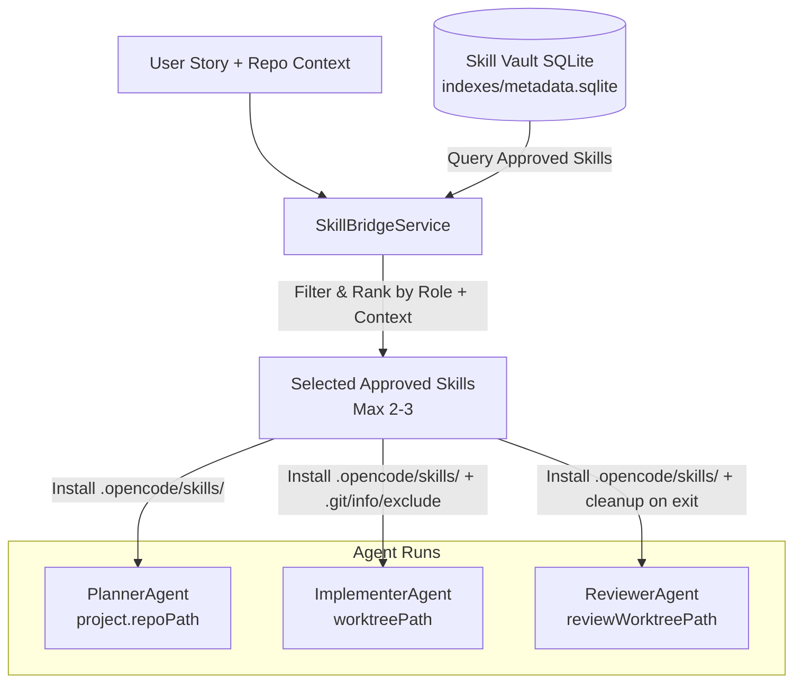

# OpenCode & Skill Vault Integration Design

**Date**: 2026-10-19  
**Status**: Approved Design  
**Target Package**: `apps/orchestrator` & `@aik/skill-vault`

---

## 1. Context & Motivation

AI Kanban uses OpenCode as its autonomous coding agent runtime across three critical roles:
- **PlannerAgent**: Produces structured implementation plans with acceptance criteria and subtasks.
- **ImplementerAgent**: Writes code and tests in an isolated git worktree to satisfy story requirements.
- **ReviewerAgent**: Performs independent code reviews in a clean review worktree against acceptance criteria.

The monorepo contains `@aik/skill-vault` (`apps/skill-vault`), a local, persistent Coding Skill Vault that discovers, verifies, scans, and indexes coding skills following the open Agent Skills standard (`SKILL.md` with YAML frontmatter).

To make OpenCode agents smarter across different tasks, this design wires OpenCode to dynamically receive task-aware, approved skills from the local Skill Vault without polluting git repositories or bloating prompt tokens.

---

## 2. Goals & Non-Goals

### Goals
1. **Dynamic Task-Aware Injection**: Automatically select and install relevant approved skills into `.opencode/skills/<name>/SKILL.md` in the working directory before an agent session starts.
2. **Strict Trust Model**: Inject only human-approved skills (`status = 'approved'`). Scanned-clean, quarantined, or dirty skills are never injected automatically.
3. **Role-Tailored Skills**:
   - **Planner**: Planning and architectural skills (e.g., `writing-plans`).
   - **Implementer**: Engineering, TDD, and debugging skills (e.g., `tdd`, `systematic-debugging`).
   - **Reviewer**: Code review and validation skills (e.g., `code-review`, `requesting-code-review`).
4. **Git Repository Isolation**: Ensure `.opencode/` is registered in `.git/info/exclude` within git worktrees so that orchestrator candidate capture (`git add -A`) never stages or commits injected skills into the user's project history.
5. **Prompt Priming**: Mention available skills in the session prompt so OpenCode knows to read and follow them.
6. **Graceful Degradation**: If the vault is uninitialized, missing, or has no matching approved skills, agent runs proceed smoothly without failure.
7. **Clean Lifecycle**: Remove vault-injected skills from project root directories after planning, and let worktree isolation handle temporary review and story environments safely.

### Non-Goals
- Auto-downloading new skills from remote networks during an active story run (vault discovery and downloads remain an explicit, offline/background user action).
- Modifying global `opencode.json` or global IDE configuration files.

---

## 3. Architecture & Data Flow



---

## 4. Components and Detailed Design

### 4.1 `SkillBridgeService` (`apps/orchestrator/src/skills/bridge.ts`)

The service acts as the bridge between `@aik/skill-vault` and the agent orchestrator:

```typescript
export interface SkillBridgeDeps {
  vaultRoot?: string;
  logger?: (msg: string) => void;
}

export type AgentRole = 'planner' | 'implementer' | 'reviewer';

export interface InjectSkillsInput {
  targetDirectory: string;
  role: AgentRole;
  storyTitle: string;
  storyDescription?: string;
  repoPath: string;
  isWorktree?: boolean;
}

export interface InjectedSkillSummary {
  id: string;
  name: string;
  installName: string;
  description?: string;
}

export interface InjectSkillsResult {
  injected: InjectedSkillSummary[];
  promptHint: string;
}
```

#### Core Methods:
1. **`injectSkills(input: InjectSkillsInput): Promise<InjectSkillsResult>`**:
   - Resolves the vault database at `%LOCALAPPDATA%\AiKanban\skill-vault` (or configured override).
   - If the vault database does not exist or cannot be opened, returns `{ injected: [], promptHint: '' }`.
   - Selects approved skills using two tiers:
     - **Role Baseline**: Default skills mapped to the agent's role:
       - `planner`: `['writing-plans']`
       - `implementer`: `['tdd', 'systematic-debugging']`
       - `reviewer`: `['code-review', 'requesting-code-review']`
     - **Contextual Matching**: Queries the vault for skills matching keywords in the repo tech stack or story title (e.g. via `recommendForRepo()`).
   - Caps total skills at 2–3 items.
   - For git worktrees (`isWorktree: true`), appends `.opencode/` to `.git/info/exclude` in the worktree if not already present.
   - Calls `installSkills()` from `@aik/skill-vault` to place skills under `.opencode/skills/<name>/SKILL.md` with `skill-vault.json` markers.
   - Generates a concise prompt hint:
     ```text
     AVAILABLE SKILLS (consult when applicable in .opencode/skills/):
     - tdd: Test-Driven Development workflow
     - systematic-debugging: 4-phase root-cause investigation
     ```

2. **`cleanupSkills(targetDirectory: string): Promise<void>`**:
   - Scans `.opencode/skills/` in the target directory.
   - Reads `skill-vault.json` in each subfolder.
   - Removes only subdirectories created by `@aik/skill-vault`, leaving any user-authored skills untouched.

---

### 4.2 Git Exclusion Guard (Worktree Protection)

In `apps/orchestrator/src/agents/implementer.ts`, before running `git add -A`:
- Injected skills reside in `<worktreePath>/.opencode/skills/`.
- Git worktrees have their own git exclude file at `.git/info/exclude` (or inside the gitdir exclude list).
- `SkillBridgeService` ensures `.opencode/` is listed in this exclude file immediately upon worktree preparation.
- When `git add -A` executes, Git ignores `.opencode/` entirely. As a secondary safeguard, candidate diff checks verify `.opencode/` is never part of staged files.

---

### 4.3 Agent Lifecycle Integration

#### A. PlannerAgent (`apps/orchestrator/src/agents/planner.ts`)
- In `planStory()`:
  - Calls `bridge.injectSkills({ targetDirectory: project.repoPath, role: 'planner', ... })`.
  - Injects `writing-plans` (if approved in the vault).
  - Appends `promptHint` to the planner system prompt.
  - In `finally`: Calls `bridge.cleanupSkills(project.repoPath)` to restore the repository to its clean state.

#### B. ImplementerAgent (`apps/orchestrator/src/agents/implementer.ts`)
- In `implementStory()`:
  - After `ensureStoryWorktree()`, calls `bridge.injectSkills({ targetDirectory: worktreePath, role: 'implementer', isWorktree: true, ... })`.
  - Injects `tdd` and `systematic-debugging`.
  - Appends `promptHint` to the implementer prompt.
  - Git exclusion keeps `.opencode/` unstaged during `git add -A` and commit.

#### C. ReviewerAgent (`apps/orchestrator/src/agents/reviewer.ts`)
- In `reviewStory()`:
  - After `ensureReviewWorktree()`, calls `bridge.injectSkills({ targetDirectory: worktreePath, role: 'reviewer', isWorktree: true, ... })`.
  - Injects `code-review` and `requesting-code-review`.
  - Appends `promptHint` to the reviewer prompt.
  - Temporary review worktree is wiped in `finally { removeReviewWorktree() }`.

---

## 5. Safety and Error Handling

| Scenario | Behavior |
|---|---|
| Vault not initialized / DB missing | Log info note, return empty skill list, agent run continues normally. |
| No approved skills match | Return empty skill list, agent run continues normally. |
| Existing non-vault `.opencode/skills/<name>` | Vault skips overwrite; reports collision; agent run continues. |
| Filesystem write error | Catches error, logs warning, returns partial or empty list; run never aborts. |
| Candidate commit in worktree | `.git/info/exclude` prevents staging `.opencode/`; verified by staged diff scan. |

---

## 6. Testing Plan

All tests will adhere to repository testing rules:
1. **Never operate on a real repository**: Use `apps/orchestrator/test/helpers/temp.ts`.
2. **Dependencies**: Use exact versions (`npm install -E`).
3. **Verification**: Run `npm run check:pins && npm run lint && npm run typecheck && npm test`.

### Test Cases (`apps/orchestrator/test/skills-bridge.test.ts`):
- `injectSkills` selects role baselines for Planner (`writing-plans`), Implementer (`tdd`, `systematic-debugging`), Reviewer (`code-review`).
- `injectSkills` correctly adds `.opencode/` to `.git/info/exclude` in a git worktree.
- `cleanupSkills` removes vault-managed skills while preserving unmanaged user skills.
- Graceful degradation: handles non-existent vault root without throwing.
- Implementer run does not stage or commit `.opencode/` files into candidate commits.
